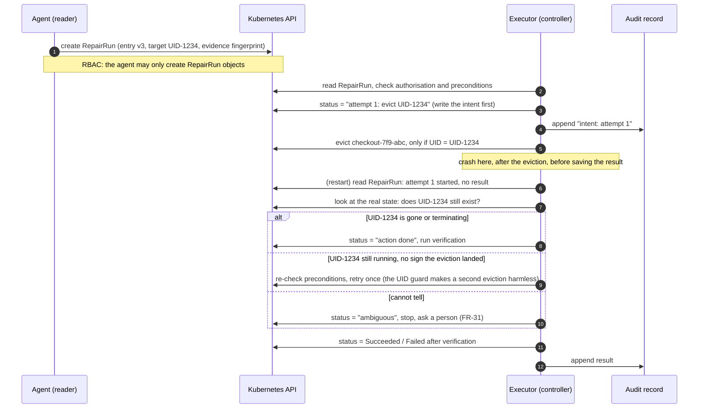

# Round 1: one repair, with a crash (working note, 2026-11-03)

Design C (hybrid), adopted by Amine. Example: checkout has 3 replicas, and replica `checkout-7f9-abc` (unique ID `UID-1234`) shows memory creep. The catalogue entry "restart one replica while the healthy replicas carry the traffic" is safe, and the customer has ticked it.

## Why it doesn't repeat the action

1. **Intent before action.** The executor writes "attempt 1: evict UID-1234" to the `RepairRun` status before acting. The write uses optimistic concurrency: if another executor instance changed the object first, this write fails and this instance stops.
2. **The action is tied to the exact target.** The eviction carries a precondition on the pod's unique ID. Kubernetes refuses it (409 Conflict) if that exact pod no longer exists. The replacement pod has a new UID, so a repeated eviction can never hit the new, healthy replica.
3. **On restart, the executor looks at reality, not just its notes.** Attempt 1 is recorded with no result, so it checks whether `UID-1234` still exists. If the pod is gone, the action happened, and the executor goes straight to verification. If it can't tell, it stops and asks a person.
4. **Every catalogue action must say how its effect is observed** ("how do I know it already happened?"). An action without such a check can't be retried automatically after a crash. It goes to "ambiguous", and a person decides.

Kubernetes references checked 2026-11-03:
- [Preconditions (uid, resourceVersion)](https://kubernetes.io/docs/reference/kubernetes-api/definitions/preconditions-v1-meta/)
- [DeleteOptions: 409 Conflict when preconditions fail](https://kubernetes.io/docs/reference/kubernetes-api/common-definitions/delete-options/)
- [Eviction accepts deleteOptions](https://kubernetes.io/docs/reference/kubernetes-api/definitions/eviction-v1-policy/)
- [The Eviction API respects PodDisruptionBudgets](https://kubernetes.io/docs/concepts/scheduling-eviction/api-eviction/)

## Corrections to the round 1 explanation (Amine, AI_LOG #34)

- RBAC controls who can read or write each object type. It isn't proof that a decision was authorised.
- Stored progress alone isn't crash safety. The four rules above are what prevent a repeated action.
- Option B could also support independent auditing. Kubernetes audit logging must be configured: on EKS each control-plane log type is off by default, and CloudWatch charges apply ([AWS](https://docs.aws.amazon.com/eks/latest/userguide/control-plane-logs.html)).
- A Kubernetes API outage blocks Kubernetes changes only. Node monitoring, the independent checker, hardware and OS operations, and manual escalation need their own failure handling (rounds 3 and 6).
- The resource and cost differences between A, B and C are estimates to verify.
