# Round 5: Fleet (working design)

## 5.1 Fleet split by responsibility (Amine, 2026-11-05)

- **Services are split by responsibility,** each with its own identity, minimum permissions and customer isolation (FR-48). That doesn't require a separate server per service.
- **Signing keys live only in a dedicated, protected signing system,** separate from ordinary Fleet services. The release key and the catalogue key are separate keys, as decided earlier, held in the same system. Only named services may request signatures, and each only for its own key.
- **The registry stores signed packages.** It has no publishing authority of its own: clusters verify every signature themselves (SEC-5).
- **The decision relay transports signed decisions.** It may sign delivery statements. Its signature and timestamp prove neither customer approval, nor that the original evidence is fresh, nor that no withdrawal was withheld. Fleet can't create a customer's approval. The executor checks every original decision, its validity and the required evidence itself (SEC-9).
- **Identity:** Quornex's identity system is unknown. Reuse it if it's suitable; Keycloak is an option, not a requirement.
- **Hosting:** Fleet's exact hosting setup stays an assumption until confirmed.

```mermaid
flowchart TB
  subgraph SIGN[Protected signing system - keys never leave]
    K1[Release key]
    K1C[Catalogue key]
    K2[Management-policy key]
    K3[Orvex people-list key]
    K4[Relay key - delivery statements only]
  end
  PIPE[Release pipeline - after testing] -->|may request| K1
  CATP[Catalogue pipeline - after testing and two reviewers, FR-39] -->|may request| K1C
  POL[Policy authoring - Orvex, FR-51] -->|may request| K2
  ROST[People-list admin - two Orvex people] -->|may request| K3
  RELAY[Decision relay - transports signed decisions] -->|may request| K4
  K1C --> REG
  K1 --> REG[Registry - stores signed packages, no publishing authority]
  subgraph FLEET[Quornex Fleet services - separate identities, minimum permissions, customer isolation]
    HB[Heartbeat watchdog]
    INTAKE[Report intake - sanitised fields only]
    CORR[Correlation and consolidated alerts]
    ROLL[Rollout controller - waves and stop conditions]
    RELAY
    CRED[Credential vending and usage check - M2 design decided, guarantees unvalidated]
    REG
  end
  PORTAL[Quornex portal] -->|people's signed decisions| RELAY
  subgraph CL[Each cluster - connects out only, verifies everything itself]
    CHK[Independent checker]
    GW[Gateway]
    EX[Executor - checks original decisions, their validity and the required evidence]
  end
  CHK -->|heartbeat, own path| HB
  GW -->|sanitised reports, cluster-signed receipts| INTAKE
  GW -->|fetch signed decisions and delivery statements| RELAY
  GW -->|fetch signed packages| REG
  GW -->|fetch short-lived credentials| CRED
  GW --> EX
```

Arrows show who calls whom. Clusters only ever connect out, and responses return over connections the cluster started. Receipts are signed by the cluster's own key, not by Fleet.

## 5.2 Release and catalogue delivery (Amine, 2026-11-05)

- **Delivery tool:** Flux in each cluster. Packages are OCI artifacts pinned by digest, and Flux's signature check is **required** (it is off by default); a cluster refuses to start without it. Rancher Fleet may be kept if Quornex already runs it. Central Argo CD is rejected: it holds credentials into every cluster and connects in. Evidence: `party-check-5.2-2026-11-05.md`.
- **Trust is separate from delivery.** Whatever tool delivered them, Nightshift verifies the catalogue, policy and people-list signatures itself before use (SEC-5).
- **Container images are verified separately.** A signed deployment package alone doesn't verify every image it references. *(Tool to verify: for example Sigstore policy-controller or Kyverno.)*
- **Rights:** routine delivery is restricted to Nightshift's namespaces and required objects, never unrestricted cluster-admin. Cluster-wide resources (CRDs, ClusterRoles, admission webhooks) go through a **separately authorised installation and upgrade path**. *(Exact Flux permission configuration to verify.)*

## 5.3 Transport (Amine, 2026-11-05): HTTPS with a local outbox

- The cluster calls Fleet over HTTPS; NATS JetStream is not used in v1.
- **The outbox survives restarts and has a storage limit.**
- **Retries use stable message IDs,** and the receiver detects duplicates. Numbered attempts alone are not enough.
- **Withdrawals and stop decisions have priority** over ordinary reports.
- **Every message still passes the privacy checks** (the outbox is not a way around them).

## 5.4 Rollout waves, stop conditions and recovery (Amine, 2026-11-05)

Proposal: `round5-rollout-proposal.md`; the decisions below replace it where they differ.

- **R1 Waves.** Gradual waves (wave 0: Orvex test clusters, at least one OMK and one EKS), both platforms per wave, health judged per platform, only within customer maintenance windows. Automatic stop when updated clusters' health worsens compared with not-yet-updated ones.
  - Wave sizes and observation periods are **assumptions to test**.
  - **Missing or stale health data pauses progression**; it never counts as success.
  - **A stop prevents further updates.** It cannot necessarily cancel one already running (an EKS control plane upgrade can't be paused once started).
- **R2 Recovery, three layers.**
  1. Flux is outside routine releases (updated only through the separate install path), so a broken Nightshift release leaves delivery working.
  2. **A separate rollback guard**, narrowly authorised, performs the probation rollback. **The independent checker stays read-only:** it only reports a failed health check.
     - **The guard and Flux cooperate,** so Flux doesn't reinstall the broken version (for example, the guard suspends the one Nightshift Flux object, which stops new revisions being applied, then restores the last known-good signed release; delivery resumes only with a newer signed fix or a signed rollback target). *(Mechanism to verify.)*
     - **Configuration and data changes:** an old image alone may not undo them. Each release declares whether it is rollback-safe (for example, data and CRD changes compatible with the previous release); if it isn't, there is no automatic rollback and recovery goes to a person. CRD changes go through the separate install path anyway (E3).
  3. A manual runbook through the separately authorised install path.
  - **Permission:** the exact, bounded probation rollback is included in the original update authorisation (AP-7). It preserves permissions, approvals and safety rules. Not justified by "Nightshift never touches workloads": the executor does.
  - **Platform rollbacks** stay under FR-47. EKS can roll the control plane back one minor version within 7 days only; OMK's rollback is unknown until Orvex confirms.
- **R3** A cluster accepts only a newer release or a signed allowed rollback target (no unauthorised downgrades), and signed release metadata expires so a held-back cluster notices and reports it.

## 5.5 Correlation and consolidated alerts (Amine, 2026-11-05)

- **C1 Groups** are keyed on allowed fields only: problem type (catalogue entry, or for unfamiliar problems a fingerprint from allowed fields), platform, Nightshift release, catalogue and platform versions, rollout wave, location (EKS Region; OMK site if Quornex shares it). **Fleet can also link related groups into a wider incident** across waves, versions or locations, because requiring every field to match can split one incident (the same fault in wave 1 and wave 2 would otherwise be two groups).
- **C2 One urgent alert** when a group exceeds its normal rate within a time window (thresholds are assumptions). If it concentrates on newly updated clusters, the rollout stops (R1). Silent clusters are grouped by location as "unreachable from Fleet". Non-reporting or stale clusters are shown as "not reporting", never healthy.
- **C3 Tools:** a small custom correlation service plus Prometheus Alertmanager (deduplication, grouping, inhibition, silences, routing; HA mode). Notifications follow the permission and outbound checks (PRIV-9).
- **C4 Isolation and approvals:** customers see only their own clusters. The incident group can change as evidence arrives; **a group approval covers a separate, frozen set of reviewed targets**, and newly affected clusters don't inherit it.

## 5.6 Group approvals across waves (O-4) and approval validity (O-2) (Amine, 2026-11-05)

Proposal: `round5-group-approvals-proposal.md`, accepted with these clarifications:

- **G-A** One signed group decision (option B). It **binds the exact repair, catalogue version, target-set fingerprint (Merkle root), wave plan, stop conditions and validity**. The Merkle proof is **membership evidence only**: it proves a cluster is in the reviewed set, nothing more. Dangerous manual repairs (FR-52) stay excluded.
- **G-B** Re-asks cover only the remaining targets, with fresh evidence. A stop voids the rest of the group approval. **A stop becomes effective when the cluster receives it.** The console shows sent versus confirmed (AP-3), and the documented limitation for disconnected clusters stays.
- **G-C** **Group validity is the shorter of the entry's validity and the group-policy cap**: a 4-hour cap never extends a 30-minute validity. The durations are assumptions to test.

## M2 Credential vending and independent usage checks (Amine, 2026-11-05)

Proposal and verified facts: `round5-m2-proposal.md`. **Decided at the design level; the operational guarantees are unvalidated.**

- **A with cells** is the provisional design: AWS accounts split into cells, so a misbehaving cluster can exhaust only its cell's quota.
- **One IAM role per cluster,** so one cluster's sessions can be revoked alone. Permissions restricted to the cluster's own application inference profile.
- **Independent usage:** AWS-recorded, content-free usage records, plus delayed billing reconciliation per profile, compared with what the gateway reports.
- **Prompt and response logging stays disabled.** To verify: the actual metadata fields, their delivery delay, and compatibility with the chosen endpoint and the zero-retention arrangement.
- **Stated limits:**
  - 15-minute sessions limit one credential's lifetime, **not sustained abuse while renewal continues**;
  - delayed accounting **cannot enforce a hard per-cluster cap**.
- **Validation plan (not yet run):** isolation (a cluster can't call another cluster's profile), revocation (one cluster's role revoked without affecting others; time to take effect), logging (no content recorded; metadata fields and delay), plus the quota checks for profiles and roles per account.
- **Fallback** if the tests fail: B, a thin metering proxy at Orvex.
