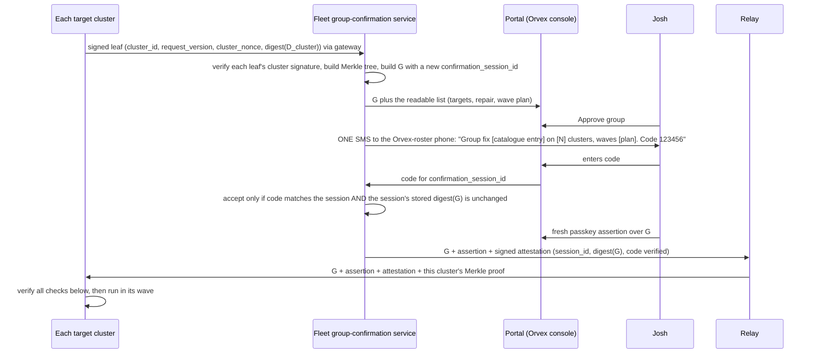

# D1 Group approval: who sends the SMS, and how it binds to the same decision (accepted by Amine 2026-11-11 with clarifications; see end)

AI proposal for Amine. Accepted by Amine so far: per-cluster nonces and per-cluster decision entries in the Merkle list. Amine's constraint: customer control clusters are optional and separate, so no customer's control cluster may authorise a fleet-wide group.

## Who sends the single SMS

**A dedicated Fleet group-confirmation service**, separate from the portal, relay and rollout controller, with its own identity and its own signing key (certified like the other Fleet keys, D10). It issues and checks the code; it holds no authority to approve anything.

Why not a cluster: one SMS for 300 clusters can't come from each cluster, and no single cluster (customer or control) may speak for other customers' clusters.

## What everyone signs and checks

- **Leaf (per cluster):** `cluster_id, request_id, request_version, cluster_nonce, digest(D_cluster)`, built and signed by that cluster with its cluster key, sent out through its gateway.
- **Group statement G:** `group_id, catalogue_entry_id, entry_version, merkle_root (of the leaves), target_count, wave_plan_digest, stop_conditions_digest, valid_until, confirmation_session_id, role = Orvex technical approver`.
- **Josh's passkey assertion:** challenge = SHA-256("nightshift-group-decision-v1" ‖ JCS(G)).
- **Confirmation attestation:** signed by the group-confirmation service: `confirmation_session_id, digest(G), roster phone reference, code verified = true, time`.

## Binding: the same G everywhere

`digest(G)` is fixed when the session starts and appears in three places:
1. **the code's session record**, so the code is accepted only for that G;
2. **Josh's passkey challenge**, which is over G itself;
3. **the service's signed attestation**.

G also carries `confirmation_session_id`. A code and a signature for different groups can therefore never be combined.

## What each cluster checks before running

1. Josh's assertion verifies against the current Orvex roster (role: Orvex technical approver), with the challenge over G.
2. The Merkle proof shows **its own leaf** in G's root, and that leaf contains **its own current** `cluster_nonce` and `request_version`, plus the digest of the D it built itself.
3. The attestation is signed by the group-confirmation service key (certified, version not lower than last seen), names the same `digest(G)`, and says the code was verified.
4. G is still valid, the entry isn't switched off, no stop covers its request version, customer approvals are present where required, and preconditions pass now.

## Limits (to state plainly)

- **The SMS step for groups depends on the Fleet group-confirmation service, not on the cluster.**
  - A compromised **portal alone** still can't get a group approved without Josh seeing the SMS that names the group.
  - A compromised **group-confirmation service together with the portal** could skip the SMS step. It still can't forge Josh's passkey or change G, because each cluster checks its own leaf.
  - Assurance is recorded as **"passkey + Fleet SMS (group)"**: weaker than the single-cluster "passkey + SMS", where the cluster issues the code itself.
- **The SMS names the group in summary** (repair, number of clusters, waves), not each cluster; the full list is in the console.
- **Group approvals cover Orvex technical approval only.** Customer approvals stay per cluster.

## Accepted with clarifications (Amine, 2026-11-11)

- The code session and the service attestation are bound to **Josh's identity, the Orvex roster version and the exact digest(G)**; each cluster checks that these match the passkey signer.
- Each cluster also verifies that **G's action, catalogue version and applicable conditions agree with its own D**, not just Merkle membership. G therefore carries the action and applicable conditions.
- **Documented:** the SMS confirms a summary, not the full target list. The mechanism does not prove what Josh understood and does not prevent a compromised portal and confirmation service from misleading him.
- Recorded as **Orvex technical approval only**; customer permissions remain independently checked per cluster.
- Spine: AD-48, AD-39 and the "Group decision" convention updated.
