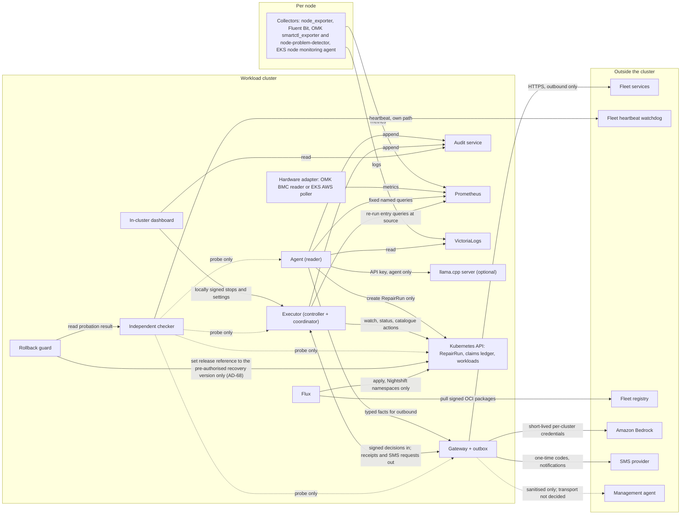
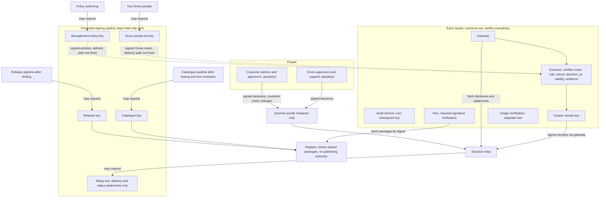
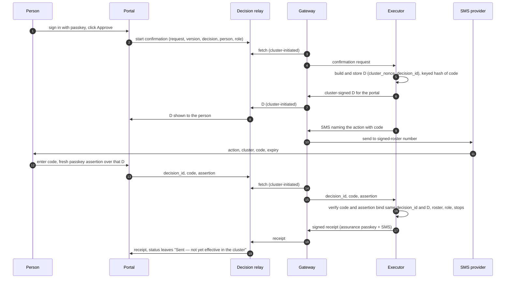

# Architecture Spine — Nightshift

Design only: nothing here is implemented or tested. Durations, sizes and resource figures are assumptions to test unless the Stack says otherwise.

## Design Paradigm

**Hybrid C** [ADOPTED]. Three levels, each watched from outside itself: per workload cluster, per customer control cluster (optional), and Quornex Fleet at Orvex.

| Layer | Units | Pattern |
| --- | --- | --- |
| Per node | Collectors only (node_exporter, Fluent Bit; OMK: smartctl_exporter, node-problem-detector; EKS EC2: AWS node monitoring agent) | DaemonSets, no decisions, no write rights |
| Per cluster, reading | Agent (reader), independent checker, hardware adapter, Prometheus, VictoriaLogs, optional llama.cpp | Ordinary services |
| Per cluster, acting | Executor (controller + coordinator), rollback guard | Kubernetes controller reconciling RepairRun and the claims ledger; guard is a narrow separate service |
| Per cluster, recording and outbound | Audit service, gateway (with outbox), in-cluster dashboard | Ordinary services |
| Customer control cluster | Management agent (plus that cluster's own Nightshift set) | Ordinary service; coordinates multi-cluster repairs |
| Fleet (Orvex) | Heartbeat watchdog, report intake, correlation, rollout controller, decision relay, credential vending, registry, protected signing system | Split services; clusters connect out only |

## Invariants & Rules

### Shape and boundaries

### AD-1 — Hybrid C paradigm [ADOPTED]

- **Binds:** all
- **Prevents:** every component becoming an operator, or the executor hand-building its own database, migrations and crash state.
- **Rule:** The agent, gateway, checker, audit service and management agent are ordinary services. Only the executor is a Kubernetes controller. The coordinator lives inside the executor and has no separate process.

### AD-2 — Exactly two custom resources, executor-owned [ADOPTED]

- **Binds:** FR-25, FR-29, FR-31
- **Prevents:** components inventing their own state stores or extra CRDs.
- **Rule:** Nightshift defines two custom resources: RepairRun and one claims ledger per cluster. No other unit adds a CRD or a private persistent store for repair state. RepairRun and the ledger hold intent, status, references and digests only; evidence bodies and audit records never go into Kubernetes objects (etcd request limit 1.5 MiB, quota 2 GiB). The claims ledger also holds the executor's cluster state: epoch, halt flag, switch-offs, issued nonces and used decision_ids (pruned after their validity ends), the highest accepted version per signed-object type, and pins. Signed objects received (rosters, settings, policies, maps) are stored as received in executor-owned Secrets in the Nightshift namespace. RepairRun uses the status subresource: the agent may create the spec only and never write status; the number of open RepairRuns per cluster is capped by an object-count quota.

### AD-3 — Distinct security boundaries per sensitive role [ADOPTED]

- **Binds:** SEC-2, SEC-3, SEC-8
- **Prevents:** one compromised process holding read, act, outbound and record rights at once.
- **Rule:** Agent, executor, gateway, audit service, hardware adapter, independent checker and rollback guard each run in their own pod with their own ServiceAccount and identity. A shared container image is allowed, a shared pod or identity is not. Privileged node exporters run one minimal pod each, read-only filesystem, no Kubernetes write rights, with egress limited by network policy to the local metrics store; that limit depends on the cluster's network plugin, and host-network or privileged pods may bypass it, so a compromised exporter is treated as a node compromise.

### AD-4 — Dependency direction and Kubernetes API reliance [ADOPTED]

- **Binds:** all; NFR-4, NFR-5
- **Prevents:** observation, auditing and heartbeats dying with the Kubernetes API, and inbound paths into clusters.
- **Rule:** Dependencies follow the diagram below. Only the executor's core loop depends on the Kubernetes API. Checker, gateway, audit service and heartbeat keep working through an API outage where their cached dependencies allow; cached tokens, configuration and DNS that need the API are documented as possibly stale; pods already running may continue, but Kubernetes cannot necessarily restart or replace them during the outage. No arrow points from Fleet, the portal or the management agent into a workload cluster: every connection is cluster-initiated. The agent never calls the executor's actions, only creates RepairRun objects.

### AD-5 — RBAC grants access, never authority [ADOPTED]

- **Binds:** SEC-8, SEC-9
- **Prevents:** treating "the object exists" as "the decision was authorised".
- **Rule:** Agent: create RepairRun only. Executor: update RepairRun status, write the claims ledger, perform catalogue actions. Only the executor may write the claims ledger. The executor verifies authorisation itself (AD-17) for every RepairRun regardless of who could create it. Kubernetes API audit logging is configured on both platforms (OMK: Orvex audit policy; EKS: control-plane audit log type enabled, CloudWatch charges apply).

### Mutating state

### AD-6 — Intent before action, guarded by UID, ambiguous goes to a person [ADOPTED]

- **Binds:** FR-25, FR-31
- **Prevents:** repeated or misdirected actions after a crash.
- **Rule:** Before acting, the executor writes the intent (attempt n, action, target UID) to RepairRun status with optimistic concurrency; a stale write fails and that instance stops. Every mutation carries UID and resourceVersion preconditions (delete and policy/v1 Eviction deleteOptions; 409 Conflict means stop and re-read). On restart it reads real target state and classifies done / not done / ambiguous; ambiguous stops and asks a person. Every action is verified after it runs; a failed verification is recorded and goes to a person, never a blind retry.

### AD-7 — One active executor, epochs, stops first on restart [ADOPTED]

- **Binds:** FR-22, FR-31
- **Prevents:** stale-leader actions and repairs resuming over a pending stop.
- **Rule:** One active executor per cluster in v1. On start it takes a new epoch written with optimistic concurrency and re-reads the RepairRun epoch immediately before each mutation. Restart and reconnect order: (1) receive and apply pending stop decisions, (2) reconcile every unfinished RepairRun against real state, (3) revalidate authorisation, evidence and preconditions, (4) resume. Action-level duplicate protection (AD-6) stays mandatory; epochs are not claimed to eliminate duplicates. Recovery time is a test result, not a promise.

### AD-8 — Catalogue action contract [ADOPTED]

- **Binds:** FR-17, FR-25, FR-31, FR-39
- **Prevents:** automatic actions that cannot be safely retried or whose effect cannot be observed.
- **Rule:** Every automatic catalogue action declares (a) safe-retry behaviour or reliable "already happened" evidence and (b) how its effect is observed. An action without both is not automatic in v1. File-deletion actions re-resolve their targets against the entry's allowlist, retention and exclusions before every attempt. Repairs come only from the signed catalogue, never from AI-written commands.

### AD-9 — Coordinator claims are atomic through the claims ledger [ADOPTED]

- **Binds:** FR-29, FR-30
- **Prevents:** two repairs both seeing "free" and both starting.
- **Rule:** Claiming a target is one indivisible operation: the executor reads the cluster's claims ledger, checks overlaps across nested scopes (pod, workload, node, cluster), and writes it back with the resourceVersion check; a 409 means nothing was claimed. An expired claim or crashed executor never frees a target: before another repair, the executor confirms no work is still happening (RepairRun and real target state; for manual repairs, the performer's report or an authorised, recorded release).

### AD-10 — Coexisting with other actors [ADOPTED]

- **Binds:** FR-29, FR-30, FR-21
- **Prevents:** Nightshift fighting Quornex controllers, GitOps, autoscalers, providers or people.
- **Rule:** A signed Orvex platform map records each component's change owner (Nightshift, Quornex controller, GitOps, autoscaler, provider); each catalogue entry lists the owners it may work alongside. The map is never assumed correct: live checks run on every action. Quiet-period checks are supplementary; the version recheck (UID and resourceVersion preconditions) right before the change is mandatory. Automatic repairs never edit declared settings of customer-owned objects unless the entry states the owner cooperates; otherwise Nightshift recommends. Impact budgets count existing failures and other actors' activity (unhealthy or disrupted nodes and pods, PDB status, AWS or Karpenter repairs, autoscaler scale-downs, rollouts, manual repairs, customer maintenance).

### AD-11 — Missing checks block; multi-cluster repairs wait [ADOPTED]

- **Binds:** FR-22, FR-29, FR-52, NFR-5
- **Prevents:** disruptive actions on stale data and local units coordinating across clusters.
- **Rule:** A disruptive action is blocked when a required check is unavailable (API errors, stale data, unconfirmed exclusivity). The alternative-evidence procedure exists only for manual repairs under a defined manual procedure record. Repairs spanning several clusters wait for the management agent; unrelated local repairs continue.

### AD-12 — The executor decides production impact itself [ADOPTED]

- **Binds:** FR-21, SM-4
- **Prevents:** the reading agent's labels deciding approval requirements.
- **Rule:** "Can affect customer production" is decided by the executor from the signed catalogue field, the signed Orvex platform-only map (absence from the map means customer production), its own live Kubernetes checks and the entry's fixed queries re-run at the source, never from the agent's summary. Any doubt selects the customer-production row. A disputed mapping moves that entry to customer-production rules for that customer until Orvex re-reviews; misses count in SM-4.

### AD-13 — Repair scope per platform [ADOPTED]

- **Binds:** FR-20, NFR-2
- **Prevents:** Nightshift competing with AWS repair or acting outside what Orvex is authorised to manage.
- **Rule:** Nightshift repairs only parts Orvex is authorised to manage. EKS: Quornex services and customer applications are repairable subject to permissions and checks; the AWS-managed control plane and physical hardware are detect, evidence and escalate (through the customer). The executor checks each EKS node's management mode and node-repair configuration before any node action and never acts on a node AWS or Karpenter is repairing. Provisional per-mode handling: Auto Mode and Fargate, no node actions; managed node groups or Karpenter with auto repair on, no overlapping node actions; auto repair off, self-managed or Hybrid Nodes, node actions only where the signed map authorises Orvex. Hybrid Nodes are not OMK: hardware access is discovered per cluster. OMK: physical hardware is the customer's; Nightshift detects, gathers evidence and escalates to the customer or provider (manual repair, FR-52); OS and Kubernetes actions only where the signed map authorises Orvex.

### AD-14 — Control-plane failures escalate in v1 [ADOPTED]

- **Binds:** FR-5, FR-20, AP-5
- **Prevents:** an unreviewed node-level helper acting without the Kubernetes API.
- **Rule:** No automatic repair that needs the Kubernetes API runs while the API is down; control-plane failures are reported and escalated to a person. No API-independent repair helper ships in v1. The reduced coverage is documented.

### Shared data ownership

### AD-15 — One writer per shared object [ADOPTED]

- **Binds:** all
- **Prevents:** two units writing the same state or a unit trusting state it does not own.
- **Rule:** Ownership is fixed as follows; readers verify signatures where a signer is listed.

| Data | Sole writer | Signed by | Readers |
| --- | --- | --- | --- |
| RepairRun spec | Agent (create only; status subresource is executor-only) | none | Executor, checker, dashboard |
| RepairRun status, claims ledger | Executor | none | Agent, checker, dashboard |
| Audit chain | Audit service (append API only; agent, executor, gateway, checker, rollback guard and dashboard append; every record carries the caller's authenticated identity; per-caller rate limits) | Audit-service key on checkpoints | Customer, dashboard, Fleet (checkpoints only) |
| Receipts | Executor | Cluster receipt key | Portal via relay, dashboard |
| Outbox | Gateway | per message type | Fleet intake, relay |
| Metrics | Prometheus (collectors, adapters write in) | none | Agent, executor, checker |
| Logs (Nightshift copies) | VictoriaLogs via Fluent Bit | none | Agent |
| Customer roster | Customer admins | Customer admin passkeys | Executor, dashboard |
| Customer settings and customer-signed policies (modes, ticks, read scope, consent, channel permissions, maintenance and rollback policies, policy acceptance) | Customer admins | Customer admin passkeys | Executor, gateway (consent and channels), dashboard |
| Received signed objects as stored | Executor (Secrets in the Nightshift namespace) | as received | Executor, gateway, dashboard |
| Orvex roster | Two Orvex people | Orvex people-list key | Executor |
| Catalogue, Orvex management policy, releases | Fleet pipelines | Catalogue, policy and release keys | Executor, agent, Flux |
| Platform-only map with change owners | Orvex | Policy key | Executor |
| Decisions | People | Their passkeys | Executor |
| Delivery and status statements | Decision relay | Relay key | Executor |

### AD-16 — Audit records stay local, checkpoints leave [ADOPTED]

- **Binds:** FR-33, FR-35, PRIV-1, SM-4
- **Prevents:** rewritable history and raw audit data leaving the cluster.
- **Rule:** The audit service runs in its own boundary with its own identity and volume, exposes append and read only, and hash-chains every record with a sequence number. Raw records never leave the cluster. Periodic authenticated checkpoints are stored independently outside the cluster. Until AP-1 is explicitly adopted, checkpoints leave through the gateway on the permitted Fleet-report channel; if that channel is disabled, the loss of external checkpointing is recorded and shown. The checkpoint rides the heartbeat only after AP-1 is accepted; until then the heartbeat carries only FR-6 fields. Destruction is detectable, not recoverable; no claim of completeness or truth is made.

### Trust and authorisation

### AD-17 — Decisions are signed by people and verified in the cluster [ADOPTED]

- **Binds:** FR-14, FR-21, FR-22, SEC-9
- **Prevents:** the portal, relay or Fleet granting authority on their own (residual limits in AD-18).
- **Rule:** The cluster builds the decision statement D (fields in Consistency Conventions) with a fresh cluster_nonce and decision_id. The executor counts a decision only if: the assertion verifies for an active credential in the current signed roster; challenge = SHA-256("nightshift-decision-v1" || canonical(D)), type webauthn.get, portal origin and RP ID (or, for decisions made on the local dashboard, that dashboard's origin and RP ID with a local credential, limited to the decision kinds the dashboard allows: stops and settings changes, never approvals, AD-51), user-verified flag set; D matches field by field the statement rebuilt from its own RepairRun; nonce issued by this cluster for this request version and decision_id unused; within validity; signer holds the role and any delegation is in scope and unrevoked; all required approvals present from distinct people; no stop covers the request version; mode allows the repair; preconditions re-checked. The portal holds no key the executor accepts as a person. Group decisions are verified by the group branch in AD-48 instead of the single-cluster nonce and SMS steps. The executor, not the agent, decides what counts as the same occurrence (catalogue entry, target UID and evidence window); the agent only proposes.

### AD-18 — Option B approval: passkey plus cluster SMS code [ADOPTED, pending feasibility and usability testing]

- **Binds:** FR-13, FR-14, SEC-7, AP-2
- **Prevents:** a portal-only identity path and silent assurance downgrades.
- **Rule:** Flow: portal sign-in (portal-verified only), Approve, cluster builds and stores D and a keyed hash of a one-time code with expiry and attempt limit, cluster sends the code through the gateway to the signed-roster phone number naming the action, person enters it (paste and auto-fill allowed), fresh WebAuthn assertion over D with user verification. The cluster accepts only if code and assertion resolve to the same decision_id and stored D, then marks both used and records assurance "passkey + SMS". Applies to customer, delegated and Orvex approvals and to "Start now". Passkey-only is allowed only where a signed policy enables it (customer-admin-signed for customer approvals, Orvex-signed for Orvex approvals), shown to the person and recorded as "passkey only" in decision, receipt and history. Without an enabled fallback, SMS failure leaves the request open and escalation continues. The executor generates the SMS text from D and the catalogue template; the code is bound to the exact decision_id, recipient, request version and expiry, with attempt and resend limits. Each cluster uses separately scoped SMS credentials, subject to provider support. After every decision the cluster sends a post-decision notice through the gateway with allowlisted fields ("You approved … Not you? Withdraw"). Limits: the passkey signs a fingerprint of D, not readable text, and paste or auto-fill means entering the code does not prove the person read the task; a compromised portal can still obtain approval for a different, genuinely pending and valid request if the SMS is not read. The gateway carries the provider-bound message, so a compromised gateway can alter or drop the SMS text (and the post-decision notice); it cannot change D or the code check held by the executor. This residual risk is recorded; the post-decision notice may reveal some cases but does not reliably detect gateway tampering. Group approvals use the separate Fleet group-confirmation path (AD-48).

### AD-19 — Rosters, enrolment, recovery, revocation [ADOPTED]

- **Binds:** SEC-7, PRIV-9, FR-12
- **Prevents:** installers, the portal or Orvex silently adding approvers.
- **Rule:** The cluster holds two signed rosters. Customer roster changes are signed by an existing customer admin passkey and notified to all customer admins; the first admin enrols with a one-time out-of-band code to the contract contact and the cluster pins that credential; the pinned fingerprint is also registered with Fleet, so a reinstall that finds an existing registration needs an existing admin or the delayed recovery; the installer never enrols. Sole-admin recovery uses the out-of-band procedure with a waiting period cancellable by any existing credential; Orvex-assisted recovery is always delayed, visible and recorded. The Orvex roster is signed by the Orvex people-list key (two Orvex people). Neither roster can grant the other's roles. Revocation of a person, passkey or delegation is a stop decision.

### AD-20 — Roles count people, not roles; support is bounded [ADOPTED]

- **Binds:** FR-21, FR-52, SEC-7
- **Prevents:** one person supplying two required approvals and support exceeding its delegation.
- **Rule:** The executor counts distinct people. Risky repairs to the customer's own app need the customer's tick or approval and Orvex technical approval. The customer is notified of every approval given on their behalf. Orvex support sees a sanitised portal view of contracted customers and approves, rejects or withdraws on a customer's behalf only inside a customer-admin-signed delegation (scope, clusters, validity; default off); it never changes settings and never approves dangerous repairs. Support and Nightshift engineering are roles in the Orvex roster; communication and incident coordination carry no execution or approval power.

### AD-21 — Performer actions [ADOPTED]

- **Binds:** FR-20, FR-22, FR-52, SEC-1
- **Prevents:** manual repairs starting without approval or closing without verification.
- **Rule:** "Start now" requires valid approvals, the approved start window and passing safety checks, is accepted only from the named performer with AD-18 confirmation, and places a coordinator mark on the target. "I've done it" is an authenticated completion report, not an approval; it triggers Nightshift's verification and the case closes only if verification passes; it stays reportable after the window ends. Report text is untrusted evidence. A hardware provider is not in any roster; a named customer person reports for them.

### AD-22 — Stop beats go [ADOPTED]

- **Binds:** FR-22, FR-50, SEC-9
- **Prevents:** a reordered or replayed decision overriding a stop that reached the cluster (a withheld stop is detected, not prevented: AD-23).
- **Rule:** On a request version, any valid stop beats any approval regardless of signing or arrival order, and closes that version. Scope: withdrawal (that approval and version), rejection (that version, this occurrence), untick (that entry's tick), alert-only (all executions), delegation or credential revocation (unused decisions under it). A rejection also blocks substitute entries for the same occurrence unless separately authorised and shown (FR-50). Renewal only through a new cluster-issued request version and nonce with every required approval given again. Stops are verified locally like approvals; an unverifiable stop is recorded and surfaced, not applied. Replay is blocked by cluster_nonce plus durably stored used decision_ids. Server sequence is for display and history only; the undo-reject window is timed by the cluster (AD-25).

### AD-23 — Receipts [ADOPTED]

- **Binds:** FR-22, AP-3
- **Prevents:** people believing a decision took effect when the cluster has not applied it.
- **Rule:** After applying (or refusing) a decision the cluster signs a receipt with its own key. Until a receipt arrives the person sees "Sent — not yet effective in the cluster". Receipts travel through the portal channel or appear on the in-cluster dashboard. The relay never signs receipts. The receipt public key is pinned at installation, signed by the first customer admin and by the Orvex people-list key; portal and Fleet accept receipts only under a key so pinned, and a key change is a roster-level change. The relay keeps every decision until the cluster's receipt for it arrives; the gateway stores inbound decisions in a durable inbox before acknowledging them. The inbox only transports: it is not an authority. The executor reads it, verifies each decision independently (AD-17) and processes valid stops before any queued execution. Limit: a lying or failed relay can delay or hide a stop; the missing receipt is the visible sign.

### AD-24 — Bounded offline validity [ADOPTED]

- **Binds:** FR-22, FR-51, NFR-5, AP-4
- **Prevents:** a cut-off cluster acting indefinitely on old permissions or widening outbound policy.
- **Rule:** Every signed authorisation object carries valid_until. Long-lived objects (ticks, policies, rosters, delegations, channel permissions) also need a fresh relay-signed status statement. Tiers by age of the last status statement: fresh (all authorised repairs), stale (only safe ticked and safe policy repairs), expired (no automatic repairs; observe and report). Cached outbound policies apply until expiry and are never widened on a failed refresh; after expiry only the heartbeat, a fixed data-free attention notice and the fetches needed to recover (relay status statements and signed key lists, carrying only cluster identity and versions) leave. Local stops keep working against the cached roster.

### AD-25 — Approval validity and re-asks [ADOPTED]

- **Binds:** FR-22, FR-32, FR-50
- **Prevents:** expired or outdated approvals running, and re-asks drifting between units.
- **Rule:** Validity is a field per catalogue entry, starting at approval. The repair must start before expiry and re-checks preconditions at start; expiry does not interrupt a running repair; a material evidence change voids the approval early. The cluster judges time with its own clock and a fixed allowed skew; an unsynchronised clock refuses time-limited approvals. Unanswered requests never expire. When one of two approvals runs out with unchanged evidence, only that person is re-asked on the same request version; changed evidence means a new version and all approvals again. Undo-reject: a fixed window timed by the cluster from receipt of the rejection; undo reopens as a new request version; late undo is refused with a receipt.

### Outbound

### AD-26 — Positive-schema fact builder; raw logs never leave [ADOPTED]

- **Binds:** PRIV-1..PRIV-4, PRIV-7..PRIV-9, SEC-1
- **Prevents:** redacted free text, raw logs or unlisted fields leaving the cluster.
- **Rule:** Every outbound message except the heartbeat is assembled in the gateway from typed, allowlisted fields per channel (failure code, catalogue ID, numbers, durations, placeholders), never from log text. Every message passes the outbound check (PRIV-4), the external-AI consent check where relevant (PRIV-8), and is recorded where the customer can see it (PRIV-7). Redaction of real text is never the primary protection. If a hosted model lacks context, the fallback is the in-cluster model or a person, never richer data. The log store has no outbound path. Code fixes are the only flow that may carry source code, and only under separate source-code consent (AD-38); they still pass secret scanning and the PRIV-4 check, with no exception.

### AD-27 — Heartbeat on its own path [ADOPTED]

- **Binds:** FR-4, FR-6, NFR-4, PRIV-4, PRIV-9
- **Prevents:** a gateway failure silencing the watchdog, and the heartbeat becoming a data channel.
- **Rule:** The independent checker sends the Fleet heartbeat on its own authenticated path to a fixed destination with rate limits and a strict fixed-schema validator (that validator is the outbound check for this channel). It carries only agent ID, timestamp and status until AP-1 is accepted, never logs or arbitrary messages. The heartbeat has no customer switch and no strict no-outbound configuration exists; a missing heartbeat means "not reporting". A shared node or network failure can break both paths; this limit is documented.

### AD-28 — HTTPS with a local outbox [ADOPTED]

- **Binds:** FR-32, FR-38, NFR-5, PRIV-9
- **Prevents:** lost, duplicated or reordered stop traffic and a broker to run at 10,000 clusters.
- **Rule:** Clusters call Fleet over HTTPS only; responses return on cluster-initiated connections. The gateway's outbox survives restarts and has a storage limit. Every message has a stable message ID; receivers detect duplicates. Withdrawals and stops have priority over ordinary reports. The outbox never bypasses privacy checks. No message broker (NATS JetStream) in v1.

### Observation

### AD-29 — Metrics [ADOPTED]

- **Binds:** FR-1, FR-8, NFR-6
- **Prevents:** raw metrics leaving the cluster and ad-hoc queries from the agent.
- **Rule:** Local Prometheus is the provisional default; suitable existing Quornex monitoring is reused where possible. The agent reads only through fixed named queries. Raw metrics stay local. No extra Grafana deployment is required. In-cluster Alertmanager is optional with internal receivers only, never Slack, email or other external receivers.

### AD-30 — Logs [ADOPTED]

- **Binds:** FR-1, FR-33, PRIV-1, NFR-6
- **Prevents:** unbounded storage, silent evidence loss and changes to customer originals.
- **Rule:** Fluent Bit plus single-node VictoriaLogs are the provisional defaults (Loki kept as an alternative, especially where Quornex already runs it). Time-based retention, a dedicated volume with a cap under 80%, per-source ingestion limits from the collector and bounded collector buffers. Dropped records are counted into the coverage report and affected explanations. A separately capped case-evidence hold keeps evidence for unfamiliar problems until the case closes. Customer originals are read-only; caps and retention apply to Nightshift's copies only.

### AD-31 — One signal interface, per-platform adapters [ADOPTED]

- **Binds:** FR-1, FR-5, FR-7, FR-20, NFR-2, SEC-3
- **Prevents:** a new adapter service per source, "unknown" read as healthy, and repairs trusting the agent's labels.
- **Rule:** The signal interface is a catalogue mapping (signal family to per-platform sources) consumed by the agent. Every value carries source, vantage point, platform, freshness and coverage state; unknown is never healthy. Catalogue entries state per platform which sources count as evidence; without enough evidence on a platform the entry is report-only there. Existing collectors are reused; credentialed adapters exist only where credentials are needed (OMK BMC reader with just-in-time credentials and network rules to listed BMCs only; optional customer-granted EKS AWS poller). On EKS the AWS node monitoring agent is used where supported; node-problem-detector only for a named missing check. Adapter failure means unknown, a monitoring failure case, and dependent disruptive repairs blocked. Missing BMC access is reduced coverage, not an unsupported cluster. The executor independently verifies evidence a repair needs.

### AD-32 — AWS poller isolation and scale [ADOPTED]

- **Binds:** SEC-3, SEC-4, NFR-1
- **Prevents:** other components obtaining AWS credentials and Fleet becoming an AWS poller.
- **Rule:** On EC2-backed EKS the AWS poller is enabled only after verified credential isolation: node IMDS credential access restricted, a separate least-privilege identity, and a check that other Nightshift components cannot obtain its credentials. Otherwise it stays disabled and reduced coverage is reported. It uses minimal Describe actions, a Region condition, filtered and paginated calls and client-side filtering to its own nodes. No AWS Health API dependency. Polling runs per cluster in the customer's account; Fleet never polls AWS; no shared poller unless the account layout shows a need.

### AD-33 — Independent checker and coverage [ADOPTED]

- **Binds:** FR-4, FR-6, FR-7, FR-15
- **Prevents:** self-monitoring that fails with what it monitors, and overclaiming what a probe shows.
- **Rule:** The checker runs without Prometheus or the agent, performs only lightweight read-only checks (component liveness, data freshness, Kubernetes API reachability, node reachability, clock skew) and never acts. A failed probe is reported as "unreachable from the checker" or "gateway health check failed", never as dead or down. Freshness is measured from the last successful observation; stale data is never shown as healthy. Orvex's installation performs initial coverage discovery; Nightshift rechecks it regularly; coverage loss opens a monitoring failure case and missing evidence blocks repairs that need it.

### Intelligence

### AD-34 — Rules first, AI optional [ADOPTED]

- **Binds:** FR-11, FR-16, FR-17, FR-18, FR-19
- **Prevents:** AI on the authorisation, safety or execution path, and a core loop that needs AI.
- **Rule:** Rules and statistics detect and predict. Rules verify catalogue matching; AI may only suggest an entry. Authorisation, safety checks, execution and verification are rules only, in the executor. Explanations and morning summaries are templates first; AI wording is optional, shown separately and labelled. AI summarises problems outside the catalogue with stated uncertainty: local evidence goes only to an in-cluster model; a hosted model receives fact-builder fields only. The output boundary follows the model's input: text generated by a model exposed to raw logs stays in the cluster and is never exported, not even after redaction. A local model given a separate context containing only approved outbound fields may produce candidate wording for remote surfaces, which then passes the outbound checks. Exact repair actions, targets, risks and approval conditions always come from verified catalogue and template fields. Hosted model output is untrusted too; labelling it does not replace the checks. With no AI, everything runs on rules and templates and unfamiliar problems become "evidence collected, cause unknown, escalated".

### AD-35 — Hosted provider: Bedrock first, retention mode none [ADOPTED, provisional]

- **Binds:** PRIV-8, FR-11
- **Prevents:** provider sprawl and retained prompts.
- **Rule:** One hosted provider initially, Amazon Bedrock, with data retention mode "none" enforced and a pinned ZDR-eligible model. Nightshift serves customers worldwide: the permitted AI-processing Regions are configured per customer according to their consent and requirements, and the consent screen names the provider, the permitted Regions (or the route) and the jurisdiction. Global (dynamic cross-Region) routing is used only when the customer explicitly permits it. For every chosen route, model availability and zero-retention controls are verified before use; retention mode is set per Region and does not propagate, so "none" is set and enforced (for example by an organisation policy) in every Region the route can use. Required provider properties: enforceable or verifiable zero retention, no training, permitted Regions and jurisdiction per customer, pinned eligible model, Orvex contract. Limit: the per-model retention signal (allowed modes) is exposed only on one Bedrock endpoint, and the other endpoint refuses models needing more retention than the account mode allows; v1 models are Claude Haiku 4.5 and Claude Sonnet 4.6, subject to availability and zero-retention checks on each customer's route; they are on Anthropic's legacy Bedrock integration (InvokeModel/Converse on the runtime endpoint), so the SDK version is pinned accordingly. On that endpoint the account retention mode is checked per Region before use, and requests to models needing more retention are refused by Bedrock; the check runs in the gateway or Fleet credential vending, never the executor. Explanation and code-fix quality of these models are validated before relying on them; newer models are adopted only if validation or availability requires it. Frankfurt/EU prices are the labelled reference cost scenario only, not a product restriction. During provider outages templates carry explanations; AI calls are not queued for later.

### AD-36 — AI credential vending (M2) [ADOPTED, design level, unvalidated]

- **Binds:** COST-1, PRIV-8, NFR-1
- **Prevents:** shared long-lived credentials and trusting the gateway's own usage report.
- **Rule:** The gateway calls Bedrock directly with short-lived per-cluster credentials (15-minute sessions). One IAM role per cluster, permitted to invoke only that cluster's application inference profile; AWS accounts split into cells. Fleet compares AWS-recorded, content-free usage records and delayed per-profile billing with gateway-reported usage. Prompt and response logging stays disabled. Account quotas are an account-wide backstop, never described as per-cluster caps; no hard per-cluster cap is claimed. Limits: stopping renewal leaves issued credentials usable until they expire; 15-minute sessions limit one credential's lifetime, not sustained abuse while renewal continues; documented revocation is per role by issue time; delayed accounting cannot enforce a cap. Isolation, revocation and logging tests are a validation plan, none passed. Fallback if validation fails: a thin metering proxy at Orvex.

### AD-37 — Local inference and model weights [ADOPTED]

- **Binds:** PRIV-6, PRIV-8, SEC-5, COST-2
- **Prevents:** unauthenticated local model endpoints and unsigned weights.
- **Rule:** llama.cpp server is the provisional in-cluster runtime, API-key authenticated and reachable only from the agent. Model weights are chosen on hardware, quality and licence checks and are signed and distributed like releases. Local inference is optional where customers have suitable resources. No shared GPU inference and no fine-tuned model in v1 (fine-tuning deferred, not shown uneconomic). A GPU shared across clusters would count as external AI (PRIV-8). GPU cost options are in the cost-model companion.

### AD-38 — Code fixes hosted first [ADOPTED; PRD change AP-6 pending]

- **Binds:** FR-42..FR-45, PRIV-6
- **Prevents:** source code leaving without its own consent.
- **Rule:** Code fixes use hosted inference when the customer separately authorises sending the relevant source code to a trusted zero-retention provider; an in-cluster model is supported where suitable hardware exists and the customer wants code kept in the cluster; otherwise code fixes are unavailable while monitoring and catalogue repairs continue. Source-code consent is separate from external-AI consent and off until the customer opts in.

### Fleet

### AD-39 — Fleet split by responsibility [ADOPTED]

- **Binds:** FR-46, FR-48, SEC-9
- **Prevents:** one Fleet identity able to sign, publish, relay and read every customer.
- **Rule:** Fleet services (heartbeat watchdog, report intake, correlation, rollout controller, decision relay, group-confirmation service, credential vending, registry) each have their own identity, minimum permissions and customer isolation; separate servers are not required. Fleet can never create a customer approval. Fleet sends only the short list of commands SEC-9 allows. The identity system reuses Quornex's if suitable.

### AD-40 — Protected signing system with separate keys [ADOPTED]

- **Binds:** SEC-5, FR-39, FR-51
- **Prevents:** ordinary Fleet services holding keys or one key signing another's artefacts.
- **Rule:** Signing keys live only in a dedicated protected signing system. Separate keys: release, catalogue, management policy, Orvex people-list, relay. Only named requesters may request each: release pipeline after testing and two distinct authorised reviewers (release key; the signing system enforces this, approvals are recorded against the exact release digest and are invalid if the release changes; release approval never bypasses customer update policies, staged rollout or local verification); catalogue pipeline after testing and two reviewers (catalogue key); policy authoring after testing and two distinct authorised reviewers (policy key, also for the platform-only map); two Orvex people (people-list key); decision relay (relay key, delivery and status statements only). Audit-service keys are generated in the cluster at installation and registered with Fleet; receipts are signed by the cluster's own key, never a Fleet key. Each purpose has its own key (release, catalogue, policy, people-list, relay, group-confirmation), certified by a protected offline Orvex root key under two-person control, with secure backups. Clusters trust only keys the root certifies, through a versioned, signed key list; rotation and emergency revocation are published the same way. Replacing the root is an explicit recovery procedure, not a routine rotation. The catalogue key may also sign catalogue switch-off notices; the policy key may also sign the platform-only map and Orvex policy. Limit: a disconnected cluster cannot learn about a newly revoked key immediately; it learns on its next successful key-list refresh, bounded by the validity tiers (AD-24).

### AD-41 — Registry and relay carry no authority [ADOPTED]

- **Binds:** SEC-5, SEC-9
- **Prevents:** a compromised registry or relay forging releases or approvals.
- **Rule:** The registry stores signed packages and has no publishing authority; clusters verify every signature. The relay transports signed decisions and may sign only delivery and status statements; its signature proves neither approval, nor fresh evidence, nor that no withdrawal was withheld. The executor checks every original decision, its validity and evidence.

### AD-42 — Clusters connect out only [ADOPTED]

- **Binds:** NFR-1, NFR-5, SEC-9
- **Prevents:** central credentials into clusters and inbound network exposure.
- **Rule:** No Fleet, portal or central delivery component opens connections into a cluster or holds cluster credentials. Central Argo CD is rejected. The in-cluster dashboard is never exposed outside the cluster by Nightshift.

### AD-43 — Delivery through Flux, trust verified separately [ADOPTED]

- **Binds:** FR-40, FR-46, NFR-3, SEC-5
- **Prevents:** unsigned or unpinned packages, delivery tools with cluster-admin, and trusting delivery as verification.
- **Rule:** Flux runs in each cluster, pulling OCI packages pinned by digest with signature verification required on Nightshift's Flux objects, enforced by admission rules (AD-68) and verified on both platforms. Rancher Fleet may replace Flux only where Quornex already runs it. Nightshift verifies catalogue, policy and roster signatures itself before use, whatever delivered them. Container images are verified by a separate admission-time mechanism that admits only image digests listed in the current signed release manifest, so an older signed image is refused. Routine delivery is limited to Nightshift namespaces and required objects; CRDs, ClusterRoles and admission webhooks go through a separately authorised installation and upgrade path, which also updates Flux itself.

### Rollout and recovery

### AD-44 — Waves and stop conditions [ADOPTED]

- **Binds:** FR-32, FR-46, FR-47
- **Prevents:** a bad release reaching the whole fleet and missing data counting as success.
- **Rule:** Releases roll out in gradual waves (wave 0: Orvex test clusters, at least one OMK and one EKS), both platforms in every wave, health judged per platform, only within customer maintenance windows. Progression stops automatically when updated clusters' health worsens against not-yet-updated ones. Missing or stale health data pauses progression. Clusters whose heartbeat does not reach Fleet are never in an early wave and never count as healthy (FR-46). A stop prevents further updates and is not claimed to cancel one already running.

### AD-45 — Probation rollback by a separate guard [ADOPTED; PRD change AP-7 pending]

- **Binds:** FR-32, FR-33, FR-47
- **Prevents:** the read-only checker gaining write rights, Flux reinstalling a broken release, and unbounded rollback authority.
- **Rule:** Three recovery layers: Flux outside routine releases; a local probation rollback; a manual runbook through the separate install path. The checker only reports a failed probation check; a separate, narrowly authorised rollback guard performs recovery and cooperates with Flux so the broken version is not reinstalled. Each release declares whether it is rollback-safe (configuration, data and CRD compatibility); otherwise there is no automatic rollback and recovery goes to a person. The rollback is exact and bounded (named previous signed release, probation window only, failed probation check only), included in the original update authorisation (its authority; not NFR-4, since the executor does touch workloads), preserves permissions, approvals and safety rules, and is recorded. Platform rollbacks stay under FR-47 (EKS: one minor version within 7 days; OMK: unknown).

### AD-46 — Downgrade protection and withheld-update detection [ADOPTED]

- **Binds:** SEC-5, FR-46
- **Prevents:** replaying old vulnerable releases and silently holding a cluster back.
- **Rule:** A cluster accepts only a newer release or a signed allowed rollback target. Signed release metadata expires; a cluster holding expired metadata reports that it is held back.

### Correlation and group approvals

### AD-47 — Correlation on allowed fields [ADOPTED]

- **Binds:** FR-32, FR-48, PRIV-5, PRIV-9
- **Prevents:** correlation on private data, split incidents, and silence shown as health.
- **Rule:** Fleet groups reports only on allowed fields (problem type or allowed-field fingerprint, platform, release, catalogue and platform versions, wave, location) and may link groups into a wider incident across waves, versions or locations. A group above its normal rate in a time window becomes one urgent alert; concentration on newly updated clusters stops the rollout. Silent clusters are grouped by location as "unreachable from Fleet"; stale clusters show "not reporting", never healthy. Implemented as a small custom correlation service plus Prometheus Alertmanager. Notifications pass permission and outbound checks. Customers see only their own clusters. Each cluster reports under its own client identity issued at installation; intake binds every report to that identity and rate-limits it, so one cluster cannot report for another.

### AD-48 — Group approvals [ADOPTED]

- **Binds:** FR-32, FR-52, PRIV-1
- **Prevents:** approval leaking to unreviewed clusters and cross-customer cluster lists.
- **Rule:** A group approval is an **Orvex technical approval only**; customer permissions are checked independently per cluster. Each target cluster builds its own D and signs a leaf (cluster_id, request_id, request_version, cluster_nonce, digest of its D) sent through its gateway. The Fleet group-confirmation service verifies the leaves, builds the Merkle tree and the group statement G (catalogue entry and version, action, applicable conditions, Merkle root, target count, wave plan, stop conditions, validity, confirmation_session_id), fixes digest(G), and sends one SMS to the approver's Orvex-roster phone summarising the group. The code session and the service's signed attestation are bound to the approver's identity, the Orvex roster version and digest(G). The approver's fresh passkey assertion is over G. Each cluster checks: the assertion against the current Orvex roster; that the attestation's identity, roster version and digest(G) match the passkey signer and G; its own leaf in the Merkle root with its own current nonce, request version and D digest; that G's action, catalogue version and applicable conditions agree with its own D; the attestation key and version; then validity, stops, switch-offs, customer permissions, preconditions and current evidence. Assurance is recorded as "passkey + Fleet SMS (group)". Limits: the SMS confirms a summary, not the full target list; the mechanism does not prove what the approver understood, and a compromised portal together with the confirmation service could mislead the approver, though neither can forge the passkey assertion or change a cluster's leaf. The target set is frozen; newly affected clusters do not inherit it. Customer approvals stay per cluster where required. Dangerous manual repairs are excluded. Group validity is the shorter of the entry validity and the group-policy cap. Re-asks cover only remaining targets with fresh evidence. Before approving, the console shows validity across the wave plan and which later-wave targets will need a new approval. A stop voids the rest of the group approval and takes effect when each cluster receives it; the console shows sent versus confirmed; a disconnected cluster applies it only on reconnection (documented limit).

### Offline operation and failure

### AD-49 — Behaviour when a dependency is unreachable [ADOPTED]

- **Binds:** NFR-4, NFR-5, FR-6, PRIV-9
- **Prevents:** units improvising degraded behaviour.
- **Rule:**

| Unreachable | Keeps working | Stops or waits | Shown as |
| --- | --- | --- | --- |
| Fleet | Monitoring, already-authorised repairs per validity tier, local stops, audit, outbox fills | Portal approvals and withdrawals, new releases, AI credentials after expiry | Orvex: "unreachable from Fleet" after 3 missed heartbeats; portal: "Sent — not yet effective in the cluster" |
| Portal only | All automatic work, heartbeat, reports | Approvals | Notifications list waiting items; dashboard for stops |
| AI provider | Rules, templates, core loop | AI wording, unfamiliar-problem analysis, code fixes | "AI explanation unavailable" |
| SMS | Everything else | Option B approvals unless passkey-only is policy-enabled | "Confirmation code could not be sent" |
| Kubernetes API | Running pods, checker, heartbeat, audit, outbox where cached | Every repair needing the API or an unavailable check | "Kubernetes API unreachable: repairs paused", escalated |
| Cloud or hardware API | Kubernetes-level signals | Hardware and AWS-sourced signals | Panel "out of date", never green |

On reconnect the executor receives and applies pending stops before resuming queued repairs; draining the outbox first is not sufficient.

### AD-50 — Nightshift's own failures [ADOPTED]

- **Binds:** FR-4, FR-31, FR-33, NFR-4
- **Prevents:** repairs without a record and silent self-failure.
- **Rule:** Agent failure: no new diagnoses, restart, nothing to undo. Executor failure: AD-6 and AD-7 recovery. Gateway failure: outbox survives, checker reports "gateway health check failed". Checker failure: Fleet sees a missing heartbeat. Prometheus or VictoriaLogs failure: stale signals block disruptive repairs. Unsynchronised clock: time-limited approvals refused. Bad release: AD-45. Full protected storage: new repairs and new repair steps are suspended and shown as "repairs suspended: storage full"; space stays reserved for recording ongoing work and recovery; the customer's alert-only setting is not changed; only delivery receipts are compacted, audit history is preserved; stops are accepted while audit storage permits; heartbeat reports degraded and the problem is escalated. Ordinary reports may be dropped with a recorded gap; stops, withdrawals and receipts have reserved, bounded capacity.

### AD-51 — Local dashboard access independent of the portal [ADOPTED, provisional]

- **Binds:** FR-15, PRIV-9, SEC-7
- **Prevents:** local stops depending on the portal; reduces the risk of portal passkeys being used against a compromised cluster's dashboard (correct origin and credential verification still required).
- **Rule:** The in-cluster dashboard uses separate local passkeys. Each cluster has one stable HTTPS hostname on the customer's internal DNS, changed only through a controlled migration; the relying-party ID is that hostname. The signed roster lists each local credential ID, public key and RP ID; the dashboard accepts only exact origin and RP ID matches. Local credentials are enrolled in advance through the roster process. The dashboard gives no approvals (approvals are portal-only, FR-14); withdrawals, rejections, unticks, the alert-only switch and settings changes are possible there for authenticated customer administrators using their local passkeys, following PRIV-9; each change is audited with a receipt. kubectl port-forward is a convenience path only and does not survive an API outage. Platform reachability: EKS internal load balancer; OMK customer ingress or load balancer (unknown, to confirm). DNS, certificates and routing are to be verified per platform.

### Failure catalogue

### AD-52 — Catalogue entry contract [ADOPTED]

- **Binds:** FR-8, FR-17, FR-20, FR-39, NFR-2
- **Prevents:** untested repairs presented as supported and platform-blind entries.
- **Rule:** Each entry states per platform its signals, evidence sources, prediction conditions, action, support checks and preconditions, risk and approval by exact action, target and production impact, and what happens when evidence is missing, the action fails or rollback is impossible; it separates restoring service from fixing the underlying fault. A proposed repair becomes an entry only after testing and two reviewers and is never described as tested before that; each action is verified against primary sources first. Prediction lead times depend on available signals and are not guarantees; approval alone does not make an action safe. The number of repairable failure types is not the share of incidents resolved. Fixed v1 limits: no external image deletion (kubelet garbage collection owns it); volume expansion is irreversible and EBS allows 4 modifications per 24 h; volume detach is report and escalate only; OMK control-plane certificate renewal is reported, not automated; CoreDNS restart only as a tested risky repair; backups are never modified or deleted (health reading allowed where authorised).

### PRD requirements carried into the architecture

These rules restate settled PRD requirements so builders cannot miss them ([PRD]). Where a rule adds a mechanism, the mechanism is marked "proposed" and awaits Amine's confirmation.

### AD-53 — Updates verified against the customer's policy in the cluster [PRD; mechanism proposed]

- **Binds:** FR-47, SEC-9, SM-4
- **Prevents:** a compromised Fleet pushing a signed release the customer never permitted.
- **Rule:** Maintenance, security-update and emergency-rollback policies are customer-signed objects held in the cluster. Before a Nightshift release is applied, the executor checks it against that policy (permitted update type, window, security-update deadline) itself (AD-68); the Fleet rollout controller's schedule is not authority. Platform updates (OMK, Quornex, EKS) are applied by the platform's own update path, which must check the same customer-signed policy; that mechanism is defined with Orvex (Deferred). An update outside policy is refused with a receipt and counts as unapproved (SM-4). Proposed: the release carries its update type in Orvex-signed metadata.

### AD-54 — Customer settings are signed and verified where used [PRD]

- **Binds:** SEC-7, SEC-9, PRIV-8, PRIV-9, FR-21, FR-22
- **Prevents:** consent, channels or ticks changed by the installer, the portal or Fleet.
- **Rule:** Modes, ticks, last-resort ticks, delegations, read scope, external-AI consent, source-code consent, channel permissions and policy acceptance are signed by an authenticated customer admin, never the installer. The executor verifies ticks and modes; the gateway verifies consent and channel permissions before every send. A tick is bound to the catalogue entry version; a new entry version needs a new tick. Onboarding defaults are shown to and confirmed by an admin.

### AD-55 — Last-resort condition [PRD; mechanism proposed]

- **Binds:** FR-24, SEC-8
- **Prevents:** the untrusted agent's prediction granting permission, and last resort overriding a person.
- **Rule:** Last resort needs the customer's signed authorisation (tick) and Orvex's signed advance permission for that entry; an Orvex policy signature can never grant or widen the customer's permission; it covers safe and risky entries only, never dangerous or prohibited ones, and never runs after a rejection. The executor itself checks that no decision exists on the open request and, proposed, re-derives the time to failure from the entry's fixed queries rather than the agent's estimate. It is recorded as "last resort".

### AD-56 — Agreed management policy [PRD; ADOPTED]

- **Binds:** FR-51, FR-39
- **Prevents:** policy repairs widening permissions or weakening Nightshift.
- **Rule:** The policy never contains risky, dangerous or production-affecting repairs, and a policy repair never changes the executor, the gateway or the audit path. The policy key is gated like the catalogue key: testing and two distinct authorised reviewers, enforced by the signing system. The executor runs only actions in a policy version the customer has accepted; permission-expanding or disputed changes stay disabled until accepted.

### AD-57 — Fleet-wide switch-off of a catalogue entry [PRD; mechanism proposed]

- **Binds:** SEC-6
- **Prevents:** a bad catalogue entry continuing to run while a release rolls out.
- **Rule:** Orvex can switch off one entry across the fleet at once. Proposed: a signed switch-off statement delivered through the relay, applied by the executor with stop priority, verified locally, answered with a receipt; no validity tier re-enables a switched-off entry.

### AD-58 — Halt after a harmful repair [PRD]

- **Binds:** FR-28, SM-3
- **Prevents:** further automatic repairs on a cluster a repair has just made worse.
- **Rule:** When the before-and-after health checks show a repair made things worse, Nightshift rolls back what it can, sets a cluster halt that blocks all automatic repairs, and calls a person. Only a recorded, authorised person clears the halt. The halt shows in the heartbeat status and the history.

### AD-59 — Prohibited actions and diagnostic access [PRD]

- **Binds:** 3.2, Glossary "Prohibited action", SEC-8
- **Prevents:** any path to changing customer data.
- **Rule:** Nightshift never modifies or deletes customer records, databases, backups or Secrets, with or without approval. The catalogue pipeline rejects such actions and the executor refuses them; executor RBAC is bounded to the catalogue's verbs and resources. Diagnostic access is read-only and recorded (FR-33); its exact scope is deferred.

### AD-60 — Dangerous repairs are never executed by Nightshift [PRD]

- **Binds:** FR-27, FR-52
- **Prevents:** the executor running a dangerous repair.
- **Rule:** Dangerous entries carry steps only and no executable action; the executor rejects any dangerous-risk RepairRun. Approvals for a manual repair bind its start window and recovery plan; a materially changed plan needs a new request version.

### AD-61 — Read scope enforced at collection [PRD]

- **Binds:** FR-1, FR-8, FR-21, SEC-7
- **Prevents:** customer app logs and metrics collected without opt-in.
- **Rule:** Collection and agent queries are limited to the customer's signed read scope (infrastructure only, or also the app and its code). App and code sources stay off until the customer opts in; a scope change is a recorded setting.

### AD-62 — No moving stateful pods off a possibly-alive node; BMC read-only in v1 [ADOPTED]

- **Binds:** FR-3, SEC-3
- **Prevents:** stateful workloads running twice.
- **Rule:** The executor never force-deletes or moves stateful pods off an unreachable node unless the node is confirmed powered off by a read-only observation (OMK: BMC power state read, used only after the BMC-to-node binding was verified at installation; EKS: instance state); otherwise it escalates for a manual decision. BMC access is read-only in v1: Nightshift never performs hardware power actions. Power actions are manual and follow the relevant authorisation and safety procedures (FR-52). Nightshift may detect faults, gather evidence and perform separately authorised software mitigations.

### AD-63 — External AI consent holds in Fleet too [PRD]

- **Binds:** PRIV-8
- **Prevents:** Fleet or fleet learning sending a non-consenting customer's data to external AI.
- **Rule:** Every report carries its customer's consent state; Fleet services and the learning pipeline never pass a non-consenting customer's information to external AI.

### AD-64 — Nightshift never blocks customer workloads [PRD]

- **Binds:** NFR-4, NFR-6
- **Prevents:** a broken Nightshift component stopping customer pods.
- **Rule:** Admission checks that validate workloads (image verification and any similar webhook) match Nightshift namespaces only and never customer namespaces. Admission rules that restrict Nightshift's own identities (AD-68, AD-69) may apply in any namespace but match only requests made by those identities, so they can never block a customer's own requests. Every Nightshift pod has resource requests and limits and a priority below customer-critical workloads, and Nightshift reports its own resource use.

### AD-65 — Evidence and repeat limits [PRD]

- **Binds:** SEC-1, FR-30
- **Prevents:** repairs on a single log line and repair loops.
- **Rule:** An automatic repair needs at least two independent signals (different source or vantage point); a log line alone is never enough. Repair evidence comes only from the catalogue entry's approved sources, collected and ingested through protected paths (Nightshift-controlled scrape targets and ingestion endpoints, authenticated per AD-67). Workload-controlled metrics and logs are untrusted context: they can never establish a safety precondition or independently justify execution. Being stored in Prometheus does not make a metric trustworthy. The executor checks each signal's source identity, freshness and the required independence before acting. Whether workloads can inject metrics or logs into Nightshift's stores (and by which path) is verified on both platforms. The executor counts repeats per entry and target and escalates to a person at the entry's cap.

### AD-66 — Management agent holds no authority [PRD; mechanism proposed]

- **Binds:** SEC-2, PRIV-5, FR-6
- **Prevents:** a compromised management agent controlling workload clusters.
- **Rule:** The management agent uses its own narrowly scoped identity, receives sanitised data only, and cannot authorise anything: workload executors verify signed decisions as in AD-17. Workload clusters initiate outbound HTTPS connections to the management agent under their own cluster identity, and the management agent authenticates with its own identity; the management agent never connects into a workload cluster. Cross-cluster repairs wait when coordination is unavailable, while unrelated authorised local repairs continue (AD-11). Proposed: the control cluster's checker includes the management agent in its heartbeat status.

### AD-67 — Default-deny network for every Nightshift pod [ADOPTED; PRD change AP-8 pending]

- **Binds:** SEC-2, SEC-8, PRIV-1, PRIV-9, NFR-2
- **Prevents:** a compromised Nightshift component sending data out around the gateway or reaching services it has no reason to call.
- **Rule:** Every Nightshift pod denies ingress and egress by default. Allowed explicitly: the internal connections each component needs (by named peer), cluster DNS, and the Kubernetes API for components that use it. Nightshift services authenticate their callers (service identity) and reject others. On EKS, pods cannot reach the node's instance metadata service. Only three outbound paths bypass the gateway, each with its own authentication, destination allowlist and restrictions: the Fleet heartbeat from the independent checker (AD-27), Flux pulls of signed packages from the registry (AD-43), and the optional AWS poller to the customer account's Describe APIs (AD-32). Everything else leaves only through the gateway. The rules are tested on both OMK and EKS, and any enforcement gap (for example a network plugin that does not enforce egress policy, or host-network and privileged pods) is documented, not assumed away.

### AD-68 — Release reference: executor for updates, guard for recovery [ADOPTED]

- **Binds:** FR-46, FR-47, SEC-5, SEC-9, NFR-4
- **Prevents:** Flux, Fleet or any other writer selecting a release the customer never permitted, a downgrade, or an unverified package.
- **Rule:** Flux applies Nightshift only from a digest-pinned release reference in the cluster. For normal updates, only the executor writes that reference, after verifying the release signature locally, checking it against the customer's update policy (AD-53) and refusing downgrades (AD-46). A separate, narrowly authorised recovery path lets the rollback guard set the reference only to the pre-authorised recovery version named in the original update authorisation (AD-45), so recovery works even when the executor is broken; the guard cannot select any other release and cannot bypass customer permissions. The release reference and Flux verification settings may be changed only by these two writers and by the separately authorised installation and upgrade path (AD-43, AD-71); trust keys change only through the root-certified, versioned key list (AD-40). Every other identity is rejected (RBAC plus admission rules requiring signature verification on Nightshift's Flux objects). Whether the proposed admission rules actually enforce these restrictions is verified on both platforms before build sign-off.

### AD-69 — Executor changes limited by admission rules [ADOPTED]

- **Binds:** SEC-2, SEC-8, FR-20
- **Prevents:** the executor's write rights (for example editing a Deployment) being used to run arbitrary changes or code.
- **Rule:** The executor holds narrowly scoped Kubernetes permissions, and admission rules restrict its changes to the actions, resources and fields allowed by approved catalogue entries. The executor cannot modify those admission rules or their bindings. Authorised rollback (the rollback guard, AD-68), installation and upgrades (the separately authorised install path, AD-43) use their own identities and narrowly scoped rules; no identity receives a general bypass. Coverage is verified per catalogue action and per API operation. Admission rules cover Kubernetes API operations only: they do not cover hardware operations or automatically cover every possible repair, and no such claim is made.

### AD-70 — Every outbound flow is assigned to a channel [ADOPTED; table draft]

- **Binds:** PRIV-3, PRIV-4, PRIV-7, PRIV-9, SEC-8
- **Prevents:** an outbound flow with no channel, no allowlist or no behaviour when the customer turns its channel off.
- **Rule:** Every outbound flow is listed with its source, destination, path (gateway or one of the three AP-8 exceptions), PRIV-9 channel, carried fields and behaviour when the channel is off, in the flow-to-channel table (.working/round9-outbound-flows.md, draft). A flow not in the table does not exist. Flows without a named PRIV-9 channel (status statements and key lists, signed package downloads, the AWS poller, the FR-12 signal) are proposed for the AP-8 PRD change; code-fix engineer access is open.

### AD-71 — Fleet operations and the privileged install path [ADOPTED]

- **Binds:** NFR-4, NFR-5, FR-6, SEC-2
- **Prevents:** a Fleet outage harming customers, an unmonitored Fleet, and standing privileged access to clusters.
- **Rule:** A Fleet outage does not stop customer workloads; Nightshift continues locally within the offline permission limits (AD-24), including suspending automatic repairs after 24 hours without renewed confirmation. Fleet is watched by external monitoring outside Fleet itself, has defined backup and restore procedures, and has provisional recovery targets (values set by Orvex). The privileged installation and upgrade path uses temporary, minimum-required permissions approved by an authorised customer admin; the work is recorded and the access removed afterwards.

## Consistency Conventions

| Concern | Convention |
| --- | --- |
| Custom resources | RepairRun (one per repair occurrence) and one claims ledger per cluster; exact kind names fixed at build |
| Decision statement D | customer_id, cluster_id, request_id, request_version, catalogue_entry_id, entry_version, entry_digest, target (kind and unique ID), evidence_digest, decision (approve, reject, withdraw, undo-reject, start-now, done-report (a report, not an approval), halt-clear, alert-only on or off, tick, untick, settings change, delegation, revocation), role (customer admin, customer approver, delegated Orvex support, Orvex technical approver, manual-repair performer), valid_from, valid_until, cluster_nonce, decision_id |
| Canonical encoding and domain tags | every signed object is encoded with the JSON Canonicalization Scheme (RFC 8785) and signed under a domain tag per object type ("nightshift-<type>-v1", e.g. nightshift-decision-v1, nightshift-receipt-v1, nightshift-roster-v1); the challenge is SHA-256(tag &#124;&#124; JCS(D)) |
| Route of D to the portal | the cluster builds D, signs it with its cluster key and sends it through the gateway and relay; the portal displays D's fields and requests the assertion over exactly that D |
| Signed-object versions | every signed object carries its type, a version that only increases, and valid_until; the executor keeps the highest accepted version per type and refuses lower ones |
| Group decision | leaf: cluster_id, request_id, request_version, cluster_nonce, digest(D), cluster-signed; G: catalogue entry and version, action, applicable conditions, Merkle root, target count, wave plan, stop conditions, validity, confirmation_session_id, role Orvex technical approver; challenge SHA-256("nightshift-group-decision-v1" &#124;&#124; JCS(G)); attestation: confirmation_session_id, approver identity, Orvex roster version, digest(G), code verified, time, signed by the group-confirmation service key |
| Receipt | decision_id, request_version, time applied, effect (applied, refused as invalid, arrived too late), executor epoch; signed by the cluster receipt key |
| Assurance level values | "passkey + SMS", "passkey only" |
| Signed authorisation objects | every one carries valid_until |
| Decision kinds, roles and surfaces | approve, reject, withdraw, undo-reject: roles per FR-21 and AD-20, portal only (reject and withdraw also on the local dashboard), request-version nonce. start-now: named performer, portal, request-version nonce. done-report: named performer, a report not an approval. halt-clear: authorised Orvex or customer admin as the halt record names, portal. alert-only on or off, tick, untick, settings change, delegation, revocation, consent and channel changes: customer admin, portal or local dashboard, with a cluster-issued settings nonce. Stop class (applied with stop priority, effective on receipt): reject, withdraw, untick, alert-only on, revocation, consent withdrawal and channel removal |
| Nonces | every decision on a request version, including withdraw and undo-reject, uses that version's current cluster_nonce and a unique decision_id |
| Request versions | a stop closes the request version; a new request_version (new cluster_nonce, every approval again) is issued only on a material change, an allowed re-request (FR-50) or an undo-reject; never automatically after a rejection |
| Heartbeat fields | agent ID (mapped to cluster_id at installation), timestamp, status (alive or degraded, FR-6) only, until AP-1 adds audit_seq (u64), chain_head (32 bytes), checkpoint_time, audit_key_id, checkpoint_sig |
| Outbox messages | stable message ID per message; receiver-side duplicate detection; priority: stops and withdrawals before ordinary reports |
| Signal values | carry source, vantage point, platform, freshness, coverage state (observed, not observable, not permitted, stale); unknown never healthy |
| Correlation group key | problem type or allowed-field fingerprint, platform, release, catalogue version, platform version, wave, location (EKS Region; OMK site if shared) |
| Status wording | "Sent — not yet effective in the cluster"; "unreachable from the checker"; "gateway health check failed"; "unreachable from Fleet"; "not reporting"; "out of date"; "repairs suspended: storage full"; "Kubernetes API unreachable: repairs paused"; "evidence collected, cause unknown, escalated"; "AI explanation unavailable"; "Confirmation code could not be sent"; "SMS confirmation unavailable: approving with passkey only (reduced assurance)" |
| Rendering of actions and targets (O-6) | the portal, SMS code message and notifications show action, target and steps only from D and catalogue fields, never from AI or log text (UX rule); target names are treated as untrusted identifiers. Exact neutralisation rules (length, characters, quoting) are deferred |
| Time | the cluster's clock with a fixed allowed skew decides validity and the undo window; freshness measured from the last successful observation |
| Mutation | intent first, optimistic concurrency on RepairRun and the ledger, UID and resourceVersion preconditions on targets, 409 means stop and re-read |
| Untrusted input | log text, Kubernetes names, BMC strings, metrics, model output and performer reports are evidence, never instructions |
| Timing starting values (assumptions to test) | heartbeat 60 s, missing after 3; out of date about 2 min; local metrics 7 days; validity tiers fresh up to 1 h, stale 1-24 h, expired after 24 h; approvals 30 min (risky or customer production), 2 h (other); group cap e.g. 4 h, shorter wins; undo-reject 2 min; AI credentials 15 min; VictoriaLogs default retention 7 days |

## Stack

| Name | Version |
| --- | --- |
| Kubernetes (OMK distribution unknown; EKS) | version to pin at build (unverified) |
| Kubernetes Eviction API | policy/v1 (verified 2026-11-03) |
| Kubernetes delete Preconditions (uid, resourceVersion) | meta/v1 (verified 2026-11-03) |
| Prometheus | version to pin at implementation freeze (unverified as a pin; 3.15.1 was latest stable when checked 2026-11-04) |
| Prometheus Alertmanager (Fleet; optional in cluster) | version to pin at build (unverified) |
| Fluent Bit | version to pin at build (unverified) |
| VictoriaLogs (single node) | version to pin at build (unverified) |
| node_exporter, smartctl_exporter, ipmi_exporter, node-problem-detector | version to pin at build (unverified) |
| eks-node-monitoring-agent (EKS add-on) | version to pin at build (unverified) |
| Flux (OCIRepository, Kustomization) | version to pin at build (unverified) |
| llama.cpp server | version to pin at build (unverified) |
| Amazon Bedrock models | Claude Haiku 4.5 and Claude Sonnet 4.6 for v1 (legacy Bedrock integration, pinned SDK); availability and retention none to verify per customer route; prices verified 2026-11-04 and 2026-11-11 (eu-central-1 reference) |
| WebAuthn | W3C Web Authentication Level 3 |

## Structural Seed

### Deployment topology (OMK and EKS)

```mermaid
flowchart TB
  subgraph FLEETZ["Quornex Fleet at Orvex: hosting unconfirmed"]
    FHB["Heartbeat watchdog"]
    FIN["Report intake"]
    FCO["Correlation + Alertmanager"]
    FRO["Rollout controller"]
    FRE["Decision relay"]
    FCR["Credential vending + usage check"]
    FRG["Registry"]
    FSG["Protected signing system"]
  end
  PORTAL["Quornex portal"]
  BED["Amazon Bedrock, retention mode none"]
  SMSP["SMS provider"]
  subgraph CTRL["Customer control cluster, optional"]
    MA["Management agent"]
    CTRLSET["Own Nightshift per-cluster set"]
  end
  subgraph OMK["Workload cluster on OMK bare metal"]
    subgraph OMKN["Per node"]
      ON1["node_exporter"]
      ON2["Fluent Bit"]
      ON3["smartctl_exporter, privileged"]
      ON4["node-problem-detector"]
    end
    subgraph OMKC["Per cluster"]
      OAG["Agent"]
      OEX["Executor"]
      OGW["Gateway + outbox"]
      OAU["Audit service + volume"]
      OCK["Checker"]
      ORG["Rollback guard"]
      OPR["Prometheus"]
      OVL["VictoriaLogs"]
      OFX["Flux + image verification"]
      OBM["BMC reader"]
      OLL["llama.cpp, optional"]
      ODB["Dashboard via customer ingress"]
    end
    BMC["BMCs on out-of-band network"]
    OBM -->|"read-only, listed BMCs only"| BMC
  end
  subgraph EKS["Workload cluster on EKS"]
    subgraph EKSN["Per EC2 node"]
      EN1["node_exporter"]
      EN2["Fluent Bit"]
      EN3["AWS node monitoring agent"]
    end
    EFG["Fargate pods: pod status and probes only"]
    EHN["Hybrid Nodes: hardware access discovered per cluster"]
    subgraph EKSC["Per cluster"]
      EAG["Agent"]
      EEX["Executor"]
      EGW["Gateway + outbox"]
      EAU["Audit service + volume"]
      ECK["Checker"]
      ERG["Rollback guard"]
      EPR["Prometheus"]
      EVL["VictoriaLogs"]
      EFX["Flux + image verification"]
      EAP["AWS poller, optional, isolation verified"]
      ELL["llama.cpp, optional"]
      EDB["Dashboard via internal load balancer"]
    end
    ECP["AWS-managed control plane: detect and escalate"]
    EAPI["EC2 Describe APIs in customer account"]
    EAP -->|"Region-scoped, filtered, paginated"| EAPI
  end
  OCK -->|"heartbeat"| FHB
  ECK -->|"heartbeat"| FHB
  OGW -->|"HTTPS out"| FIN
  EGW -->|"HTTPS out"| FIN
  OGW -->|"fetch decisions"| FRE
  EGW -->|"fetch decisions"| FRE
  EGW -->|"credentials"| FCR
  OGW -->|"credentials"| FCR
  OFX -->|"pull by digest"| FRG
  EFX -->|"pull by digest"| FRG
  OGW --> BED
  EGW --> BED
  OGW --> SMSP
  EGW --> SMSP
  PORTAL --> FRE
  FSG --> FRG
  FIN --> FCO
  FCO --> FRO
```

### Approval confirmation (option B)

## Capability → Architecture Map

| Capability / Area | Lives in | Governed by |
| --- | --- | --- |
| 5.1 Observe (FR-1..FR-7) | Collectors, adapters, Prometheus, VictoriaLogs, agent, checker | AD-29, AD-30, AD-31, AD-32, AD-33, AD-27 |
| 5.2 Predict (FR-8..FR-10) | Agent (rules and statistics) | AD-34, AD-52 |
| 5.3 Explain and notify (FR-11..FR-16) | Agent (templates), gateway, dashboard, portal | AD-26, AD-34, AD-35, AD-51 |
| 5.4 Choose a repair (FR-17..FR-20) | Agent proposes, executor verifies match | AD-8, AD-12, AD-13, AD-34, AD-52 |
| 5.5 Authorise (FR-21..FR-24, FR-50..FR-52) | Executor, rosters, relay, portal | AD-17..AD-25, AD-48 |
| 5.6 Act and verify (FR-25..FR-29) | Executor and coordinator, RepairRun, claims ledger | AD-6, AD-7, AD-9, AD-10, AD-11 |
| 5.7 When things go wrong (FR-30..FR-32) | Executor, Fleet correlation and rollout | AD-10, AD-14, AD-44, AD-45, AD-47, AD-49, AD-50 |
| 5.8 Record (FR-33..FR-36) | Audit service, Fleet checkpoint store | AD-16, AD-15 |
| 5.9 Learn across the fleet (FR-37..FR-41) | Report intake, catalogue pipeline, signing system | AD-26, AD-40, AD-43, AD-52 |
| 5.10 Code fixes (FR-42..FR-45) | Gateway to Bedrock, optional llama.cpp | AD-38, AD-37, AD-36 |
| 5.11 Manage the fleet (FR-46..FR-49) | Fleet services, Flux, rollback guard | AD-39..AD-46 |
| Cost (COST-1..COST-6) | Cost model companion | AD-36, AD-37; cost-model v4 (frozen) |

## Deferred

| Item | Why it can wait |
| --- | --- |
| PRD change queue AP-1 (audit checkpoint in heartbeat), AP-2 (option B approval steps), AP-3 (receipt wording), AP-4 (offline validity tiers), AP-5 (reduced coverage during API outage), AP-6 (code fixes hosted first), AP-7 (bounded probation rollback), AP-8 (outbound paths that bypass the gateway) | Pending PRD and UX updates; not spine decisions. Until AP-1 is accepted the heartbeat stays FR-6-only |
| OMK distribution, CNI, storage system, BMC Redfish support, ingress or load balancer, platform rollback, whether site location is shared | To confirm with Orvex; adapters and catalogue entries are written per platform behind AD-31 |
| EKS account layout (one account per customer is an assumption), who operates EKS accounts and nodes, IRSA on Fargate, node monitoring agent in Auto Mode and its privilege, per-request Describe charges | To confirm with Orvex or verify; AD-13 and AD-32 already fail safe |
| Bedrock Region prices, model availability per Region, ZDR eligibility (allowed_modes includes none), the pinned model | Verify before enabling hosted AI; rules and templates work without it |
| M2 validation: profile isolation, single-cluster revocation and its delay, no-content logging, metadata fields and delay, profile and role quotas at 10,000 clusters, endpoint and ZDR compatibility | Design-level decision; fallback metering proxy defined |
| Image-verification tool (e.g. Sigstore policy-controller, Kyverno) | Requirement fixed in AD-43; tool chosen at build |
| Exact Flux permission configuration for namespace-restricted delivery; mechanism for rollback guard and Flux cooperation | Rules fixed in AD-43 and AD-45; mechanism verified at build |
| Local dashboard DNS, certificates and routing per platform; whether routing survives an API outage | AD-51 provisional; settings changes follow PRIV-9 (D15) |
| Unverified metric names: CNI Metrics Helper, node_exporter timex, kernel I/O error patterns | Final catalogue verification |
| Fluent Bit per-source rate limiting and tail behaviour across rotation during a pause | Verify before AD-30 limits are configured |
| Values to set: sole-admin recovery waiting period, checkpoint frequency, SMS code expiry and attempt limits, origin-bound code format and auto-fill, passkey-only fallback limit by risk level, clock skew, wave sizes and observation periods, correlation thresholds, AWS poll interval and jitter, reserved storage size (e.g. 7 days at maximum decision rate) | Assumptions to test; conventions carry starting values where decided |
| Authentication level for "I've done it" (fresh passkey assertion, no SMS) | AI proposal not adopted by Amine, though written into AP-2 |
| Signing-system operations: root ceremony, backup locations, rotation schedule, emergency revocation procedure, root replacement procedure; delivery path for policies and the Orvex roster | Procedures defined at build under AD-40; key purposes and certification fixed |
| Fleet hosting and identity system (reuse Quornex's; Keycloak an option) | Unknown until Orvex confirms |
| Implementation language, controller framework, source tree | Not decided; no unit depends on them beyond the conventions |
| API-independent node-level repair helper | Revisit with outage frequency data (AD-14) |
| Customer-controlled audit backup and export | Destruction is detectable, not recoverable, in v1 |
| VictoriaMetrics with vmalert instead of Prometheus; Loki instead of VictoriaLogs; benchmark plan | Adopt only if measured savings justify it |
| Shared GPU inference; fine-tuned model | Kept in cost comparison only; not v1 |
| NATS JetStream | Not needed in v1 |
| Per-check coverage choice between AWS node agent and node-problem-detector on EKS | Decided per named missing check |
| Executor recovery time; resource footprint of every component | Measured in the prototype; figures are estimates |
| Per-channel allowlists for Slack messages, phone calls, notification texts and the SMS code message (O-11); Slack and telephony providers in the topology | Fixed in the PRD PRIV-3 update with AP-2; until then AD-26's typed-field rule applies to every channel |
| Neutralising attacker-controlled names in rendered text (O-6 detail) | Security review; the structured-rendering convention already applies |
| Portal sign-in mechanism and session handling; customer role values beyond admin and approver (O-5 detail) | Quornex portal scope; the executor counts only roster roles (AD-20) |
| Mapping neutral design tokens onto the Quornex portal (O-12) | Not architecture: UX and Orvex |
| Outbound flow-to-channel table (PRIV-9): registry pulls, relay fetches and receipts, credential vending, Bedrock, SMS, telephony, Slack, the FR-12 signal to Orvex, audit checkpoints, management agent, code-fix engineer access; behaviour when each channel is off | Needed before build; paths that bypass the gateway (heartbeat, Flux pulls, AWS poller) are queued as PRD change AP-8 |
| Admission rules protecting the release reference, Flux verification settings and trust keys (AD-68): mechanism (e.g. ValidatingAdmissionPolicy or Kyverno) and proof that they enforce the restrictions | Verify on OMK and EKS before build sign-off |
| Fleet monitoring tool, backup and restore procedures, recovery targets (RTO/RPO) | Values set by Orvex; AD-71 fixes that they exist |
| Default-deny network tests on OMK and EKS, including which network plugins enforce egress | AD-67; results and gaps documented before build sign-off |
| Hardware-action component (SEC-3): action-scoped credentials, signed per-machine action list | Not in v1 (BMC read-only, power actions manual, AD-62); revisit after v1. The BMC-to-node binding check at installation is still required for read-only use |
| Code-fix path detail (FR-42..FR-44): customer-specific entries, isolated test environment, engineer-access channel, deployment path, per-transfer records | Separate design after AP-6; consent and PRIV-4 rules already bind (AD-26, AD-38) |
| Audit record contents (event types including reads, permit basis, policy version, FR-34 outcomes); manual procedure record contents (FR-22, FR-52) | Build detail under AD-16 and AD-11 |
| Portal history and health projection, Orvex grouped views (FR-15) | Portal and Fleet service design; must use fact-builder fields |
| Who labels an update routine; extra review for releases changing the executor, gateway or audit path; supported version skew | Release process design |
| Notification paths and providers per level (FR-12, FR-13) | With the O-11 allowlists |
| Two catalogue states (incident and repair catalogue) and the learning pipeline's replay and shadow-run stages (FR-37..FR-40) | Fleet learning design |
| Install-time variants (Rancher Fleet instead of Flux, reused monitoring) are platform variants, not release differences (NFR-3) | Confirm at install design |
| Platform update path (OMK, Quornex, EKS) checking the customer-signed update policy (AD-53) | Mechanism defined with Orvex; Nightshift releases are already gated by AD-68 |
| BMC network as a pivot: segmentation of the out-of-band network is the customer's or provider's; Nightshift's reader is read-only with listed BMCs only | Stated limit; other pods or a compromised node reaching the BMC network are outside Nightshift's control |
| Privileged collectors: further hardening (seccomp, capability drop, separate nodes) beyond AD-3 | Security review; a compromised exporter is treated as node compromise |
| One customer's reports stalling a fleet rollout (stop conditions weighted across customers) | Correlation design (AD-47); reports are already bound to cluster identity |
| First-admin pin held in a Fleet record that Orvex operators could change | Stated limit; the pin is also held in the cluster and a change is visible to existing admins |
| Cost-model placeholders: productive hours (1,760), handling-time proportions, catalogue-team sizes, engineer cost basis | Frozen v4 working model; round-9 review |
| Testing and two-reviewer approval of every proposed catalogue repair | FR-39 process; the catalogue is a design draft |
