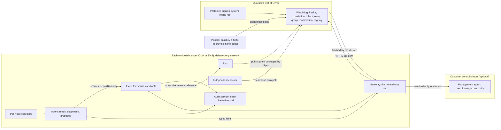
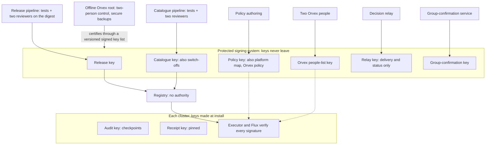
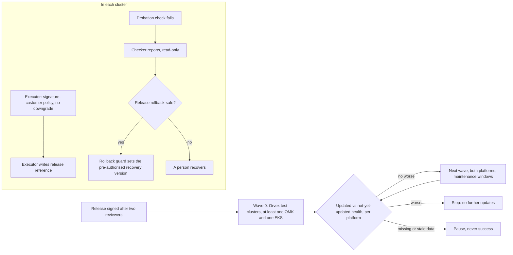

# Nightshift architecture

| | |
|---|---|
| **Document** | Nightshift architecture: the design, its reasoning and its trade-offs (hand-in for Orvex AI) |
| **Date and status** | 2026-11-15, draft for review (synced with spine AD-1..AD-71, final 2026-11-15) |
| **Build contract** | [ARCHITECTURE-SPINE.md](ARCHITECTURE-SPINE.md) (decision ids such as "AD-12" refer to it) |
| **Failure catalogue (draft)** | [failure-catalogue.md](failure-catalogue.md) |
| **Cost model (frozen working model v4)** | [cost-model/](cost-model/): [README](cost-model/README.md), [results](cost-model/cost-model-results.md) |
| **Tool comparison and evidence** | [tool-comparison.md](tool-comparison.md) |
| **Appendices** | [A. Outbound flows and channels (draft)](appendix-a-outbound-flows.md); [B. Proposed PRD changes (AP-1..AP-8)](appendix-b-proposed-prd-changes.md); [C. Failure catalogue sources](appendix-c-failure-catalogue-sources.md) |

> **What this is.** A design, not a finished production system. Nothing in it has been implemented, deployed or tested. Durations, sizes, resource figures and handling times are **assumptions to test** unless a source is given. Orvex asked for the reasoning and the trade-offs, "not a finished production design" (PRD Section 11). This document and its appendices stand alone; process history is kept in `.working/`.

**15-minute walkthrough:** §1 (bottom line, picture, main choices), 2.3 (OMK and EKS), 3.3 (one repair with a crash), 4.1–4.3 (who signs, option B), 5.3 (compromise cases), 11 (failure catalogue), 12.1 (what moves the cost), 13.2 (open questions for Orvex).

**Labels:** **[Verified 2026-11-xx]** checked against the linked primary source (maintainer documentation, not our own test) on that date; **[Assumption]** a planning value with no measurement; **[To verify]** still to check or confirm with Orvex; **[Untested]** designed but not run; **ADOPTED / provisional / proposed** the decision's status in the spine ("proposed" marks a mechanism that restates a PRD requirement and awaits confirmation).

**Ids:** AD-n, decisions in the spine; AP-n, proposed PRD changes (Appendix B); FR, NFR, SEC, PRIV, COST and SM, the PRD's functional, non-functional, security, privacy and cost requirements and success metrics; O-n, open items handed over from the UX specification; M2, the AI credential decision (8.6); D and G, the decision and group statements (4.2, 4.4).

---

## 1. Overview

**Bottom line.** Nothing here has been built or tested, and every figure is an assumption to test. Under the cost model's assumptions Nightshift saves Orvex nothing at 100 clusters, where round-the-clock cover sets the cost, and cuts Orvex's cash cost from about $48.75 to $10.81 per cluster per month at 10,000 clusters, while in the base case the customer's in-cluster footprint grows by more than Orvex saves (12). What we most need from Orvex: OMK distribution, CNI, storage and BMC details; EKS account layout and who operates it; Fleet hosting (13.2). The 20 failures and what Nightshift can do about each are summarised in 11.

### 1.1 What Nightshift is

Nightshift is a night-shift site reliability engineer inside every Quornex cluster. It watches the cluster, predicts problems it can see coming, explains them in plain language, and runs repairs, but only repairs from a signed, tested catalogue that the right people have authorised. It must work the same way on Orvex Managed Kubernetes (OMK) on customers' bare metal and on EKS (NFR-2), and keep working when Quornex Fleet, the portal or the AI provider can't be reached (NFR-5).

Three facts from Orvex's answers (`danny-qa-summary.md`) shape it: customer hardware can be cheap and unreliable, so hardware faults are a central case; customers own their hardware, and on EKS the provider owns the control plane and infrastructure; Orvex expects to rely mainly on hosted AI for the next few years, and wants AI only where rules and automation can't do the job.

### 1.2 The design in one picture



### 1.3 The main choices

1. **Three levels, each watched from outside itself:** workload cluster, optional control cluster, Fleet.
2. **Hybrid design (option C of three, 3.1):** ordinary services plus **one controller, the executor** (AD-1, AD-2).
3. **Reading and acting are separate:** a read-only agent; an executor with narrow rights, limited by admission rules (AD-3, AD-5, AD-69).
4. **Crash safety:** intent first, UID-guarded changes, the target's real state re-read after a restart, ambiguity to a person (AD-6, AD-7).
5. **People sign; the cluster verifies.** Passkey plus a cluster-built SMS code (option B, pending testing); group approvals through a Fleet service, with each cluster checking its own part (AD-17, AD-18, AD-48).
6. **Stop beats go** (AD-22).
7. **Raw data stays in.** Typed, allowlisted outbound fields; default-deny pods; everything leaves through the gateway except three named bypass paths (5.1); every flow has a channel (AD-26, AD-67, AD-70).
8. **Rules first, AI optional.** Hosted AI (Bedrock, retention `none`, customer-permitted Regions) only writes wording and analyses unfamiliar problems (AD-34, AD-35).
9. **Clusters connect out only;** Flux applies only the release the executor checked (AD-42, AD-68).
10. **Small, standard open-source parts** (10).

---

## 2. What runs where, and what changes between OMK and EKS

### 2.1 Per node, per cluster, control cluster, Fleet

| Level | What runs | Pattern and rights |
|---|---|---|
| **Per node** | node_exporter, Fluent Bit. **OMK:** smartctl_exporter (privileged), node-problem-detector. **EKS on EC2:** AWS node monitoring agent. **Fargate:** none | DaemonSets; no decisions or write rights. Privileged exporters: minimal pods, egress limited to the metrics store; privileged or host-network pods may bypass that, so a compromised exporter counts as a node compromise (AD-3) |
| **Per cluster, reading** | Agent, checker, hardware adapter (OMK read-only BMC reader or optional EKS AWS poller), Prometheus, VictoriaLogs, optional llama.cpp | Ordinary services; the agent only creates `RepairRun` specs |
| **Per cluster, acting** | Executor (with the coordinator), rollback guard | Only the executor reconciles `RepairRun`, writes the ledger and the release reference; the guard may only select the pre-authorised recovery release (AD-45, AD-68) |
| **Per cluster, recording and outbound** | Audit service, gateway (outbox, inbox), dashboard, Flux, image verification | Own pod and ServiceAccount each (AD-3) |
| **Customer control cluster** (optional) | Management agent and its own Nightshift set | Coordinates multi-cluster repairs; no authority (AD-66) |
| **Quornex Fleet** | Watchdog, intake, correlation, rollout, relay, group confirmation, credential vending, registry, signing system | Separate identities, minimum permissions (AD-39); hosting unconfirmed |

Every pod is default-deny, authenticates callers (AD-67) and runs below customer-critical priority (AD-64). Different rights need different pods, since a ServiceAccount is per pod ([Kubernetes](https://kubernetes.io/docs/concepts/security/service-accounts/), [Verified 2026-11-03]). **Footprint [Assumption]:** 6 to 7 small processes plus the observation stack; research envelopes of 0.8 to 12.7 vCPU and 2 to 22 GiB per cluster (3 to 30 nodes), to be measured (NFR-6).

### 2.2 Deployment topology

```mermaid
flowchart TB
  subgraph FLEETZ["Quornex Fleet at Orvex (hosting unconfirmed)"]
    FHB["Heartbeat watchdog"]
    FIN["Report intake"]
    FCO["Correlation + Alertmanager"]
    FRO["Rollout controller"]
    FRE["Decision relay"]
    FGC["Group-confirmation service"]
    FCR["AI credential vending"]
    FRG["Registry"]
    FSG["Protected signing system"]
  end
  PORTAL["Quornex portal"]
  BED["Bedrock, retention none, customer-permitted Regions"]
  SMSP["SMS provider"]
  subgraph CTRL["Customer control cluster, optional"]
    MA["Management agent + own Nightshift set"]
  end
  subgraph OMKC["Workload cluster on OMK bare metal"]
    ON["Per node: node_exporter, Fluent Bit, smartctl_exporter, node-problem-detector"]
    OR["Reading: agent, checker, Prometheus, VictoriaLogs, BMC reader, llama.cpp optional"]
    OA["Acting: executor, rollback guard"]
    OO["Outbound and record: gateway, audit, dashboard through customer ingress, Flux"]
    BMC["BMCs, out-of-band network"]
  end
  subgraph EKSC["Workload cluster on EKS"]
    EN["Per EC2 node: node_exporter, Fluent Bit, AWS node monitoring agent; Fargate: pod status only"]
    ER["Reading: agent, checker, Prometheus, VictoriaLogs, AWS poller optional, llama.cpp optional"]
    EA["Acting: executor, rollback guard"]
    EO["Outbound and record: gateway, audit, dashboard through internal load balancer, Flux"]
    EAPI["EC2 Describe APIs, customer account"]
    ECP["AWS-managed control plane: detect and escalate"]
  end
  ON --> OR
  OR -->|"read-only, listed BMCs"| BMC
  OR -->|"creates RepairRun"| OA
  EN --> ER
  ER -->|"AWS poller, own path"| EAPI
  ER -->|"creates RepairRun"| EA
  OR & ER -->|"heartbeat, checker's own path"| FHB
  OO & EO -->|"HTTPS: reports, receipts, leaves"| FIN
  OO & EO -->|"fetch signed decisions"| FRE
  OO & EO -->|"Flux pull by digest, own path"| FRG
  OO & EO -->|"short-lived credentials"| FCR
  OO & EO --> BED
  OO & EO --> SMSP
  OO & EO -->|"outbound HTTPS, sanitised"| MA
  PORTAL --> FRE
  PORTAL --> FGC
  FGC --> SMSP
  FSG --> FRG
  FIN --> FCO
  FCO --> FRO
```



**Dependency rules (AD-4, AD-42, AD-67):**

- The cluster starts every connection; nothing from Fleet, the portal or the management agent connects into a workload cluster. The one inbound endpoint is the local dashboard, reachable only through the customer's internal ingress or load balancer (AD-51; 5.1, 9.3).
- Only the executor's core loop needs the Kubernetes API; checker, gateway, audit and heartbeat survive an outage where caches allow (tokens and DNS may go stale; pods may not be restarted).
- The agent never calls the executor; it only creates `RepairRun` objects.
- Three named paths bypass the gateway (5.1, AP-8).

### 2.3 OMK and EKS side by side

Units, rules and release are the same on both. Only **adapters, evidence sources and repair scope** change. Catalogue entries state per platform which sources count as evidence; without enough, the entry is report-only there (AD-31, AD-52).

| Topic | OMK (bare metal) | EKS |
|---|---|---|
| **Who owns what** | Customer owns the hardware; Orvex manages OS, Kubernetes and Quornex | AWS owns control plane and hardware. Who operates the AWS account and nodes is **[To verify with Orvex]** |
| **Repair scope** (AD-13, AD-62) | Physical hardware is the customer's: Nightshift detects, gathers evidence and escalates to the customer or provider (manual repair, FR-52). OS and Kubernetes actions (for example a drain) only where the signed platform map authorises Orvex. **No hardware power actions in v1;** BMC access is read-only | Quornex services and customer applications, subject to permissions and checks. Control plane and hardware: detect, evidence, escalate through the customer |
| **Node collectors** | node_exporter, Fluent Bit, smartctl_exporter (root), node-problem-detector | node_exporter, Fluent Bit, AWS node monitoring agent; node-problem-detector only for a named missing check |
| **Hardware signals** | SMART (node_exporter has no SMART collector), EDAC memory errors, BMC data through Redfish (ipmi_exporter fallback) | EC2 status checks, scheduled events, EBS volume status, node agent conditions. **No host memory-error signal,** no SMART. ENA `*_allowance_exceeded` counters are AWS limits, not faults |
| **Credentialed adapter** | BMC reader in its own pod: just-in-time credentials, read-only BMC accounts where enforced **[To verify]**, network rules to listed BMCs only, BMC-to-node binding verified at install (only then, AD-62). No BMC access means reduced coverage | Optional AWS poller, **enabled only after credential isolation is verified** (AD-32): minimal `Describe` actions, Region condition, filtered calls. **No AWS Health API dependency** |
| **Unreachable node, stateful pods** (AD-62) | Moved only under a verified fencing and storage-safety procedure; a BMC power-state read is evidence only, and counts only if the BMC's system UUID matches the node's (re-checked on every use); otherwise a person decides | Same principle; EC2 instance state is evidence only |
| **Network policy** (AD-67) | Default-deny; enforcement depends on the CNI (unknown). Tested, gaps documented | Default-deny; pods can't reach IMDS. Tested, gaps documented |
| **Provider node repair** | None | EKS node auto repair; Nightshift never competes with it (2.4) |
| **Control plane** | Escalated to a person in v1 (AD-14). etcd compaction is a risky repair needing Orvex approval; control-plane certificate renewal is reported | AWS's responsibility: detect and escalate |
| **API audit logs** (AD-5) | Orvex sets the audit policy | Audit log type must be enabled; off by default, CloudWatch charges apply ([AWS](https://docs.aws.amazon.com/eks/latest/userguide/control-plane-logs.html), [Verified 2026-11-03]) |
| **Local dashboard** (AD-51) | Customer ingress or load balancer **[To verify]** | Internal load balancer; forwarding during an API outage **[To verify]** |
| **Platform rollback** (FR-47) | Unknown until Orvex confirms | One minor version back within 7 days; upgrades can't be paused ([AWS](https://docs.aws.amazon.com/eks/latest/userguide/update-cluster.html), [Verified 2026-11-05]) |
| **Capacity repair** | Report only | Propose node-group scaling with customer approval, only where no autoscaler manages the group |
| **Correlation location** | OMK site, if shared **[To verify]** | AWS Region |
| **Footprint cost** | Allocated value of existing hardware | Customer cash |

Platform unknowns are listed in 13.2. **Sources [Verified 2026-11-04]:** EC2 [status checks](https://docs.aws.amazon.com/AWSEC2/latest/UserGuide/monitoring-system-instance-status-check.html) and [scheduled events](https://docs.aws.amazon.com/AWSEC2/latest/UserGuide/monitoring-instances-status-check_sched.html); node agent [conditions](https://docs.aws.amazon.com/eks/latest/userguide/node-health-nma.html); `Describe*` permissions, Health API, throttling and Fargate/IMDS evidence in [tool-comparison.md](tool-comparison.md) §5.

### 2.4 EKS management modes and node repair

Before any node action the executor checks the node's management mode and repair configuration, and never acts on a node AWS or Karpenter is repairing (AD-13). **Provisional:**

| Mode | AWS node auto repair | Nightshift node actions |
|---|---|---|
| Auto Mode | Always on | None: detect, evidence, escalate |
| Fargate | Not applicable | None: pod status and probes only |
| Managed node groups or Karpenter, repair on | Opt-in | Nothing overlapping AWS repair; nothing on a node being repaired |
| Repair off, self-managed nodes | None | Only where the signed platform map authorises Orvex |
| Hybrid Nodes | Depends on setup | Only where the map authorises; **not OMK**, hardware access discovered per cluster |
| Mode or repair configuration can't be determined | Unknown | None: a missing check blocks the action (AD-11) |

AWS facts [Verified 2026-11-04]: default actions are Replace or Reboot for Ready, KernelReady, NetworkingReady and StorageReady after 10 to 30 minutes, none for DiskPressure or MemoryPressure; repair pauses above 20% unhealthy nodes; Auto Mode and Karpenter before v1.15 **bypass PodDisruptionBudgets**; Karpenter v1.15+ respects them and honours `karpenter.sh/do-not-repair`. These count as other actors' activity in impact budgets (AD-10).

---

## 3. Repair execution and crash safety

### 3.1 Why one controller and two custom resources

| Option | In short | Outcome |
|---|---|---|
| **C. Hybrid** | Ordinary services; one controller (executor) reconciling `RepairRun` and a claims ledger per cluster | **Adopted** (AD-1) |
| A. Operator everywhere | Every component a controller | Rejected: 4 to 6 object types for parts that reconcile nothing |
| B. Services with the executor's own database | No custom objects | Rejected: crash state, migrations and backups built by hand |

Both hold intent, status, references and digests only (etcd: 1.5 MiB per request, 2 GiB total, [etcd](https://etcd.io/docs/v3.5/dev-guide/limit/), [Verified 2026-11-03]). The ledger also holds executor state: epoch, halt, switch-offs, nonces, used `decision_id`s, highest signed-object versions, pins. Received signed objects sit in executor-owned Secrets. Only the executor writes `RepairRun` status; a quota caps open runs (AD-2). **RBAC grants access, never authority** (AD-5).

### 3.2 The crash-safety rules

1. **Intent before action (AD-6).** The executor writes "attempt *n*, action, target UID" to status with optimistic concurrency; if another instance changed the object first, the write fails and this instance stops.
2. **Every change is tied to the exact target (AD-6, AD-10).** Every mutation carries `uid` and `resourceVersion` preconditions, rechecked right before the change (for deletes and `policy/v1` Evictions, in the delete options); a changed target returns 409 and the executor stops and re-reads. A replacement pod has a new UID, so a repeated eviction can't hit it, and a target with a different UID is a different occurrence that the approval doesn't cover (AD-17) ([Preconditions](https://kubernetes.io/docs/reference/kubernetes-api/definitions/preconditions-v1-meta/), [DeleteOptions](https://kubernetes.io/docs/reference/kubernetes-api/common-definitions/delete-options/), [Eviction v1](https://kubernetes.io/docs/reference/kubernetes-api/definitions/eviction-v1-policy/), [Verified 2026-11-03]). Eviction respects PodDisruptionBudgets and returns 429 when blocked ([Kubernetes](https://kubernetes.io/docs/concepts/scheduling-eviction/api-eviction/)); a blocked eviction is never retried blindly (rule 4).
3. **On restart, check reality (AD-6):** done, not done or ambiguous. **Ambiguous goes to a person.**
4. **Verify after every action (AD-6).** Failure is recorded and goes to a person; never a blind retry. Unknown or stale signals never count as success (AD-31).
5. **One active executor with epochs (AD-7).** On start the executor takes a new epoch with an optimistic-concurrency write and re-reads it right before each mutation. On restart or reconnect: (1) apply pending **stops**, (2) reconcile unfinished runs, (3) revalidate authorisation, evidence and preconditions, (4) resume. Epochs reduce takeover races, not eliminate them; rule 2 stays mandatory. **Takeover:** (1) the starting executor acquires a Kubernetes Lease with a version-checked write; if that fails it stays passive and retries; (2) only while holding the Lease, it increments the epoch in the claims ledger with a version-checked write; if that write fails (conflict or API error), it performs no actions, re-reads and restarts from step 1; (3) it acts only after both succeed, and stops acting as soon as it cannot renew the Lease within a safety margin before expiry; (4) after taking over it applies stops first and reconciles all unfinished work against real state before resuming (order above). Two version-checked objects alone do not guarantee safe leadership: a paused or partitioned old executor may still act briefly after losing the Lease, so every automatic action also depends on verified fencing (AD-8, A3); without it the action stays manual. The executor pod's replacement delay after node loss is shortened (30-60 s, to test), which is not a promise of total recovery time. The executor, agent and checker are spread across nodes where capacity allows; smaller clusters may not allow this, and that limit is documented.
6. **Catalogue action contract (AD-8).** Each automatic action declares safe-retry behaviour (or reliable "already happened" evidence) and how its effect is observed; otherwise it isn't automatic in v1. Each automatic action also needs **verified protection against stale and duplicate execution**, for example by an old executor cut off during a takeover: version-checked writes (resourceVersion preconditions) where supported, and an intent that records the exact target (object UID; for volumes, the exact size). Re-reading the ledger alone isn't fencing. An epoch check by admission rule is *proposed* until its enforcement and race behaviour are verified. Actions without adequate protection stay manual in v1.

### 3.3 One repair with a crash

Example: replica `checkout-7f9-abc` (UID-1234) shows memory creep; the entry "restart one replica while healthy replicas carry traffic" is ticked.

```mermaid
sequenceDiagram
  autonumber
  participant AG as Agent (reader)
  participant K as Kubernetes API
  participant EX as Executor
  participant AU as Audit service
  participant P as Person
  AG->>K: create RepairRun (entry v3, target UID-1234, evidence digest)
  EX->>K: read RepairRun, verify authorisation, re-run entry queries at source
  EX->>K: claim target in claims ledger (resourceVersion check)
  EX->>K: status = attempt 1, evict UID-1234 (intent first)
  EX->>AU: append intent
  EX->>K: evict checkout-7f9-abc with precondition uid = UID-1234
  Note over EX: crash after the eviction, before the result is saved
  EX->>K: restart, new epoch, apply pending stops first
  EX->>K: read RepairRun (attempt 1, no result) and real pod state
  alt UID-1234 gone or terminating
    EX->>K: status = action done, run verification
  else UID-1234 running, no sign the eviction landed
    EX->>K: revalidate authorisation, validity, stops, evidence (AD-7)
    alt approval still valid and AD-8 protections pass
      EX->>K: status = attempt 2, retry (UID precondition)
    else approval expired or protections not verified
      EX->>K: no new forward step; pre-authorised safe-stop only if safe now
      EX->>P: escalate; new request version if still needed
    end
  else cannot tell
    EX->>K: status = ambiguous, stop
    EX->>P: escalate (FR-31)
  end
  EX->>K: status = Succeeded, or Failed and escalated, after verification
  EX->>AU: append result
```

The retry writes its own intent (attempt 2) first, so after another crash the executor can tell it from attempt 1 (AD-6). **After a crash (AD-7):** the executor processes stops, reconciles real state and revalidates before any further action. An expired approval does not authorise new forward steps. External operations already accepted (for example an EBS modification in progress) may still complete; they are neither repeated nor cancelled blindly, but observed and recorded. Safe-stop or rollback steps run only if pre-authorised in the entry and safe in the current state; otherwise the case is escalated. A retry is allowed only when authorisation is still valid and the action's duplicate and stale-executor protections (AD-8) pass; a single-retry limit alone is not a safety guarantee. Anything still needed after expiry needs a new request version with fresh evidence. If the retry is blocked (429) or UID-1234 is still running, verification fails and a person takes over; there's no further retry.

**Edge cases settled (AD-7, AD-65):** Refused actions (E3): when an eviction or other action is refused (for example 429 from a disruption budget or rate limiting), the run is recorded as "blocked" or, once retries are used up, "exhausted", distinct from "attempted and failed". Retries use bounded backoff within the approval's validity and the entry's attempt limit, re-check current safety conditions before each retry, and never bypass the disruption budget; afterwards the claim is released once nothing is running and a person is called. Audit unavailable (E6): if writing the intent to the audit service fails, the action does not run; the status becomes "blocked: audit unavailable" and the case is escalated (FR-33). Repeat counting (E8): repeats are counted per catalogue entry and stable owning workload identity, including its UID (for example the owning Deployment), under the entry's occurrence rules, not per pod UID or by name alone. Stop during a run (E9): no new step starts; a step whose API call is already in flight is not interrupted halfway, and its result is observed and recorded; then the pre-authorised safe-stop runs only if safe in the current state (A4), otherwise the case is escalated.

### 3.4 The coordinator: one repair per target, alongside other actors

- **Atomic claims (AD-9)** across nested scopes (pod, workload, node, cluster) through one ledger write with a `resourceVersion` check. An expired claim keeps holding its target until the executor confirms that no work is still running; if it can't confirm, the case is ambiguous and goes to a person (AD-6).
- **Other actors (AD-10).** A signed platform map names each component's change owner, checked live on every action. Customer-owned settings are only recommended unless the owner cooperates. Impact budgets count other actors' activity.
- **Missing checks block (AD-11);** multi-cluster repairs wait for the management agent, local ones continue.
- **The executor decides production impact and occurrence (AD-12, AD-17)** from signed fields, the platform-only map (an entry absent from the map counts as customer production), live checks and re-run queries, never the agent's summary. Any doubt selects the customer-production rules, and misclassifications count against SM-4.

### 3.5 Limits on what the executor may do

| Limit | Rule |
|---|---|
| **Admission rules (AD-69)** | Changes restricted to the actions, resources and fields of approved entries; the executor can't modify the rules. Rollback, install and upgrade use their own scoped identities; no general bypass. Verified per action; Kubernetes API only, not hardware or every possible repair |
| **Evidence (AD-65)** | Two independent signals; never a log line alone. Only approved sources through protected collection. **Workload-controlled metrics and logs are untrusted context;** being in Prometheus doesn't make a metric trustworthy. The executor checks source, freshness and independence. Injection paths **[To verify]** on both platforms |
| **Repeats (AD-65)** | Counted per entry and target; at the cap, a person takes over |
| **Never (AD-59, AD-60)** | Modify or delete customer records, databases, backups or Secrets. Execute a dangerous entry: those carry manual steps only |
| **Stateful pods and hardware (AD-62)** | No moving stateful pods off an unreachable node without a verified fencing and storage-safety procedure; a powered-off reading alone doesn't guarantee the node can't write; BMC identity is re-checked on every use (2.3). No hardware power actions in v1: manual, under their own authorisation and safety procedures (FR-52) |
| **Harmful repair (AD-58)** | Roll back what it can, set a cluster halt blocking automatic repairs, call a person. Only a recorded, authorised person clears it; it shows in heartbeat and history |

**Not claimed:** recovery time. Pods on a lost node are evicted after 5 minutes by default ([Kubernetes](https://kubernetes.io/docs/reference/access-authn-authz/admission-controllers/), [Verified 2026-11-03]), so with one executor replica (v1, AD-7) repairs pause at least that long when the executor's node is lost **[Untested]**.

---

**Admission failure behaviour (AD-69, A9).** The executor limits and release-reference protection use ValidatingAdmissionPolicy (evaluated inside the API server) where the required checks and the Kubernetes versions support it; coverage is verified, not assumed. Image verification, which needs a webhook, fails closed and is scoped to Nightshift resources only; there is no general recovery bypass. Limit: during an image-verification outage, existing Nightshift pods may continue, but new or replacement pods (including those a recovery needs) can be blocked; a documented manual procedure restores verification, and the outage and recovery are tested on both platforms.

## 4. Trust and approvals

### 4.1 The principle

Authority comes only from **people's signatures, verified inside the cluster**. The portal, relay and Fleet are transports; compromising one must not forge an approval (SEC-9). The portal holds no key the executor accepts as a person (AD-17).

### 4.2 What gets signed and checked

The cluster builds a **decision statement D**: customer, cluster, request ID and version, entry ID, version and digest, target (kind and UID), evidence digest, decision, role, validity window, a fresh `cluster_nonce` and a `decision_id`. Decisions: approve, reject, withdraw, undo-reject, start-now, the "I've done it" report (not an approval), halt-clear, alert-only on/off, tick, untick, settings change, delegation, revocation.

- **Encoding.** Signed objects use RFC 8785 JSON canonicalisation (JCS) under per-type domain tags; the challenge is `SHA-256("nightshift-decision-v1" || JCS(D))`. Each carries `valid_until` and an increasing version; lower versions are refused.
- **Route.** The cluster signs D and sends it through the gateway and relay; the portal displays D's fields and asks for an assertion over exactly that D. Actions and targets are shown only from D and catalogue fields; target names are untrusted identifiers.
- A passkey signs authenticator data plus the hash of client data containing the challenge, never readable text ([MDN](https://developer.mozilla.org/en-US/docs/Web/API/AuthenticatorAssertionResponse/signature), [Verified 2026-11-03]).

The executor counts a decision only if all of these hold (AD-17):

- the assertion verifies against the current roster, with the portal's origin and RP ID (or the dashboard's, for local stops and settings) and user verification;
- D matches what the executor rebuilds from its own `RepairRun`;
- the nonce is this cluster's for this request version, and the `decision_id` is unused;
- validity, role, delegation scope and distinct approvers check out;
- no stop covers the version;
- the mode allows it;
- preconditions pass.

### 4.3 Option B: passkey plus a cluster-sent SMS code

**ADOPTED as a working proposal, pending feasibility and usability testing (AD-18, AP-2).**

```mermaid
sequenceDiagram
  autonumber
  participant P as Person
  participant PO as Portal
  participant R as Decision relay
  participant G as Gateway
  participant E as Executor
  participant S as SMS provider
  P->>PO: sign in with passkey, click Approve
  PO->>R: start confirmation (request, version, decision, person, role)
  G->>R: fetch (cluster-initiated)
  G->>E: confirmation request
  E->>E: build and store D, keyed hash of a one-time code
  E->>G: cluster-signed D; SMS text built from D and catalogue template
  G->>R: D for the portal to display
  G->>S: SMS to the roster number (per-cluster credentials)
  S->>P: action, cluster, code, expiry
  P->>PO: enter code, fresh passkey assertion over D
  PO->>R: decision_id, code, assertion
  G->>R: fetch (cluster-initiated)
  G->>E: decision_id, code, assertion (durable inbox)
  E->>E: both bind the same decision_id and D, plus all checks
  E->>G: signed receipt, assurance passkey + SMS
  G->>R: receipt
  R->>PO: status leaves "Sent — not yet effective in the cluster"
```

**The SMS (AD-18).** The executor writes it from D and the catalogue template. The code is bound to the `decision_id`, recipient, request version and expiry, with attempt and resend limits. Each cluster has separately scoped SMS credentials, subject to provider support **[To verify]**. After every decision a post-decision notice follows ("You approved … Not you? Withdraw").

| Part | Proves | Doesn't prove |
|---|---|---|
| Passkey assertion | The registered passkey's holder, after user verification, signed a fingerprint of D for the portal's origin | That the screen showed the right repair: WebAuthn Level 3 has no transaction-display extension ([W3C](https://www.w3.org/TR/webauthn-3/), [Verified 2026-11-03]) |
| SMS code | Someone with the SMS entered it in this flow before expiry | That the person read it (paste and auto-fill allowed). SMS is a "restricted" authenticator: SIM swap and porting are possible ([NIST SP 800-63B-4 §3.1.3.3](https://pages.nist.gov/800-63-4/sp800-63b.html), [Verified 2026-11-04]) |

**Remaining risks.** A compromised **portal** can misdescribe a repair, so someone not reading the SMS could approve a *different* repair, though only one genuinely pending and passing every check. A compromised **gateway** can alter or drop the SMS and the notice, but not D or the executor's code check. It also carries the code, so against a compromised gateway the SMS adds no proof of possession; the passkey assertion over D is still required. The notice is **not** claimed to detect gateway tampering reliably.

**SMS abuse limits (AD-18).** against a gateway that sees the code, the SMS gives no independent proof of possession; the passkey signature over D remains the protection, and the risk that the person is shown a misleading message is documented. Provider-enforced recipient restrictions (roster numbers only), fixed templates, per-cluster rate limits and spending controls are used where the provider supports them, each verified before relying on it. Fleet monitors SMS use per cluster from the provider's own records, independently of the gateway; alerts and delayed billing checks are not hard caps.

**Approval latency (AD-18, targets to test).** the budget covers the initial relay wait, cluster processing, SMS delivery and the person's entry time; starting targets are under 60 s from clicking Approve to receiving the code and under 60 s from submitting to the cluster's receipt. The gateway uses bounded fast polling or long-polling only while a confirmation is open, and the load is tested at 10,000 clusters. The one-time code's starting lifetime is 5 minutes; it never extends the repair approval's validity. The person sees distinct states: "sent", "received/applied by cluster", "expired" and "unreachable"; nothing is shown as effective before the cluster confirms it.

**Passkey-only fallback** only where a signed policy enables it (customer-signed for customer approvals, Orvex-signed for Orvex ones), shown and recorded as reduced assurance. Otherwise, if the SMS can't be sent or its attempt and resend limits run out, the request stays open, escalation continues and the person sees "Confirmation code could not be sent" (AD-18, AD-49). **Requirements are never silently downgraded.** Option B covers customer, delegated and Orvex approvals and "Start now"; groups use 4.4.

**Rejected:** SMS code only (no identity check); the portal signing for people; a separate Orvex signing service (a hack forges approvals); approval in Slack (FR-14).

### 4.4 Group approvals (AD-48)

Orvex can approve one repair across many clusters at once. **This is Orvex technical approval only;** each cluster checks customer permissions independently. Customer control clusters are optional and separate, so none can authorise a fleet-wide group.

```mermaid
sequenceDiagram
  autonumber
  participant C as Each target cluster
  participant GS as Group-confirmation service
  participant PO as Portal (Orvex console)
  participant J as Orvex approver
  participant S as SMS provider
  C->>GS: cluster-signed leaf through its gateway (cluster_id, request_id, request_version, cluster_nonce, digest of its D)
  GS->>GS: verify leaves, build Merkle root and G, fix digest(G)
  GS->>PO: G, target list, wave plan
  J->>PO: Approve group
  GS->>S: one SMS to the approver's roster phone
  S->>J: repair, cluster count, waves, code
  J->>PO: code, fresh passkey assertion over G
  PO->>GS: code for this session
  GS->>GS: accept only for the same approver, roster version and digest(G); sign attestation
  C->>C: fetch G, assertion, attestation, own proof; run every check
```

- **G** holds entry and version, action, conditions, Merkle root, target count, wave plan, stop conditions, validity and session ID. Code session and attestation bind the **approver, Orvex roster version and digest(G)**.
- **Each cluster checks** the assertion and attestation against the roster, signer and G; **its own leaf** (current nonce, request version, D digest); that **G's action, version and conditions agree with its own D**; then validity, stops, switch-offs, customer permissions, preconditions and evidence. A cluster whose leaf no longer matches refuses and answers with a "refused as invalid" receipt; it's covered again only by a re-ask with fresh evidence, and the console shows sent versus confirmed per cluster (AD-23, AD-48).
- **Assurance** "passkey + SMS verification attested by Fleet; not independently verified by the cluster", weaker than per-cluster. **Limits:** the SMS confirms a summary, not the full list; nothing proves what the approver understood, and a compromised portal plus confirmation service could mislead them, though neither can forge the passkey or change a leaf. Clusters don't see the SMS step: that part of the assurance rests on the confirmation service's signed attestation.
- **Scope.** Frozen target set; customer approvals stay per cluster; dangerous manual repairs excluded. Validity is the shorter of entry validity and the group cap (for example 4 hours **[Assumption]**); the console shows which later-wave targets will need re-approval. A stop voids the rest as each cluster receives it (sent versus confirmed shown; disconnected clusters apply it on reconnection).

### 4.5 Rosters, roles and performers

- **Rosters (AD-19).** Customer roster changes are signed by an existing admin and notified to all admins. The first admin enrols with a one-time out-of-band code sent to the contract contact; the cluster pins that credential and registers the pin with Fleet, so a reinstall needs an existing admin or delayed recovery. The installer never enrols. Orvex operators could change the Fleet copy of the pin, but the cluster keeps its own and a change is visible to existing admins (stated limit). Sole-admin recovery waits a cancellable period **[value to set]**; Orvex-assisted recovery is always delayed and visible. The Orvex roster is signed by the people-list key. Neither roster grants the other's roles; revocation is a stop.
- **First-admin enrolment (AD-19, provisional).** the cluster generates the one-time enrolment code at installation; the install workflow does not expose it. Delivery is split: one half is shown through protected local access, the other is sent by Fleet to the contractual customer contact, whose identity and contact details are verified independently of the install workflow. Both halves are bound to the exact cluster and enrolment session, with short expiry, one-time use and attempt limits. Protected local access before any admin exists: the local half is readable only through a narrowly scoped bootstrap path that the customer controls and the install identity cannot use (mechanism to verify per platform). Before the pin is registered with Fleet, the customer contact on record is notified and the enrolment is recorded in the cluster audit. If the enrolment is disputed, the pin is not trusted, the delayed sole-admin recovery procedure applies, and both Orvex and the customer are alerted. Limit: someone with cluster-admin at installation can still interfere (AD-72).
- **People, not roles, are counted (AD-20).** A risky repair to the customer's app needs customer and Orvex technical approval from two different people. Orvex support acts for a customer only inside a customer-signed delegation (default off), never on settings or dangerous repairs, and the customer is notified.
- **Performers (AD-21).** "Start now" needs valid approvals, the window, passing checks and option B. "I've done it" is a report that triggers verification, not an approval. Hardware providers report through a named customer person.

### 4.6 Stop beats go, and receipts

- **Stop beats go (AD-22).** Any valid stop beats any approval on a request version and closes it.

  | Stop | What it stops |
  |---|---|
  | Withdrawal | That approval and request version |
  | Rejection | That version for this occurrence, and substitute entries for it unless separately authorised and shown (FR-50) |
  | Untick | That entry's tick |
  | Alert-only | All executions |
  | Revocation | Unused decisions under the revoked credential or delegation |
  | Fleet-wide switch-off (AD-57) | That entry on every cluster; no validity tier re-enables it |

  Renewal needs a new request version and every approval again. Stops are verified like approvals (an unverifiable one is surfaced, not applied); nonces and stored `decision_id`s block replay.
- **Inbox (AD-23).** The relay keeps decisions until receipted; the gateway stores them in a durable inbox. The inbox **is not an authority**: the executor verifies each decision and processes stops before queued work.
- **Receipts (AD-23, AP-3).** Signed with **the cluster's own receipt key**. Its public key is pinned at installation, signed by the first customer admin and by the Orvex people-list key; portal and Fleet accept receipts only under that pinned key. Until a receipt arrives the person sees **"Sent — not yet effective in the cluster"**; a missing receipt is the visible sign of a withheld stop. The portal displays receipts, so a compromised portal could show a false status; receipts also appear on the local dashboard (9.3).
- **Independent confirmation of stops (AD-23).** The portal's "effective" status is a convenience, not proof: a compromised portal and relay could show a false one. So, only after the cluster has applied and recorded a stop, it notifies the person who made it on the notifications channel (if enabled), through the gateway, not through the portal or relay. The signed receipt also stays visible on the local dashboard. No notification means "unconfirmed", not proof of failure. A compromised gateway can still block or alter the notice.

### 4.7 Validity

- **Approval validity (AD-25).** Per entry, from approval: **[Assumption]** 30 minutes for risky or customer-production repairs, 2 hours otherwise. The repair must start in time and re-checks preconditions; expiry doesn't interrupt it; changed evidence voids it. The cluster's clock decides (unsynchronised: time-limited approvals refused). Unanswered requests never expire. Every required approval must be valid when the repair starts; with unchanged evidence, a lapsed approval re-asks only that person (AD-17, AD-25). Undo-reject: 2 minutes **[Assumption]**.
- **Offline tiers (AD-24, AP-4).** Long-lived objects (ticks, policies, rosters, delegations, channel permissions) also need a fresh relay-signed status statement. What still works per unreachable dependency: 9.1.

  | Age of the last status statement **[Assumption]** | What may run |
  |---|---|
  | Fresh, under 1 h | All authorised repairs |
  | Stale, 1 h to under 24 h | Only safe ticked and safe policy repairs |
  | Expired, 24 h or more | No automatic repairs; observe and report |

  Cached outbound policies are **never widened** on a failed refresh. After expiry, only three things leave: the heartbeat, a fixed, data-free attention notice, and the fetches needed to recover (relay status statements and signed key lists, carrying only cluster identity and versions). Local stops keep working. A disconnected cluster learns of a revoked key only at its next key-list refresh, bounded by these tiers (AD-40).
- **Clock protections (AD-24).** Every Fleet status statement carries an increasing signed sequence number; the cluster persists the latest accepted number, and a repeated or older statement never resets freshness. While disconnected, statement age is measured with a local monotonic timer from receipt; reboots never extend permission validity, and if age cannot be established safely after a restart, permissions are treated as expired until fresh confirmation arrives. A statement whose signed issue time is ahead of the local clock by more than the allowed skew is refused, and a backward clock jump raises an alarm. If no time source or Fleet statement has confirmed the clock for longer than a set limit, the clock counts as unsynchronised and time-limited approvals are refused (AD-25). Tier boundaries: fresh under 1 h, stale from 1 h to under 24 h, expired at 24 h or more. Authenticated time (for example NTS) is optional hardening to verify. Restart and restore behaviour (including an etcd or ledger restore) is verified. Limit: a compromised host or cluster-admin can still manipulate time and stored state (AD-72).
- **State restore (AD-24).** Fleet keeps the last epoch and status sequence number each cluster reported; on reconnect the cluster compares them with its own. If its values are lower, or a restore or reinstall is known, ordinary actions stay blocked and permissions are treated as expired; only authenticated recovery messages (fresh status statements, key lists, stops) are processed. Before repairs resume, state is reconciled against reality; approvals from before the restore are not revived automatically and need a new request version. Limit: a restore made while the cluster is disconnected is detected only when it reconnects.
- **Request capacity (AD-2).** requests waiting for approval and active runs have separate bounded caps; capacity is reserved for urgent requests, and stops (which are not runs) always remain available. Repeats are merged into an existing request only when the executor confirms they are the same occurrence; a material change still needs a new request version and fresh approval. Waiting requests never expire by time (O-2); one is closed as "resolved, no longer needed" only after verification shows the problem is gone, and this is recorded and notified. When capacity is full, the problem is recorded within bounded storage, the status shows "approval request blocked: capacity full", and Orvex is alerted; local recording is bounded, not unlimited.

### 4.8 Signed customer settings and Orvex policies

| Object | Signed by | Rule |
|---|---|---|
| Modes, ticks, delegations, read scope, AI and source-code consent, channel permissions (AD-54) | A customer admin, never the installer | Executor verifies ticks and modes; gateway verifies consent and channels before every send. A tick binds to the entry version |
| Update policies (AD-53) | Customer | The executor checks every Nightshift release itself; Fleet's schedule is not authority; refusals are receipted and count against SM-4. Platform updates (OMK, Quornex, EKS) go through the platform's own update path, which must check the same policy: mechanism to define with Orvex. *Proposed:* update type in signed release metadata |
| Last resort (AD-55) | Customer tick **and** Orvex advance permission | Safe and risky entries only, never after a rejection; Orvex policy can't widen the customer's permission. *Proposed:* executor re-derives time to failure |
| Management policy (AD-56) | Policy key; customer accepts each version | No risky, dangerous or production-affecting repairs; never touches executor, gateway or audit. Policy key gated by testing and two distinct authorised reviewers (AD-56, decided 2026-11-15) |
| Switch-off (AD-57) | Catalogue key | *Proposed:* through the relay, stop priority, receipted |

### 4.9 Signing system and keys (AD-40)



- **One key per purpose,** certified by an offline root. Clusters trust only certified keys through a versioned, signed key list, which also carries rotation and emergency revocation. Root replacement is an explicit recovery procedure.
- **Release signing needs two distinct reviewers,** enforced by the signing system and recorded against the exact digest (void if the release changes). It never bypasses customer update policies, staged rollout or local verification.
- **Relay, registry and group-confirmation service carry no authority (AD-41, AD-48).** The registry stores signed packages with no publishing authority. The relay signs only delivery and status statements; these don't prove approval or fresh evidence, and they don't show that every stop was delivered: a lying relay could keep statements fresh while hiding a stop (the missing receipt shows it). The group-confirmation service checks a group's SMS code and signs an attestation; it can't forge the approver's passkey or change a cluster's leaf.
- **Open:** signing-system operations (root ceremony, backups, rotation schedule, revocation and root-replacement procedures); delivery path for policies and the Orvex roster.

---

## 5. Security boundaries and outbound data

### 5.1 Security boundaries

- **Read-only agent (AD-3, AD-5).** Log text, Kubernetes names, BMC strings, metrics, model output and performer reports are **evidence, never instructions**. Repairs come only from the signed catalogue (AD-8).
- **Default-deny network (AD-67).** Allowed explicitly: named internal peers, cluster DNS, the Kubernetes API where needed. Services authenticate callers; EKS pods can't reach IMDS. Only three paths bypass the gateway, each with its own authentication and allowlist: the heartbeat, Flux pulls and the AWS poller. **Tested on OMK and EKS;** gaps (non-enforcing CNI, host-network or privileged pods) are documented. AP-8 pending.
- **Local dashboard (AD-42, AD-51).** The one inbound endpoint: a stable hostname in the customer's internal DNS, reached through customer ingress or an internal load balancer; Nightshift never exposes it further. Local passkeys with exact origin and RP ID checks; stops and settings only, no approvals (9.3).
- **Fact builder (AD-26).** Every outbound message on the gateway path (everything except the three bypass paths) is built in the gateway from typed, allowlisted fields, passes the outbound (PRIV-4) and consent (PRIV-8) checks, and is recorded for the customer (PRIV-7). Redaction is never the primary protection; a hosted model short of context gets the local model or a person, **never richer data**. Only code fixes carry source code (AD-38).
- **Read scope (AD-61).** App and code sources are off until the customer opts in.
- **Audit (AD-16).** Append-only, hash-chained, own boundary and volume; raw records stay local. Each record names its authenticated appender, rate-limited. Signed checkpoints stored outside make destruction **detectable, not recoverable**. Until AP-1 is accepted they use the Fleet reports channel; if that is off, the loss is recorded and shown.
- **Heartbeat (AD-27).** Own path, fixed destination and schema; agent ID, timestamp and status only until AP-1 is accepted. No customer switch.
- **Workloads never blocked (AD-64).** Nightshift's admission checks match its own namespaces only.

### 5.2 Outbound flows and channels (AD-70)

PRIV-9 defines five channels: external AI, the Fleet heartbeat (required), Fleet reports, notifications and the portal. The draft [flow-to-channel table (Appendix A)](appendix-a-outbound-flows.md) assigns every outbound flow, with source, destination, path, fields and behaviour when the channel is off. **A flow not in the table is not allowed.**

| Channel | Flows (table rows) | If off |
|---|---|---|
| Fleet heartbeat (own path) | Heartbeat (1) | Can't be turned off |
| Fleet reports | Sanitised reports, coverage, AI usage (2); audit checkpoints until AP-1 is accepted (3) | Out of correlation; checkpoint loss recorded |
| Portal | D, requests, receipts, group leaves (4); fetched decisions (5); dashboard and summary data (7) | No remote approvals; local dashboard and stops still work |
| Notifications | SMS codes, alerts, notices (8); phone, Slack (9) | Option B can't complete unless passkey-only is enabled; no external alerts |
| External AI | Bedrock calls to permitted Regions (11); credential vending (12); source code under its own consent (13) | Rules and templates only |
| Customer estate | Management-agent links (17) | Cross-cluster repairs wait |
| One-time setup | Install registrations: public keys, fingerprints (18) | Install can't complete |

**No named PRIV-9 channel yet:** status statements, key lists, policy and roster updates (6); the FR-12 signal (10, proposed: Fleet reports); Flux downloads (15); the AWS poller (16). Proposed: extend AP-8 with "required service traffic" and the poller exception. The fixed attention notice sent after expiry (4.7) has no row yet. **Code-fix engineer access (14)** has no design, consent or channel.

### 5.3 Compromise cases

| Compromised | It can | It can't | Residual risk |
|---|---|---|---|
| **Agent** (for example, prompt injection) | Propose misleading repairs; write misleading local text | Act, approve, write status, read credentials, send raw data | A wrong catalogued repair passing every check |
| **A workload** | Emit misleading metrics or logs | Establish a safety precondition (AD-65) | Injection paths to verify |
| **Executor** | Make any change its approved entries allow | Change admission rules; pick an out-of-policy release; run dangerous or prohibited actions (AD-68, AD-69) | Admission coverage to verify |
| **Portal** | Misdescribe; delay decisions; show a false status | Forge a decision; beat a stop | A different pending repair approved if the SMS isn't read |
| **Gateway** | Read, alter or drop SMS codes and notices; send misleading or phishing texts to roster phones and run up SMS costs with the cluster's SMS credentials; misreport AI usage; drop traffic | Change D or the code check; forge the passkey assertion; act; reach denied destinations | Unnoticed SMS tampering; SMS gives no independent possession proof against it (the passkey signature over D remains); provider-enforced recipient, template, rate and spending controls where supported and verified; Fleet monitors SMS use from provider records, and alerts or delayed billing checks are not hard caps (AD-18); AI spend within one credential lifetime and cell quota (AD-36) |
| **Relay or Fleet** | Withhold decisions; hide a stop | Sign releases or entries; approve; connect in; read prompts | Hidden stop until the missing receipt is noticed; the portal can also show a false "effective" status, so stops are confirmed independently by a cluster notice and on the local dashboard (AD-23) |
| **Group-confirmation service + portal** | Mislead the group approver; skip the SMS | Forge the passkey; change a leaf; grant customer permissions | Recorded as "passkey + SMS verification attested by Fleet; not independently verified by the cluster" on the service's attestation alone; because the same service controls the session records, no session fingerprint would make a skipped SMS detectable |
| **Management agent** | Delay coordination | Authorise; connect in (AD-66) | Cross-cluster repairs wait |
| **Audit service** | Destroy local records; with AP-1, use the heartbeat's checkpoint fields as a covert channel of about 32 bytes per heartbeat | Rewrite checkpointed history undetected | Detectable, not recoverable |
| **A passkey** | Sign within its role | Grant Orvex roles | Revocation is a stop |
| **Cluster-admin or node root** (Orvex on OMK, which manages the OS and Kubernetes; whoever operates the account on EKS) | Read Nightshift's Secrets, including the receipt and audit keys; rewrite the claims ledger; remove admission rules; swap images; use any signing access the cluster holds | Forge Orvex-signed releases, catalogue or policy; forge a person's passkey assertion | **Security limit (AD-72):** in-cluster authority is only as strong as cluster-admin hygiene. Encrypted Secrets don't protect keys from an authorised cluster-admin, and a non-exportable key (KMS, TPM) can still be misused through authorised signing access. Audit logs and external checkpoints give partial tamper detection, not a guarantee. Normal work uses limited roles; full Orvex admin access is temporary, approved and audited |

---

## 6. Observation stack

| Layer | Choice | Rules |
|---|---|---|
| **Metrics** (AD-29) | Local Prometheus, **provisional**; existing Quornex monitoring reused where suitable | Fixed named queries only; raw metrics stay local; no Grafana needed; in-cluster Alertmanager optional, **internal receivers only** |
| **Logs** (AD-30) | Fluent Bit + single-node VictoriaLogs, **provisional**; Loki where Quornex runs it | 7-day retention; dedicated volume capped under 80%; per-source limits in the collector; bounded buffers; dropped records counted into coverage and explanations; capped evidence hold for unfamiliar problems; customer originals read-only |
| **Repair evidence** (AD-65) | Approved sources through Nightshift-controlled, authenticated ingestion | Workload data is untrusted context (3.5); read scope applies (AD-61) |
| **Hardware and platform signals** (AD-31, AD-32) | One signal interface mapping signal families to per-platform sources | Each value carries source, vantage point, freshness and coverage state. **Unknown is never healthy;** adapter failure blocks dependent repairs |
| **Independent checker** (AD-33) | Small service, independent of Prometheus and the agent | Read-only liveness, freshness, reachability, clock checks; "unreachable from the checker", never "dead" |
| **Heartbeat and coverage** (AD-27, AD-33) | Heartbeat from the checker; coverage discovered at install, rechecked | Survives gateway failure (not a shared node or network failure); coverage loss opens a monitoring case |

**Sources [Verified 2026-11-04]:** Prometheus local storage is not clustered or replicated (3.15.1 latest when checked, pinned at freeze); VictoriaLogs has no ingestion rate limit, so limits come from the collector; Fluent Bit's buffer limits and drop counters. Quotes and links: [tool-comparison.md](tool-comparison.md) §3–§4. **[To verify]:** Fluent Bit per-source rate limiting and tail behaviour across rotation.

**Starting values [Assumption]:** heartbeat 60 s, missing after 3; "out of date" about 2 minutes after the last observation; metrics and log retention 7 days. Tool switches (VictoriaMetrics, Loki) only on measured savings ([tool-comparison.md](tool-comparison.md)).

---

## 7. Intelligence

### 7.1 Rules and statistics versus a language model (AD-34)

| Task | How it's done |
|---|---|
| Detection and prediction | Rules and statistics |
| Matching a problem to an entry | Rules verify; AI may only suggest |
| Authorisation, safety, execution, verification | **Rules only, in the executor** |
| Explanations and morning summaries | Templates first; optional AI wording, labelled |
| Problems in neither catalogue (FR-19) | AI summary with stated uncertainty: local evidence only to a local model; hosted models get fact-builder fields only |
| Code fixes (experimental) | Language model, under source-code consent (AD-38) |

**The output boundary follows the model's input (AD-34).** Text from a model that saw raw logs stays in the cluster, even after redaction. A local model given a separate context of approved outbound fields only may draft wording for remote surfaces, which then passes the outbound checks. Actions, targets, risks and approval conditions always come from catalogue and template fields. Hosted output is untrusted too; labelling doesn't replace checks.

### 7.2 Hosted AI: Amazon Bedrock first (AD-35)

**Provisional.** **Why hosted.** Orvex expects to rely on hosted AI for at least three years (Orvex's answers, Exchange 3); tokens are cheap at the assumed volumes (7.6), GPUs a fixed cost per cluster. **Required:** verifiable zero retention, no training, per-customer Regions and jurisdiction, a pinned eligible model, an Orvex contract.

**Why Bedrock.** Its per-Region retention mode `none` stores no request or response data and shares none with the model provider; Bedrock blocks models needing retention, and an organisation policy can force `none` ([Bedrock data retention](https://docs.aws.amazon.com/bedrock/latest/userguide/data-retention.html), [Verified 2026-11-04]), so zero retention is checkable. Anthropic API zero retention is granted through sales ([Anthropic](https://platform.claude.com/docs/en/manage-claude/api-and-data-retention)); OpenAI's needs approval and keeps abuse logs up to 30 days by default ([OpenAI](https://developers.openai.com/api/docs/guides/your-data)), both [Verified 2026-11-04].

**Regions: customers worldwide, no EU-only restriction.** Permitted AI Regions are set **per customer** from their consent and requirements, and the consent screen names provider, Regions (or route) and jurisdiction; customers refusing a US hyperscaler get a local model or no AI. **Global cross-Region routing only when the customer explicitly permits it.** Retention mode doesn't propagate, so `none` is enforced in **every Region a route can use**, and availability and zero retention are verified per route. Frankfurt prices are only the **labelled reference cost scenario**.

**Models.** v1 keeps Claude Haiku 4.5 and Sonnet 4.6, subject to per-route checks and validated explanation and code-fix quality; newer models only if validation or availability requires. They are on Anthropic's legacy Bedrock integration (InvokeModel/Converse, runtime endpoint), so the SDK is pinned. The per-model allowed-modes signal is on another endpoint; here the account's retention mode is checked per Region, and Bedrock refuses models needing more. The check runs in the gateway or credential vending, never the executor.

**Use.** One provider. During outages templates carry explanations; calls aren't queued. Bedrock quotas are per account and Region ([quotas](https://docs.aws.amazon.com/bedrock/latest/userguide/quotas.html)): a backstop, **never a per-cluster cap**. Fleet and the learning pipeline never pass a non-consenting customer's data to external AI (AD-63).

**Reference prices (eu-central-1, regional):** Haiku 4.5 $1.10 / $5.50 per million input / output tokens; Sonnet 4.6 $3.30 / $16.50; blended, assuming 80% input and 20% output tokens, $1.98 and $5.94. Regional endpoints cost 10% more than global for Haiku 4.5 and later. Sources: [Anthropic pricing](https://platform.claude.com/docs/en/about-claude/pricing), [Verified 2026-11-04]; AWS Price List API, [Verified 2026-11-11]. **[To verify]:** availability and `none` per route; prices outside eu-central-1.

### 7.3 How Nightshift works in each AI situation

| Situation | Repairs | Explanations | Unfamiliar problems | Code fixes |
|---|---|---|---|---|
| Hosted, consent given | Rules | Templates + labelled AI wording | Hosted AI on typed facts | Hosted, with source-code consent |
| No consent, local GPU | Rules | Templates + local wording (export per 7.1) | Local model, local evidence | Local, if suitable |
| No consent, no GPU, or no AI | Rules | Templates | "Evidence collected, cause unknown, escalated" | Unavailable |
| Provider unreachable | Rules | Templates, "AI explanation unavailable" | Escalated | Unavailable |

The core loop never needs AI.

### 7.4 Local and shared inference (AD-37)

- **llama.cpp server** (provisional): API key, agent-only; it supports `--api-key` and binds 127.0.0.1 by default ([llama.cpp server](https://github.com/ggml-org/llama.cpp/blob/master/tools/server/README.md), [Verified 2026-11-04]); Ollama documents no authentication ([Ollama FAQ](https://docs.ollama.com/faq)). Weights are signed and distributed like releases. Optional; no GPU assumed per cluster.
- **No shared GPU in v1:** it would be external AI (PRIV-8) needing one server per customer (shared vLLM doesn't isolate tenants).
- **[To test]:** 24 GB and 96 GB model quality; sharing savings; local versus hosted on the same cases.

### 7.5 Fine-tuning

**Deferred, not shown uneconomic.** Tokens are cheap, self-hosting needs always-on GPUs, there is no reviewed incident data, and training needs consent. Bedrock custom-model pricing couldn't be verified.

### 7.6 Expected number of model calls

**Adopted as starting assumptions.** Inputs **[Assumption]**, low / baseline / high: 250 / 500 / 1,000 problems a day at 10,000 clusters (NFR-1: about 250 a night); 95 / 90 / 80% supported; AI wording for 10 / 30 / 60% of supported problems, at 1 / 2 / 4 calls of about 1.8k tokens; 2 / 3 / 5 calls of about 9k tokens per unfamiliar problem; AI-written morning summaries (about 3.5k tokens) for 10 / 20 / 50% of 2,500 customers (4 clusters each); retries +5 / +10 / +25%; 100% of customers consenting to external AI (an upper bound).

Derived (30-day month), at reference prices:

| | Low | Baseline | High |
|---|---|---|---|
| Calls a day, 10,000 clusters | about 310 | about 1,010 | about 5,200 |
| Calls a month, 10,000 clusters | about 9,400 | about 30,000 | about 156,000 |
| Calls per cluster per month | about 0.9 | about 3 | about 16 |
| Tokens a month, 10,000 clusters | about 36 M | about 118 M | about 631 M |
| Haiku 4.5 regional, per month | about $71 | about $234 | about $1,250 |
| Sonnet 4.6 regional, per month | about $214 | about $703 | about $3,749 |

At 100 clusters: about $2.34 a month on Haiku at baseline. **Tokens only**, not operating cost.

### 7.7 Code fixes (AD-38)

AP-6 pending. Hosted inference is the main v1 path when the customer **separately** authorises sending relevant source code to a zero-retention provider; code still passes secret scanning and PRIV-4 (AD-26). A local model is supported where hardware exists and the customer wants code kept inside; otherwise code fixes are unavailable while everything else continues. Source-code consent is off until opted in. About $0.25 per attempt on Sonnet 4.6 at reference prices (assumed 50k input, 5k output tokens); volume unknown. **Open:** the code-fix path (customer-specific entries, isolated test environment, deployment, per-transfer records) and **engineer access** to the test environment, which needs its own consent and channel (FR-44; Appendix A flow 14).

---

## 8. Fleet

### 8.1 Services split by responsibility (AD-39)

| Service | Responsibility | Can't |
|---|---|---|
| Heartbeat watchdog | "Unreachable from Fleet" after 3 misses | Read logs |
| Report intake | Sanitised reports, bound to each cluster's own identity, rate-limited (AD-47) | Take raw data or one cluster speaking for another |
| Correlation + Alertmanager | Consolidated alerts | Show other customers' clusters |
| Rollout controller | Waves, stop conditions | Sign releases; override update policy (AD-53) |
| Decision relay | Carries decisions until receipted; signs status statements | Create approvals or receipts |
| Group-confirmation service | Group statements, SMS, attestations (group approvals: 4.4) | Approve; forge a passkey |
| Credential vending | Short-lived Bedrock credentials, retention check, usage comparison | See prompts |
| Registry | Signed packages | Publish unsigned |
| Signing system | Per-purpose keys (4.9) | Serve unnamed requesters |

Each has its own identity, minimum permissions and customer isolation (FR-48); Fleet sends only SEC-9's commands. Quornex's identity system is reused if suitable.

### 8.2 Transport (AD-28, AD-23)

HTTPS only, cluster-initiated. The outbox survives restarts, is size-limited, deduplicates by message ID, sends **stops and withdrawals first**, and reserves capacity for them and receipts (AD-50); ordinary reports may be dropped with a recorded gap. Inbound decisions land in the durable inbox (4.6). No NATS JetStream in v1: no need shown for another stateful system.

### 8.3 Delivery: Flux and the release reference (AD-43, AD-68, AD-71)

- Flux pulls OCI packages **pinned by digest** with **signature verification required** (off by default in Flux, so it is enforced on Nightshift's Flux objects by admission rules (AD-68) and verified on both platforms; [Flux OCIRepository](https://fluxcd.io/flux/components/source/ocirepositories/), [Verified 2026-11-05]).
- **Release reference.** Flux applies only a digest-pinned reference that **only the executor writes**, after signature, update-policy (AD-53) and downgrade (AD-46) checks. A narrow path lets the guard set it **only to the pre-authorised recovery version**, so recovery works with a broken executor. RBAC and admission rules protect the reference, Flux settings and trust keys; **enforcement is verified on both platforms before build sign-off.**
- Signatures are verified by Nightshift whatever delivered them; images at admission, in Nightshift namespaces only, and only digests listed in the current signed release manifest, so an older signed image is refused (AD-43, AD-64). Admission rules that restrict Nightshift's own identities (AD-68, AD-69) may apply in any namespace but match only requests made by those identities, so they never block a customer's own requests.
- **Install path.** CRDs, ClusterRoles, webhooks and Flux itself use temporary, minimum permissions approved by a customer admin, recorded and removed afterwards. Flux permissions **[To verify]**. Rancher Fleet only where Quornex runs it.

### 8.4 Rollout waves, stop and recovery (AD-44 to AD-46)



- **Waves (AD-44)** cover both platforms, judged per platform; silent clusters never join early waves. Sizes **[Assumption]**. A stop doesn't cancel a running update. The customer's signed update policy, not the schedule, decides (AD-53).
- **Recovery (AD-45, AP-7):** Flux sits outside releases; the guard's probation rollback is exact and bounded (named previous release, probation window, failed check, rollback-safe only), part of the update authorisation and recorded. A release that isn't rollback-safe, or has no named previous release, gets no automatic rollback; after that, a person recovers through a manual runbook on the separate install path.
- **Probation as a dead-man's switch (A8):** a release passes only when the checker sends a fresh healthy signal tied to the exact release and probation attempt within the window; if it is missing, the guard triggers only the pre-authorised, rollback-safe recovery (otherwise a person is called). The checker and guard are updated separately from routine releases. Limit: shared node, network or Kubernetes API failures can still prevent recovery. False rollbacks are recorded, rollback loops are prevented (a release rolled back once is not re-applied automatically), and the problem is escalated if recovery cannot complete.
- **Downgrade protection (AD-46):** only newer or signed rollback targets; expiring metadata exposes a held-back cluster.

### 8.5 Correlation and consolidated alerts (AD-47)

Fleet groups reports **only on allowed fields** (problem type or allowed-field fingerprint, platform, release, catalogue and platform versions, wave, location) and can link groups across waves, versions or locations. A group above its normal rate becomes **one urgent alert** (thresholds **[Assumption]**); concentration on newly updated clusters stops the rollout. Silent clusters show "unreachable from Fleet" by location; stale ones "not reporting", never healthy. Built as a small custom service plus Prometheus Alertmanager (deduplication, grouping, inhibition, silences, HA; [Alertmanager](https://prometheus.io/docs/alerting/latest/alertmanager/), [Verified 2026-11-05]). Customers see only their own clusters.

### 8.6 AI credentials (AD-36)

Design level, unvalidated (decision M2).

- **Design:** **15-minute per-cluster credentials** (STS minimum 900 s, [Verified 2026-11-04]); one IAM role per cluster, limited to its **application inference profile**; accounts split into **cells** so one cluster can exhaust only its cell's quota; Fleet compares AWS-recorded, content-free usage and billing with gateway reports; prompt logging off.
- **Verified [2026-11-05]:** profiles track usage and cost ([AWS](https://docs.aws.amazon.com/bedrock/latest/userguide/inference-profiles-create.html)); runtime metrics are per model ([AWS](https://docs.aws.amazon.com/bedrock/latest/userguide/monitoring-runtime-metrics.html)); IAM revokes a role's sessions by issue time ([AWS](https://docs.aws.amazon.com/IAM/latest/UserGuide/id_roles_use_revoke-sessions.html)).
- **Limits:** issued credentials live until expiry; delayed accounting can't enforce a cap. **No hard per-cluster cap is claimed.** Isolation, revocation, metadata, quotas at 10,000 clusters and per-route compatibility are **[To verify]**. Fallback: a metering proxy at Orvex (a real cap, but content passes through Orvex).

### 8.7 The management agent (AD-66)

It coordinates repairs spanning several workload clusters and **holds no authority**: workload executors verify decisions themselves. It has its own narrow identity and sees sanitised data only (PRIV-1, PRIV-5). **Workload clusters open outbound HTTPS connections to it** under their own identity; it never connects in. If it is unreachable, cross-cluster repairs wait and local ones continue. *Proposed:* the control cluster's heartbeat includes its status.

### 8.8 Fleet operations (AD-71)

A Fleet outage doesn't stop customer workloads; Nightshift continues within offline limits, suspending automatic repairs after 24 hours without renewed confirmation (4.7). Fleet has **external monitoring outside itself**, **backup and restore procedures** and **provisional recovery targets**, with values set by Orvex.

---

**Rollout and alert edge cases (AD-44, AD-47).** Last-wave baseline (E21): when no not-yet-updated clusters remain to compare against, each updated cluster is compared with its own pre-update health, per platform; with no usable baseline the rollout pauses and a person decides. Paused rollouts (E22): after a set time (assumption) a paused rollout alerts the release owner; it never resumes on its own and needs an explicit resume or stop by a person. New problem groups (E23): a group with no history uses provisional count-and-time thresholds (for example the same problem on several clusters or customers within a window; values to tune); it alerts when sufficient permitted evidence meets the threshold. Limits: clusters that send no reports or stale data are not counted, so a fleet-wide problem can stay below the threshold; low thresholds raise false alerts.

## 9. Offline operation and what happens if Nightshift fails

### 9.1 When a dependency is unreachable (AD-49)

What may still run as the last status statement ages is set by the validity tiers in 4.7.

| Unreachable | Keeps working | Stops or waits | Shown as |
|---|---|---|---|
| Fleet | Workloads, monitoring, repairs per tier, local stops, audit | Portal decisions, releases, AI credentials; after 24 h all automatic repairs | "Unreachable from Fleet"; "Sent — not yet effective in the cluster" |
| Portal | Automatic work, heartbeat, reports | Approvals | Dashboard offers stops |
| AI provider | Rules, templates | AI wording, unfamiliar analysis, code fixes | "AI explanation unavailable" |
| SMS | Everything else | Option B, unless passkey-only is enabled | "Confirmation code could not be sent" |
| Management agent | Local repairs | Cross-cluster repairs | Waiting for coordination |
| Kubernetes API | Checker, heartbeat, audit, cached outbox | Repairs needing the API | "Kubernetes API unreachable: repairs paused" |
| Cloud or hardware API | Kubernetes signals | Hardware and AWS signals | "Out of date", never green |

On reconnect, pending stops apply **before** queued repairs resume.

### 9.2 When Nightshift itself fails (AD-50, AD-58, NFR-4)

| Failure | Effect | Recovery |
|---|---|---|
| Agent | No new diagnoses | Restart; nothing to undo |
| Executor mid-repair | Repair paused | Intent-first recovery; ambiguity to a person |
| Executor broken after an update | No reference writes | Guard selects the recovery version (8.3) |
| Gateway | Only own-path flows leave | "Gateway health check failed"; outbox and inbox survive |
| Checker | No local checks | Missing heartbeat |
| Prometheus or VictoriaLogs | Stale signals | Disruptive repairs blocked |
| Unsynchronised clock | Validity unreliable | Time-limited approvals refused |
| Harmful repair | Cluster halt | A recorded, authorised person clears it |
| Bad release | Any of the above | Rollback guard (8.4) |
| Protected storage full | New repairs and new repair steps suspended ("repairs suspended: storage full") | Reserved space for ongoing work; only receipts compacted; audit space reserved for stops; if even that fills, valid, authorised stops are still enforced and new execution is blocked, running work follows its safe-stop or recovery procedure, and missing audit records and confirmations are reported honestly (no promise of unlimited retention); a stop's effect is kept in the claims ledger, and after a restart with unconfirmed state the executor starts with repairs suspended, so a stop is never forgotten (AD-50); escalation. Reserved size **[Assumption]** |

**In every case** workloads keep running (AD-64), no repair runs unrecorded, and Fleet notices silence.

### 9.3 Local dashboard (AD-51)

Provisional.

- Local passkeys bound to one stable internal HTTPS hostname per cluster (the RP ID). Passkeys work only for their own domain ([MDN](https://developer.mozilla.org/en-US/docs/Web/API/PublicKeyCredentialRequestOptions), [Verified 2026-11-05]), so portal and local credentials don't cross; the roster lists each local credential.
- **No approvals** (FR-14). Customer admins can withdraw, reject, untick, switch alert-only and **change settings** per PRIV-9; each change is audited with a receipt. Receipts for portal decisions also show here (AD-23).
- It's the one inbound endpoint into a workload cluster, on the customer's internal network only (5.1).
- `kubectl port-forward` is a convenience only. **Known limit:** if ingress needs the API, local stops may be unreachable during an outage.

---

## 10. Open-source choices and rejected alternatives

Evidence and access dates: [tool-comparison.md](tool-comparison.md). **No benchmark, security audit or production deployment was performed for Nightshift.**

### 10.1 Chosen

| Layer | Tool | Licence | Why | Status |
|---|---|---|---|---|
| Metrics | [Prometheus](https://github.com/prometheus/prometheus) or existing Quornex monitoring | Apache-2.0 | Standard rules; local | Provisional |
| Node metrics | [node_exporter](https://github.com/prometheus/node_exporter) | Apache-2.0 | Disk, network, EDAC | Decided |
| Disk health (OMK) | [smartctl_exporter](https://github.com/prometheus-community/smartctl_exporter) | Apache-2.0 | SMART; needs root | Decided |
| BMC (OMK) | Redfish reader; [ipmi_exporter](https://github.com/prometheus-community/ipmi_exporter) fallback | MIT | Remote, read-only, credentials outside the agent | Decided (Redfish [To verify]) |
| Node conditions (OMK) | [node-problem-detector](https://github.com/kubernetes/node-problem-detector) | Apache-2.0 | Kernel and node conditions | Decided |
| Node conditions (EKS) | [AWS node monitoring agent](https://github.com/aws/eks-node-monitoring-agent) | Apache-2.0 | AWS-supported | Decided where supported |
| Logs | [Fluent Bit](https://github.com/fluent/fluent-bit), [VictoriaLogs](https://docs.victoriametrics.com/victorialogs/) | Apache-2.0 | Bounded buffers; retention plus disk cap | Provisional |
| Fleet alerts | [Alertmanager](https://github.com/prometheus/alertmanager) | Apache-2.0 | Grouping, inhibition, HA | Decided |
| Delivery | [Flux](https://github.com/fluxcd/flux2) | Apache-2.0 | Pull, digest pinning, signature verification | Decided |
| Local inference | [llama.cpp](https://github.com/ggml-org/llama.cpp) | MIT | API key; localhost default | Provisional |
| Controller library | [controller-runtime](https://github.com/kubernetes-sigs/controller-runtime) | Apache-2.0 | Standard for one controller | Candidate |
| Admission and image verification | For example ValidatingAdmissionPolicy, Kyverno, Sigstore policy-controller | — | AD-43, AD-68, AD-69 | Chosen at build; verified on both platforms |
| Hosted model | Amazon Bedrock: Haiku 4.5, Sonnet 4.6 | — | Checkable retention `none` | Provisional |

### 10.2 Rejected or kept as alternatives

| Alternative | Licence | Reason |
|---|---|---|
| [Argo Workflows](https://github.com/argoproj/argo-workflows), [Temporal](https://github.com/temporalio/temporal), [StackStorm](https://github.com/StackStorm/st2) | Apache-2.0, MIT, Apache-2.0 | Too broad for typed repairs; own datastore per cluster; large footprint |
| [VictoriaMetrics](https://docs.victoriametrics.com/victoriametrics/) + vmalert | Apache-2.0 core | **To evaluate;** savings are a vendor claim; MetricsQL differs from PromQL |
| [Zabbix](https://www.zabbix.com/license), [Netdata](https://github.com/netdata/netdata), central raw-metrics store | AGPLv3, GPLv3+ | Central trigger evaluation; uncalibrated anomaly scores; PRIV-1 |
| [Loki](https://github.com/grafana/loki) | AGPL-3.0 | **Alternative** where Quornex runs it; filesystem mode described as for development |
| [OTel Collector](https://github.com/open-telemetry/opentelemetry-collector), [Vector](https://github.com/vectordotdev/vector), [OpenSearch](https://github.com/opensearch-project/OpenSearch), [Grafana](https://github.com/grafana/grafana) | Apache-2.0, MPL-2.0, Apache-2.0, AGPL-3.0 | More than needed or too heavy; views are in the portal |
| node-problem-detector beside the AWS agent; AWS Health API; watchdog through the same Prometheus | — | Duplicate privileged pods; paid support; can't see Prometheus die |
| Central [Argo CD](https://github.com/argoproj/argo-cd) | Apache-2.0 | Holds credentials and connects into clusters ([architecture](https://argo-cd.readthedocs.io/en/stable/operator-manual/architecture/)); source checks "not possible when using Helm or OCI application sources" ([source integrity](https://argo-cd.readthedocs.io/en/stable/user-guide/source-integrity-git-gpg/)), [Verified 2026-11-05] |
| [Rancher Fleet](https://github.com/rancher/fleet) | Apache-2.0 | Only where Quornex runs it; signature checks and scale not described ([architecture](https://fleet.rancher.io/explanations/architecture)) |
| [NATS JetStream](https://github.com/nats-io/nats-server) | Apache-2.0 | No need shown in v1 |
| Ollama; shared [vLLM](https://github.com/vllm-project/vllm) | MIT; Apache-2.0 | No authentication; no tenant isolation |
| [Presidio](https://github.com/data-privacy-stack/presidio), OTel redaction as primary protection | MIT, Apache-2.0 | PRIV-2: at most an extra layer |
| [HolmesGPT](https://github.com/HolmesGPT/holmesgpt), [K8sGPT](https://github.com/k8sgpt-ai/k8sgpt), [kagent](https://github.com/kagent-dev/kagent) | Apache-2.0 | AI never on the action path; HolmesGPT has Bash tools on by default |
| LiteLLM | MIT | Not needed with one provider |

---

## 11. Failure catalogue summary

Full draft: [failure-catalogue.md](failure-catalogue.md); source checks (2026-11-11): [Appendix C](appendix-c-failure-catalogue-sources.md).

> **No repair has been tested.** A proposed repair becomes an entry only after testing and two reviewers (FR-39, AD-52). Prediction depends on available signals; risk depends on the exact action, target and production impact. The number of repairable failure *types* says nothing yet about the share of *incidents* resolved.

Ranking is a labelled judgement (impact if missed, likelihood on cheap bare metal and EKS, what Nightshift can do). **Predict:** early warning, if signals exist. **Fix:** a proposed Kubernetes-level catalogue action, never a hardware power action in v1. **Report:** detect, evidence, escalate. The underlying fault belongs to its owner.

| # | Failure | OMK | EKS |
|---|---|---|---|
| 1 | Node disk filling | Predict; Fix: drain if eviction near (risky) | Predict; drain where the mode allows (risky) |
| 2 | Persistent volume filling | Predict; Fix: expand (customer approval, irreversible; CSI support unknown) | Predict; Fix: expand (customer approval, irreversible; 4 EBS changes per 24 h) |
| 3 | Disk failing | Predict partly (SMART); Fix: drain (risky); replacement is the customer's | Report; drain where the mode allows |
| 4 | NIC hung or flapping | Predict partly; Fix: drain (risky) | Predict partly; drain where allowed, else AWS replaces |
| 5 | L2/L3 network fault | Report; Fleet correlation | Report |
| 6 | Node NotReady (incl. power) | Predict partly (redundant PSU); Report; power actions manual | Report; AWS auto repair where on |
| 7 | Pods killed for memory | Predict; propose a limit change (approval; recommend unless owner cooperates) | Same |
| 8 | Memory hardware errors | Predict (EDAC); Fix: drain (risky) | Report only (no host ECC signal) |
| 9 | App failing after a deploy | Fix: Deployment rollback (approval or policy) | Same |
| 10 | Certificate expiry | Predict; Fix: cert-manager renewal; control-plane certs: Report | Predict; Fix: cert-manager; cluster CA is AWS's |
| 11 | etcd near limit or slow | Predict; Fix: compact and defragment (risky, Orvex approval) | Predict; Report |
| 12 | API overloaded or down | Predict partly; Report (AD-14) | Same |
| 13 | DNS failing | Predict partly; Report; CoreDNS restart only as tested risky repair | Same, through the add-on |
| 14 | Pod IPs running out | Depends on CNI; Report | Predict; Report |
| 15 | Clock drift | Predict; Report; time-limited approvals blocked | Same |
| 16 | Image pull failures | Report | Report |
| 17 | Volume stuck attaching | Report, escalate | Report, escalate (force detach a last resort) |
| 18 | Storage backend degraded | Report | Predict partly; Report |
| 19 | Bad release across clusters | Fix: stop rollout, rollback guard | Same |
| 20 | Not enough capacity | Predict; Report | Predict; propose scaling (customer approval; not where an autoscaler manages) |

**Fixed v1 limits (AD-52, AD-59, AD-62):** no image deletion (kubelet garbage collection owns it); volume expansion irreversible; volume detach report-only; OMK control-plane certificates reported, not renewed; CoreDNS restart only as a tested risky repair; backups, customer data and Secrets never modified or deleted (backup health may be read where authorised); no hardware power actions; no moving stateful pods off a node not confirmed off.

**[To verify]:** OMK distribution, CNI, storage and Redfish; three metric names (CNI Metrics Helper, node_exporter `timex`, kernel I/O error patterns).

---

## 12. Cost summary

Source: frozen working model v4 ([README](cost-model/README.md), [results](cost-model/cost-model-results.md)), generated by `cost_model.py` with a source row per input.

> **How to read these numbers.** No handling time, proportion or footprint has been measured; **PLACEHOLDER** inputs have no source. Prices are AWS Frankfurt (eu-central-1) list prices checked 2026-11-11: **a labelled reference scenario**, not Orvex's hosting cost and not a limit on where customers or their AI processing run. Every saving holds only **under these assumptions**. The 95 / 90 / 80% shares (7.6) are the share the catalogue *supports*, not the share resolved automatically.

### 12.1 What moves the cost most (under these assumptions)

1. **Human time** dominates Orvex's cost; at 100 clusters round-the-clock cover sets it.
2. At 10,000 (base 12.3 FTE with Nightshift): minutes per manual repair (60 min → 15.1 FTE); share in Orvex's scope (90% → 14.4); Kubernetes and AWS self-healing (0% → 14.1); supported problems repaired with no Orvex person (50% → 13.6).
3. The **in-cluster footprint** (customer-paid, $176 base standalone) dominates technical cost; reusing monitoring is the biggest lever (about $59 incremental, 20% extra-load PLACEHOLDER).
4. **AI tokens are small** on the hosted path; a GPU per cluster is the largest AI option.
5. SMS, egress and Fleet are small per cluster at 10,000.

### 12.2 Per cluster per month: hosted AI, engineer cost $100,000 a year (illustrative), equal handling time with and without Nightshift

| Line (who pays) | 100 clusters, base | 10,000, low | 10,000, base | 10,000, high |
|---|---|---|---|---|
| T1 in-cluster footprint, standalone (customer) | $176 | $36.79 | $176 | $567 |
| T2 hosted AI tokens (Orvex) | $0.02 | $0.01 | $0.02 | $0.12 |
| T3 Nightshift share of Fleet (Orvex) | $7.21 | $0.14 | $0.27 | $0.57 |
| T4 network egress (Orvex) | $0.18 | $0.05 | $0.18 | $0.36 |
| T5 SMS and calls (Orvex) | $0.08 | $0.00 | $0.08 | $0.67 |
| H Orvex engineers | $415 | $4.70 | $10.25 | $25.54 |
| **Orvex cash: with Nightshift** | **$422** | **$4.90** | **$10.81** | **$27.26** |
| **Orvex cash: without Nightshift** | **$422** | **$25.35** | **$48.75** | **$92.03** |
| Customer: Nightshift standalone (EKS cash; OMK allocated hardware value) | $176 | $36.79 | $176 | $567 |
| Customer: baseline monitoring | $126 | $23.04 | $126 | $481 |
| Customer: Nightshift reusing existing monitoring (incremental) | $59.25 | $16.84 | $59.25 | $102 |
| **Total system, with Nightshift** (Orvex cash + customer standalone) | **about $598** | **about $42** | **about $187** | **about $594** |
| **Total system, without** (Orvex cash + customer baseline monitoring) | **about $548** | **about $48** | **about $175** | **about $573** |
| Orvex FTE with / without | 5.0 / 5.0 | 5.6 / 30.3 | 12.3 / 58.2 | 30.6 / 109.5 |

**Why the 100-cluster lines are equal.** At 100 clusters someone must be on duty at all hours either way, so round-the-clock cover (5 FTE, $415) sets the engineer cost whatever the workload; Orvex's other lines come to about $7 in both cases. So **under these assumptions Nightshift saves Orvex nothing at 100 clusters**. At 10,000 clusters base, Orvex's cash cost is about $10.81 against $48.75 per cluster per month, **under these assumptions**. Engineer-cost sensitivity at 10,000 base (with / without): $50,000 a year gives $5.69 / $24.51; $130,000 gives $13.88 / $63.29.

**Total system cost.** The totals add the rows above. Standalone, the customer's footprint grows by $50 at 10,000 base ($176 against $126) while Orvex saves about $38, so the whole system costs more with Nightshift in the base and high cases (about $187 against $175 at base) and less only in the low case. Reusing existing monitoring is the main customer-side lever (12.1).

### 12.3 Staffing

The larger of (a) someone on duty at all hours (SM-8: one engineer on night duty, backups on call) and (b) incident hours plus catalogue and release work.

| 10,000 clusters | FTE with | FTE without |
|---|---|---|
| Work-type split, low / base / high | 5.6 / 12.3 / 30.6 | 30.3 / 58.2 / 109.5 |
| PRD average (90% automatic, 20 min) | 8.5 | 37.6 |
| PRD stress (60% automatic, 45 min) | 36.1 | 80.8 |

**About 15 engineers for 10,000 clusters (SM-8) is a target, not proven capacity;** reaching it needs, for example, at least 50% of supported problems repaired with no Orvex person plus a limited scope or short investigations. Catalogue work is a **PROVISIONAL** 5 FTE. Base night hands-on work (about 17.6 hours) exceeds one 12-hour duty, so backups would be needed.

### 12.4 AI variants: replaces T2 for a cluster that uses it

Includes hardware or instance, power, hosting share and maintenance; excludes staff time, evaluation and spares. **Capability differs:** a 24 GB card runs smaller models than Haiku or Sonnet, quality untested.

| Variant, per cluster per month | Low | Base | High |
|---|---|---|---|
| Hosted tokens, Haiku 4.5 regional | $0.01 | $0.02 | $0.12 |
| Existing spare 24 GB datacenter GPU (L4-class, 72 W), power only | $4.73 | $7.88 | $11.04 |
| Existing spare 24 GB consumer GPU (~350 W, assumption), power only | $23.00 | $38.33 | $53.66 |
| New 24 GB consumer GPU (~$1,000, Danny's figure, unverified), 36 months | $79.11 | $94.44 | $110 |
| New 96 GB GPU ($10,000 Danny / ~$15,000 listing) | $441 | $557 | $674 |
| EKS g6.xlarge (L4) always on | $735 | $735 | $735 |
| EKS g6.xlarge on demand (1 h/day warm, assumption; start-up delay unverified) | $0.08 | $30.27 | $60.46 |
| One model server per customer (g6.xlarge, 4 clusters) | $184 | $184 | $184 |
| No AI | $0 | $0 | $0 |

Verified 2026-11-11: g6.xlarge $1.0064/h in eu-central-1; L4 maximum 72 W. Consumer and 96 GB power draw, load, PUE, electricity and host share are **PLACEHOLDERS**. Whether on-demand start-up meets COST-6 is to be tested.

### 12.5 PRD Section 11 cost items not yet covered (no numbers invented)

External-AI consent share (100% upper bound only); COST-1 "technical" and "total operating" totals per Section 7 option (v4 splits by payer); shared GPU on OMK; fine-tuned model (price unverifiable); customer and provider hardware work ("not estimated"); AI prices outside eu-central-1 and for routes permitting global routing; placeholders to review (1,760 productive hours, handling proportions, catalogue-team size, engineer cost basis).

---

## 13. Assumptions, open questions, items to verify, proposed PRD changes

### 13.1 Main assumptions

Load (250 / 500 / 1,000 problems a day at 10,000 clusters; 95 / 90 / 80% supported; 4 clusters per customer); the timing starting values (4.4, 4.7, 6); one AWS account per customer; SMS fast and reliable at night, with per-cluster credentials; people with two or synced passkeys and a stable Orvex-owned portal origin; Fleet storing checkpoints durably on a hosting provider (unconfirmed); footprint envelopes and every handling time and staffing proportion.

### 13.2 Open questions for Orvex

- **OMK:** distribution, CNI (decides egress-policy enforcement), storage, BMC Redfish, ingress, platform rollback, shared site location.
- **EKS:** account layout; who operates accounts and nodes.
- **Fleet:** hosting; identity system; monitoring tool, backup and restore, recovery targets (AD-71).
- **Existing tools:** monitoring to reuse; Loki or Rancher Fleet in use.
- **Release process:** who labels an update routine; extra review for executor, gateway or audit changes; supported version skew.
- **Not yet asked (open in PRD Section 10):** who decides "high-confidence"; unanswered requests at night; today's monitoring and night cover.

### 13.3 Open design items

- **AP-8 and flows without a PRIV-9 channel** (5.2).
- **Code-fix engineer access** (own consent and channel) and the rest of the code-fix path (7.7).
- **Proposed mechanisms to confirm:** AD-53, AD-55, AD-57, AD-66 (4.8, 8.7).
- **"I've done it" authentication level:** AP-2 proposes passkey without SMS; not yet decided.
- **Keys:** signing-system operations; delivery path for policies and the Orvex roster.
- **Hardware-action component (SEC-3):** after v1.
- **Allowlists and rendering:** per-channel texts (O-11); neutralising attacker-controlled names (O-6); diagnostic access scope (AD-59).
- **Build choices:** language, controller framework, admission and image-verification tools.
- **Values to set:** recovery wait, checkpoint frequency, SMS expiry and limits, passkey-only limits by risk, clock skew, wave sizes, correlation thresholds, poll interval, reserved storage.

### 13.4 Items to verify

- **On both OMK and EKS:** default-deny enforcement and gaps (AD-67); admission rules for the release reference (AD-68) and executor actions (AD-69); metric and log injection paths (AD-65); dashboard routing (AD-51).
- **Bedrock per route:** availability, `none` in every Region, non-Frankfurt prices, model quality. **AI credentials:** the 8.6 list. **SMS:** per-cluster credentials.
- **Flux:** permissions; guard cooperation. **Fluent Bit:** rate limiting, rotation.
- **EKS:** IRSA on Fargate; node agent in Auto Mode; `Describe` charges; load balancer in an API outage.
- **Hardware:** read-only BMC accounts; BMC-to-node binding.
- **Catalogue and prototype:** three metric names; every repair tested and reviewed; recovery time and footprints measured.

### 13.5 Proposed PRD changes (none is a PRD permission yet)

Full text: [Appendix B](appendix-b-proposed-prd-changes.md).

| # | Proposed change | Affects |
|---|---|---|
| AP-1 | Minimal audit checkpoint in the heartbeat (fixed schema; about 32 bytes per heartbeat of possible covert channel) | FR-6, PRIV-9, NFR-4; UX onboarding |
| AP-2 | Option B confirmation; passkey-only only where policy enables it, recorded as reduced assurance; also Orvex approvals and "Start now" | FR-13, FR-14, PRIV-3, PRIV-9, SEC-7; UX |
| AP-3 | "Sent — not yet effective in the cluster" until a signed receipt | FR-22; UX |
| AP-4 | Fresh, stale and expired offline tiers | FR-22, FR-51, NFR-5; UX |
| AP-5 | No API-dependent automatic repair while the API is down; control-plane failures escalate | PRD 3.1, FR-5, FR-20 |
| AP-6 | Code fixes hosted first, under separate source-code consent | PRD 3.1, FR-43, FR-44, PRIV-6, Section 7; UX |
| AP-7 | Bounded probation rollback inside the update authorisation | FR-47, FR-32, FR-33 |
| AP-8 | Name the three gateway-bypass paths (heartbeat, Flux pulls, AWS poller) as the only exceptions, each allowlisted, with default-deny egress (design adopted, AD-67). Proposed extension: "required service traffic" for flows without a channel (5.2) | SEC-8, PRIV-9 |
