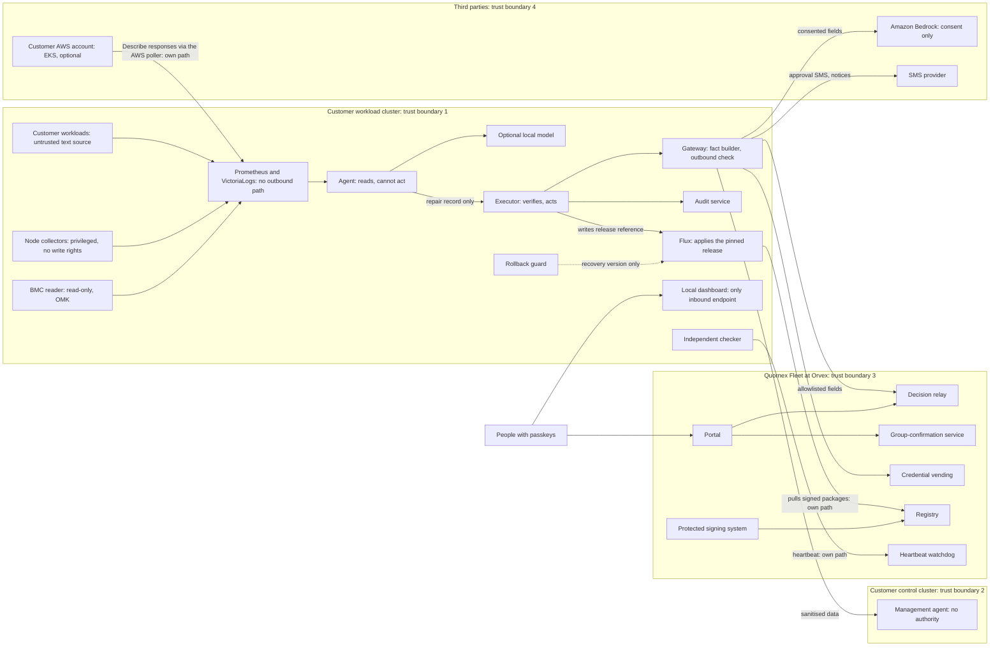

# Nightshift privacy and security review

| | |
|---|---|
| **Date** | 2026-11-15 |
| **Status** | Design review; nothing tested yet |
| **Scope** | Nightshift as designed for OMK bare metal and hosted Kubernetes (EKS): per-node collectors, per-cluster services, the customer control cluster, and the Nightshift parts of Quornex Fleet at Orvex |
| **Covers** | PRD Section 6 (PRIV-1 to PRIV-9, SEC-1 to SEC-10), including untrusted log text and a compromised agent, as PRD Section 11 requires |
| **Readers** | Orvex engineers and the sponsor |
| **Sources** | [Architecture spine](ARCHITECTURE-SPINE.md) (AD-1 to AD-72) · [Orvex architecture document](architecture-orvex.md) (§4 trust and approvals, §5 security boundaries) · [Appendix A: outbound flows](appendix-a-outbound-flows.md) · [Appendix B: PRD changes AP-1 to AP-20](appendix-b-proposed-prd-changes.md) · [PRD](../../prds/prd-nightshift-2026-10-28/prd.md) Sections 6, 10 and 11 · review reports in [reviews/](reviews/) |

**How to read the ids.** AD-n is a decision in the spine; AP-n a PRD change from the architecture (appendix B); PRIV-n, SEC-n, FR-n and NFR-n are PRD requirements; D1 to D15 and A1 to A20 are review decisions recorded in the architecture decision log (`.memlog.md`); "flow n" is a row in appendix A. "Orvex §n" is a section of the Orvex architecture document.

---

## 1. Summary

**What is protected.** Two things: customer data, and the power to change a customer's cluster. Raw logs, metrics, secrets, application content and source code are meant to stay in the cluster they came from (PRIV-1, PRIV-2). The power to change a cluster is meant to come only from people's signatures, checked inside that cluster (SEC-9, AD-17).

**How.** The design separates reading from acting and from sending:

- **The agent reads untrusted text but cannot act.** It can only create a repair record (AD-3, AD-5). A separate executor runs repairs, and only from the signed repair catalogue, after checking the evidence, the authorisation and the safety conditions itself (SEC-8, AD-8, AD-12).
- **Everything that leaves is built, not filtered.** The gateway assembles each outbound message from typed, allowlisted fields, never from log text, then runs the outbound check and the consent check (AD-26, PRIV-3, PRIV-4). Three narrow paths leave outside the gateway, each with its own purpose-specific controls (AD-67).
- **Every channel needs the customer's permission.** External AI is opt-in with nothing preselected. The approval SMS has its own opt-in permission. Only the Fleet service channel is required, and its exact fields are disclosed at onboarding (PRIV-8, PRIV-9).
- **Authority is a signature checked in the cluster.** Approvals and settings are signed with people's passkeys and verified by the executor. The portal, relay and Fleet only carry them (AD-17, AD-41). A stop beats any approval (AD-22).
- **Compromise is planned for, component by component.** Orvex §5.3 states what each compromised part can and can't do.

**Top remaining risks** (detail in Part B):

1. Someone with **cluster-admin or node root** (Orvex on OMK; the account operator on EKS) can read Nightshift's keys and rewrite its in-cluster state. This is a documented limit, not something the design prevents (SEC-10, AD-72).
2. A **compromised portal** can misdescribe a pending repair. A person who doesn't read the SMS could approve a different repair, though only one that is genuinely pending and passes every check (AD-18).
3. A **compromised gateway** sees SMS codes. It can send misleading texts to roster phones and run up SMS costs. Against it, the SMS adds no proof of possession; the passkey signature remains (AD-18, A6).
4. A **compromised portal together with the group-confirmation service** could skip the SMS step in a group approval without the clusters noticing (AD-48).
5. **Network containment, admission rules and AI credential isolation** are designed but unproven on either platform (AD-67, AD-69, AD-36).

**No control in this review has been tested.** Every statement below describes the design. Where this document says a control "limits" or "blocks" something, read it as "is designed to"; Part C lists the tests that would show whether it does.

---

## 2. Assets and trust boundaries

### 2.1 Assets

| Asset | Where it lives | Main protections (design) |
|---|---|---|
| **Customer data**: application data, databases, backups, Kubernetes Secrets | Workload clusters | Nightshift never modifies or deletes them, with or without approval; the catalogue pipeline rejects such actions and the executor refuses them (AD-59) |
| **Logs and metrics** (may hold personal data, tokens, injected text) | VictoriaLogs and Prometheus in the cluster | No outbound path from the log store (AD-26); collection limited to the signed read scope, app and code sources off until opted in (AD-61) |
| **Source code** | Customer repositories, read only with consent | Separate source-code consent, secret scanning and the outbound check (PRIV-6, AD-38) |
| **Audit records** | Audit service, own volume | Append-only, hash-chained; signed checkpoints leave on the heartbeat, so destruction is detectable, not recoverable (AD-16, AP-1) |
| **Approvals, ticks, policies, consent, channel permissions** | Signed objects in the cluster | Person-signed, versioned, time-limited, verified where used (AD-17, AD-24, AD-54) |
| **In-cluster keys** (receipt, audit) | Executor- and audit-owned Secrets | Made at installation; receipt public key pinned (AD-23, AD-40). Readable by cluster-admin (AD-72) |
| **Orvex signing keys** (release, catalogue, policy, people-list, relay, group-confirmation) | Protected signing system at Orvex | One key per purpose under an offline root; two reviewers for release, catalogue and policy signing (AD-40, AD-56) |
| **Rosters and passkeys** | Signed rosters in the cluster; passkeys on people's devices | Changes signed by an existing admin; the installer never enrols (AD-19) |
| **BMC credentials** (OMK) | Credentialed adapter | Read-only in v1 (SEC-3, AD-62) |
| **AI credentials and spend** | Fleet credential vending; gateway | 15-minute per-cluster credentials; no hard per-cluster cap claimed (AD-36) |
| **Fleet** (relay, registry, group-confirmation, credential vending, correlation, rollout) | Orvex | No approval authority; clusters connect out only (AD-41, AD-42) |

### 2.2 Trust boundaries

The diagram is simplified: arrows show the direction of data or authority, while connections always start from the cluster (AD-42). The registry arrow stands for Flux pulling signed packages named by the executor's release reference (AD-43, AD-68), and the AWS arrow for the optional poller's read-only calls (AD-32). The local dashboard is reached only through the customer's internal network (AD-51).

| Boundary | What crosses it | Control at the crossing |
|---|---|---|
| Workload → Nightshift stores | Logs, metrics, names: all untrusted | Treated as evidence, never instructions (SEC-1); workload data can't establish a safety precondition (AD-65) |
| Agent → executor | A repair record (RepairRun) only | Executor re-checks catalogue match, evidence, authorisation and preconditions (AD-5, AD-12, AD-17) |
| Cluster → anywhere outside | Only flows listed in appendix A | Gateway fact builder and checks; three own paths with purpose-specific controls; a flow not in the table is not allowed (AD-26, AD-67, AD-70) |
| Fleet / portal → cluster | Signed decisions, releases, policies, key lists | Pulled by the cluster; every signature verified in the cluster; Fleet holds no cluster credentials (AD-41, AD-42) |
| Person → cluster | Passkey assertion over a decision statement D | Executor verifies against the roster, the nonce, validity and role (AD-17) |
| Cluster-admin / node root → Nightshift | Everything in the cluster | Not a protected boundary: a documented limit (AD-72) |

### 2.3 What differs between OMK and EKS

| Topic | OMK bare metal | EKS |
|---|---|---|
| Who holds cluster-admin and node root | Orvex (manages OS and Kubernetes) | Whoever operates the AWS account (layout to confirm) (AD-72) |
| Hardware access | BMC reader, read-only, listed BMCs only; BMC-to-node UUID check (AD-62) | No BMC; instance state from the optional AWS poller (AD-32) |
| Third outbound path outside the gateway | None | Optional AWS poller to the customer's own account, read-only (flow 16) |
| Instance metadata | Not applicable | Pods can't reach IMDS (AD-67) |
| Egress enforcement | Depends on the OMK network plugin (unknown) (Orvex §13.2) | Depends on the EKS network plugin configuration; to test (AD-67) |
| Optional key hardening | TPM-backed storage, to verify (AD-72) | AWS KMS, to verify (AD-72) |
| Kubernetes audit logs | Orvex audit policy (AD-5) | Control-plane audit log type enabled; CloudWatch charges (AD-5) |
| Local dashboard reachability | Customer ingress or load balancer (unknown) (AD-51) | Internal load balancer (AD-51) |

---

## 3. Threat model: actors and entry points

| # | Actor or entry point | Goal | Main design response | Part B |
|---|---|---|---|---|
| T1 | **Untrusted log text, names, BMC strings, model output** (prompt injection) | Steer the AI to a harmful repair; mislead an approver; carry data out | Agent can't act; signed catalogue only; two independent signals; outbound from typed fields; decisions shown from D and catalogue fields, never AI text (SEC-1, AD-34, AD-65, Orvex §5.4) | B6, B7, B12 |
| T2 | **Compromised agent** | Act, approve, exfiltrate | Creates RepairRun only; no credentials; default-deny network (SEC-2, AD-3, AD-5, AD-67) | B7 |
| T3 | **Compromised gateway** | Alter outbound traffic; abuse SMS and AI credentials | Can't change D or the code check, forge passkeys or act (Orvex §5.3) | B2, B10 |
| T4 | **Compromised executor** | Run arbitrary changes | Admission rules limit it to approved catalogue actions; can't pick an out-of-policy release (AD-68, AD-69) | B11 |
| T5 | **Compromised checker** | Silence the heartbeat; force a rollback | Never acts; only reports a failed probation check (AD-33, AD-45) | B22 |
| T6 | **Compromised rollback guard** | Install an arbitrary release | May select only the pre-authorised recovery version (AD-68) | B11 |
| T7 | **Compromised relay** | Withhold decisions; hide a stop | Signs only delivery and status statements; a missing receipt shows a withheld stop (AD-23, AD-41) | B4 |
| T8 | **Compromised registry** | Push a malicious or old release | No publishing authority; signature, digest and downgrade checks in the cluster (AD-43, AD-46) | B13 |
| T9 | **Compromised group-confirmation service** (with the portal) | Skip the SMS; mislead the approver | Can't forge the passkey or change a leaf; customer permissions checked per cluster (AD-48) | B3 |
| T10 | **Compromised credential vending** | Mis-issue AI credentials | Per-cluster role and profile; AWS records compared with gateway reports (AD-36) | B9 |
| T11 | **Compromised portal** | Misdescribe repairs; show false status | Holds no key the executor accepts as a person; independent stop confirmation (AD-17, AD-23) | B1, B4 |
| T12 | **A compromised customer cluster** | Reach others; poison correlation | Own identities; reports bound to cluster identity and rate-limited; Fleet never connects in (AD-42, AD-47) | B14 |
| T13 | **Cluster-admin or node root** | Anything in the cluster | Documented limit; limited roles; temporary, approved Orvex admin access (SEC-10, AD-72) | B5 |
| T14 | **SMS provider, SIM swap** | Intercept codes | SMS is one factor; the passkey assertion over D is still needed (AD-18) | B2 |
| T15 | **AI provider** | Retain or train on prompts | Consent only; retention "none" per Region; fact-builder fields only (AD-26, AD-35) | B8 |
| T16 | **Supply chain** (images, packages, weights, catalogue) | Introduce malicious code | Signed artefacts; image digests checked against the signed manifest; two reviewers (SEC-5, AD-37, AD-40, AD-43) | B13 |
| T17 | **Insider at Orvex**, or the installer | Approve alone; change rosters; enrol as admin | Two distinct people for risky customer-app repairs; two-reviewer signing; installer never enrols (AD-19, AD-20, AD-40) | B5, B15 |
| T18 | **Management agent** | Control workload clusters | No authority; workload clusters connect out to it (AD-66) | — |
| T19 | **Privileged collectors, BMC network** | Node escape; hardware pivot | Minimal pods, no write rights; BMC reader read-only (AD-3, AD-62) | B16, B17 |

---

## 4. Controls, remaining risks and validation

### Part A. Specified design controls

"Specified" means decided in the design and written into the spine and the PRD. None is built or tested.

#### A.1 Privacy

| # | Decision | What it does | Ids |
|---|---|---|---|
| P1 | **Positive-schema fact builder** | Outbound messages on the gateway path are assembled from typed, allowlisted fields per channel (failure code, catalogue ID, numbers, durations, placeholders), never from log text. Redaction is never the primary protection | AD-26, PRIV-2, PRIV-3 |
| P2 | **Raw logs never leave** (design rule) | The log store has no outbound path. A hosted model short of context gets the local model or a person, never richer data | AD-26, PRIV-1 |
| P3 | **Mandatory outbound check** | Every line leaving through the gateway is tested after sanitising; the three own paths use purpose-specific controls instead (fixed-schema validator, digest and signature rules, defined Describe operations) | PRIV-4, AD-27, AD-67, AP-8 |
| P4 | **Consent per channel** | Nothing leaves by a channel the customer hasn't permitted. External AI is opt-in, nothing preselected, naming provider, Regions and jurisdiction. Fleet reports, notifications and the portal start ticked as service settings, confirmed by an authenticated customer admin, never the installer. The gateway checks consent and channel permission before every send | PRIV-8, PRIV-9, AD-54 |
| P5 | **Fleet service channel, exact fields** | The one required channel: heartbeat (agent ID, timestamp, status, five checkpoint fields); status and key-list requests (cluster identity, versions, sequence numbers); downloads (cluster identity, digests or versions); policy and roster requests (cluster identity, versions); a fixed attention marker. Minimal service metadata; no raw logs, secrets or application content. Disclosed at onboarding | PRIV-9, AD-27, AD-70, flows 1, 6, 6a, 15 |
| P6 | **Approval-SMS permission** | Code message and post-decision notice need their own opt-in permission naming the SMS provider and fields (action, target, code); separate from notifications | PRIV-3, PRIV-9, FR-14, AP-2 |
| P7 | **Per-customer AI Regions** | Permitted Regions set per customer (customers are worldwide; Frankfurt is only the cost example); cross-Region routing only if explicitly permitted | AD-35, D4 |
| P8 | **Bedrock, retention "none"** | One provider initially; retention "none" set and enforced in every Region a route can use, since it doesn't propagate; pinned model; prompt logging off | AD-35, AD-36 |
| P9 | **Local model output boundary** | Text from a model that has seen raw logs stays in the cluster, even after redaction; a local model given only approved fields may draft remote wording, which then passes the outbound checks | AD-34, D8 |
| P10 | **Consent holds in Fleet** | Reports carry the customer's consent state; Fleet and fleet learning never pass a non-consenting customer's data to external AI. A shared GPU would count as external AI (none in v1) | AD-37, AD-63 |
| P11 | **Source code only under separate consent** | Off until opted in; relevant files only, after secret scanning and the outbound check | PRIV-6, AD-38 |
| P12 | **Customer isolation in Fleet** | Correlation on allowed fields only; customers see only their own clusters | AD-47, PRIV-5 |
| P13 | **Evidence for the customer** | A record of what left; planted-secret tests reported with their scope; an outside audit | PRIV-7 |

#### A.2 Security

| # | Decision | What it does | Ids |
|---|---|---|---|
| S1 | **Read-only agent** | Reads untrusted data; can only create a RepairRun; no credentials | SEC-8, AD-3, AD-5 |
| S2 | **Separate executor** | Acts only from the signed catalogue after its own checks of authorisation, evidence and preconditions; dangerous entries are manual steps only | SEC-8, AD-8, AD-12, AD-60 |
| S3 | **One pod and identity per sensitive role** | Agent, executor, gateway, audit, hardware adapter, checker, rollback guard | AD-3 |
| S4 | **Signed decisions verified in the cluster** | Cluster-built decision statement D; executor checks roster, origin, nonce, unused `decision_id`, validity, role, distinct approvers, stops, mode, preconditions | SEC-9, AD-17 |
| S5 | **Option B approvals** | Passkey, a cluster-written SMS code bound to the decision, then a fresh passkey assertion over D. Passkey-only only where a signed policy allows it, recorded as reduced assurance. Pending feasibility and usability tests | AD-18, AP-2 |
| S6 | **Stop beats go** | Any valid stop beats any approval; stops go before queued work and have reserved audit space | AD-22, A11 |
| S7 | **Receipts and independent stop confirmation** | Receipts signed by the cluster's pinned key; "Sent — not yet effective in the cluster" until then; after a stop, the cluster notifies the person through the gateway (not portal or relay) and shows the receipt locally | AD-23, AP-3, A2 |
| S8 | **Validity tiers by required authority** | Stale (from 1 h): Orvex-authority permissions pause. Expired (24 h): only customer-only safe ticked repairs continue. Signed sequence numbers and monotonic timers resist clock rollback; restores block actions until reconciled | AD-24, AP-4, A5, E18 |
| S9 | **Default-deny network, three bypass paths** | All Nightshift pods deny by default; only heartbeat, Flux pulls and the optional AWS poller bypass the gateway, each with defined destinations, operations, fields, authentication and limits; no IMDS on EKS | AD-67, AP-8 |
| S10 | **Admission limits** | Executor changes restricted to approved catalogue actions and fields; it can't edit the rules. Image verification fails closed, scoped to Nightshift; workloads never blocked | AD-64, AD-69, A9 |
| S11 | **Release reference and rollback guard** | Flux applies only a digest-pinned reference written by the executor after signature, policy and downgrade checks; the guard can set only the pre-authorised recovery version | AD-43, AD-45, AD-46, AD-68 |
| S12 | **Signing keys under an offline root** | One key per purpose; two-person offline root; signed key list with rotation and revocation; relay, registry and group service carry no authority | SEC-5, AD-40, AD-41 |
| S13 | **Clusters connect out only** | Fleet and portal hold no cluster credentials; the local dashboard is the only inbound endpoint, internal only | AD-42, AD-51 |
| S14 | **First-admin enrolment** (provisional) | First install authorised by the verified contract contact; split single-use code, one half local, one half to the contact; installer never enrols | SEC-7, AD-19, AD-71, AP-9 |
| S15 | **Cluster-admin as a documented limit** | Stated, not assumed away; limited roles; temporary, approved, recorded Orvex admin access | SEC-10, AD-72 |
| S16 | **BMC read-only** | Health and power status only; power actions manual; readings used only when BMC and node UUIDs match | SEC-3, AD-62 |
| S17 | **Prompt-injection controls** | S1, S2, evidence rules, typed outbound fields, trusted text in decisions, queue caps, engineer review of code fixes | SEC-1, Orvex §5.4 |
| S18 | **Group approvals = Orvex technical approval only** | Each cluster checks its own leaf, that G matches its D, and customer permissions | AD-48 |
| S19 | **People, not roles, are counted** | Risky customer-app repairs need two different people; Orvex support only under a customer-signed delegation | AD-20 |
| S20 | **Fleet-wide switch-off and prohibited actions** | A switch-off is a stop no tier re-enables; customer records, databases, backups and Secrets are never changed | SEC-6, AD-57, AD-59 |

### Part B. Remaining risks

**Residual** means reduced but present; **accepted** means deliberately left, with the reason.

| # | Risk | Type and why | Mitigation | Ids |
|---|---|---|---|---|
| B1 | **Compromised portal misleads an approver** into approving a different pending repair | Residual: a passkey signs a hash, not readable text; WebAuthn has no transaction display | The cluster-written SMS names the real action and target; only a genuinely pending repair passing every check can be approved. Depends on the person reading the SMS | AD-18 |
| B2 | **Compromised gateway sees SMS codes**; can alter or drop codes and notices, phish roster phones, run up SMS costs. SIM swap is a separate route | Residual: the gateway carries the message; SMS is a "restricted" authenticator | Passkey over D still required; provider recipient, template, rate and spend limits where supported and verified; Fleet watches provider records. These are not hard caps; the notice is not claimed to detect tampering | AD-18, A6 |
| B3 | **Portal plus group-confirmation service skip the SMS** in a group approval | Accepted: clusters can't see the SMS step; a session fingerprint was rejected because the same service controls the records | Recorded as "passkey + SMS verification attested by Fleet; not independently verified by the cluster"; no forged passkey, changed leaf or customer permission | AD-48, A15 |
| B4 | **Relay hides a stop and the portal shows "effective"** | Residual: status statements prove liveness, not delivery of every stop | Missing receipt; cluster's own post-stop notice (if notifications are on); receipt on the local dashboard | AD-23, AD-41 |
| B5 | **Cluster-admin or node root compromise** (Orvex on OMK; account operator on EKS) | Accepted: in-cluster authority is only as strong as cluster-admin hygiene; encrypted Secrets and non-exportable keys don't stop an authorised admin | Limited roles; temporary approved access; audit logs and external checkpoints give partial tamper detection. Orvex-signed objects and passkeys can't be forged. KMS and TPM optional, to verify | SEC-10, AD-72 |
| B6 | **Attacker-chosen content in allowlisted fields** (names, identifiers) | Residual: typed fields still carry values; name neutralisation is deferred | Names treated as untrusted identifiers; decisions rendered from D and catalogue fields; outbound check | AD-26, O-6 |
| B7 | **Wrong but valid catalogued repair** proposed by an injected or compromised agent; misleading local AI text | Residual: rules confirm a match, and evidence may also fit | Two independent signals; executor re-runs queries; facts shown apart from AI wording | SEC-1, AD-65 |
| B8 | **AI retention or routing differs from configuration** | Residual: retention is per Region; the per-model signal sits on another Bedrock endpoint | Per-Region check before use; Bedrock refuses models needing more retention; route verified per customer | AD-35 |
| B9 | **No hard per-cluster AI spend cap (M2)** | Accepted for v1: credentials last until expiry; accounting is delayed; quotas are account-wide | 15-minute credentials, cells, usage comparison; fallback metering proxy (a real cap, but content passes through Orvex) | AD-36 |
| B10 | **Covert channels**: about 32 bytes per heartbeat via checkpoint fields if the audit service is compromised; typed fields generally | Residual | Fixed schema, rate limits, validator | AD-16, AD-27 |
| B11 | **Admission rules have limits**: API operations only, not hardware; an image-verification outage blocks replacement pods | Accepted: failing closed is safer than a bypass | Coverage verified per action; documented manual restore; guard and install path use their own narrow identities | AD-68, AD-69 |
| B12 | **Code-fix injection through comments** | Residual: code is attacker-influenced text sent to a model | Engineer review and tests reduce, not remove, the risk; never applied automatically; engineer access (flow 14) undesigned | AD-38, C-14 |
| B13 | **Supply chain and signing pipeline** | Residual: signing proves origin, not safety; signing-system operations undefined | Two reviewers on the exact digest; downgrade protection; expiring metadata reveals a held-back cluster | AD-40, AD-46 |
| B14 | **One customer stalling a fleet rollout** | Residual: weighting stop conditions across customers is not designed | Reports bound to cluster identity and rate-limited | AD-47 |
| B15 | **Orvex operators change Fleet's copy of a first-admin pin** | Accepted | The cluster keeps its own pin; changes visible to existing admins | AD-19 |
| B16 | **BMC network as a pivot** (OMK) | Accepted: segmentation belongs to the customer or provider | Reader read-only, listed BMCs only | AD-62 |
| B17 | **Privileged collectors as a node escape** | Residual: egress limits on privileged or host-network pods depend on the network plugin | Minimal pods, no write rights; treated as node compromise; further hardening deferred | AD-3 |
| B18 | **Disconnected clusters learn revocations and portal unticks late** | Accepted | Bounded by the tiers (1 h pause, 24 h stop for Orvex authority); local stops still work | AD-24, AD-40 |
| B19 | **Clock or state manipulation by a compromised host** | Residual | Restore detected on reconnect, actions blocked until reconciled; not while disconnected | AD-24, AD-72 |
| B20 | **Junk requests delay urgent ones** | Residual | Separate caps, reserved urgent capacity; stops always available | AD-2, A10 |
| B21 | **Own-path controls are not equal to the gateway's checks** | Accepted, documented | Defined destinations, operations, fields, authentication, limits; enforcement to verify | PRIV-4, AD-67 |
| B22 | **Shared node or network failure stops heartbeat and gateway together**; a compromised checker can trigger the bounded rollback | Accepted | Missing heartbeat means "not reporting"; rollback only to the pre-authorised, rollback-safe version | AD-27, AD-45 |
| B23 | **Pre-ticked service settings may lack a legal basis** somewhere | Open: basis is the service contract | Admin-confirmed, never the installer; optional channels can be unticked; legal review pending | PRIV-9, PRD §10 item 23 |
| B24 | **Local dashboard allows settings changes, including widening ones** | Accepted (D15, following PRIV-9); edge case 24 proposed narrowing-only | Local passkeys enrolled in advance; exact origin and RP ID; each change audited with a receipt; no approvals there | AD-51 |

### Part C. Validation not yet performed

None of these has been run. Results will be reported with their scope ("no injection succeeded in these tests", "no planted secrets escaped in these tests"), never as proof (PRIV-7, Orvex §5.4).

| # | Test or verification | What it would show | Where | Ids |
|---|---|---|---|---|
| V1 | **Prompt-injection test set**: seeded content in log lines, Kubernetes names, allowlisted fields at maximum length and character range, model responses, BMC strings (OMK) and AWS strings (EKS), code comments | Injected text can't cause an action without a signed match, authorisation and executor checks; can't meet evidence or preconditions alone; can't block stops; doesn't reach outbound messages, approval screens or the SMS | Prototype and pre-release, both platforms | SEC-1, Orvex §5.4 |
| V2 | **Planted-secret tests** through every channel | How well sanitising keeps private data in, within the scope tested | Prototype, then regularly | PRIV-7, PRD §10 item 16 |
| V3 | **Outbound record against captured traffic** | Whether the customer's record of what left is complete | Prototype | PRIV-7, AD-26 |
| V4 | **Default-deny enforcement**, including which plugins enforce egress, host-network and privileged pods, IMDS on EKS | Where the network rules hold; gaps documented | OMK and EKS separately | AD-67, PRD §10 item 33 |
| V5 | **Own-path controls**: heartbeat validator, Flux to registry only, poller to defined Describe calls | Each path carries only its fields to its destination | OMK and EKS (poller EKS only) | PRIV-4, AD-67 |
| V6 | **Admission-rule coverage** per catalogue action and API operation; other identities changing the release reference, Flux settings or trust keys | Executor and others are restricted as designed | OMK and EKS, before build sign-off | AD-68, AD-69 |
| V7 | **Admission outage** and ValidatingAdmissionPolicy support per Kubernetes version | Fails closed; manual restore works | OMK and EKS | AD-69, A9 |
| V8 | **Flux permissions and guard cooperation** | Routine delivery can't touch CRDs, ClusterRoles or webhooks; a broken release isn't reinstalled | OMK and EKS, at build | AD-43, AD-45 |
| V9 | **Image-verification tool** (for example Sigstore policy-controller or Kyverno) | Only digests in the current signed manifest are admitted | At build, both platforms | AD-43 |
| V10 | **M2 AI credentials**: profile isolation, revocation delay, content-free logging, quotas at 10,000 clusters, endpoint compatibility | Whether per-cluster isolation holds, or the metering proxy is needed | Pre-release, AWS | AD-36 |
| V11 | **Bedrock per route**: availability, "none" in every Region, refusals, prices | Each customer route meets zero retention before use | Per customer route | AD-35 |
| V12 | **Option B**: feasibility, usability, 60-second targets, 5-minute code, load at 10,000 clusters | Whether people read the SMS and finish in time | Prototype with users | AD-18, PRD §10 item 32 |
| V13 | **SMS provider controls**: per-cluster credentials, recipient limits, templates, rate and spend limits, usage records | Which abuse limits really exist | Pre-release, per provider | AD-18 |
| V14 | **Receipts and stop confirmation** with a withholding relay and a lying portal | A withheld stop is visible to the person | Prototype | AD-23 |
| V15 | **Clock and restore**: rollback, skew, offline reboots, etcd and ledger restores, reinstalls | Freshness can't be extended; old permissions don't revive | Prototype, both platforms | AD-24, E18 |
| V16 | **Validity tiers and undo-reject window** | Whether 1 h, 24 h and 2 min are workable | Controlled tests | AD-24, PRD §10 item 31 |
| V17 | **Metric and log injection paths** | Whether one actor can forge "two independent signals" | OMK and EKS | AD-65 |
| V18 | **BMC read-only accounts and UUID matching** | When BMC readings can be relied on | OMK hardware | AD-62 |
| V19 | **Fencing procedures** per workload and platform | A node can't write before pods move; until then, escalate | OMK and EKS | AD-62, A3 |
| V20 | **First-admin local access path** | The install identity can't read the local half | OMK and EKS | AD-19, A7 |
| V21 | **Local dashboard** DNS, certificates, routing, origin checks, API outage | Local stops work without the portal | OMK and EKS | AD-51 |
| V22 | **Optional key hardening**: KMS (EKS), TPM (OMK) | Availability, cost, offline use, recovery | Per platform | AD-72 |
| V23 | **Probation dead-man's switch** with a release that breaks the checker or guard | Only the pre-authorised recovery runs | OMK and EKS | AD-45, A8 |
| V24 | **Outside audit** | Independent check of the privacy controls | Before or after first customers | PRIV-7 |

---

## 5. Review findings and how they were handled

| Round | Date | Reviews | Findings | Outcome | Recorded in |
|---|---|---|---|---|---|
| Reconcile | 2026-11-11 | Spine against PRD; spine against other inputs | PRD: 2 critical, 15 high, 10 medium, 8 low. Inputs: 0 critical, 4 high, 8 medium, 12 low | Fixes applied; AP-8 (gateway exceptions) queued | [reconcile-prd.md](reviews/reconcile-prd.md), `.memlog.md` round 9 |
| Reviewer gate | 2026-11-11 | Rubric; reality check; adversarial; security | Rubric 1 critical, 9 high. Reality check 0 critical, 3 high. Adversarial 3 critical, 14 high. Security 1 critical, 10 high (H-1 to H-10; the report's summary table says 9), 13 medium | Decisions D1 to D15 (group approvals, default-deny network, release reference, AI routing, evidence, executor limits, AI output boundary, SMS, keys, connections, operations, release signing, hardware, local dashboard) | [review-security.md](reviews/review-security.md), [review-adversarial.md](reviews/review-adversarial.md), [review-rubric.md](reviews/review-rubric.md), [review-reality-check.md](reviews/review-reality-check.md), `.memlog.md` |
| Re-review | 2026-11-11 | Light recheck after D1 to D15 | 58 earlier critical and high findings: 40 resolved, 1 deferred, 17 open or partly open; new contradictions introduced by the fixes | Consistency fixes applied; the spine was finalised. These later fixes were not independently re-checked | [review-recheck.md](reviews/review-recheck.md), `.memlog.md` |
| bmad-review | 2026-11-15 | Orvex document: adversarial, edge cases, structure, prose | 20 adversarial, 25 edge cases, 18 structure, 40 + 9 prose | Editorial changes applied; 26 items needing a decision were decided (A1 to A20 and edge cases), giving AD-72 and amendments to 15 ADs. Edge case 24 not applied (conflicts with D15) | [bmad-review-2026-11-15/](reviews/bmad-review-2026-11-15/README.md), [applied-changes.md](reviews/bmad-review-2026-11-15/applied-changes.md), `.memlog.md` |
| Focused consistency check | 2026-11-15 | Amended decisions against all documents | 8 high (for example: a restore could lose applied stops; stops when audit storage is full; first install with no admin) | All adopted: restore reconciliation, reserved stop audit space, first-install authorisation by the contract contact | [consistency-check.md](reviews/bmad-review-2026-11-15/consistency-check.md), `.memlog.md` |
| Prompt-injection plan | 2026-11-15 | Focused decision | — | Controls and limits documented without absolute claims; validation planned, not run (Part C, V1) | Orvex §5.4, `.memlog.md` |
| PRD update | 2026-11-15 | Architecture changes into the PRD | AP-1 to AP-20 | Adopted, including SEC-10 and the Fleet service channel | [Appendix B](appendix-b-proposed-prd-changes.md) |

Two points matter for reading this review honestly. First, every review so far was a read-only review of documents; nobody has attacked a running system. Second, the fixes after the 2026-11-11 re-review and the 2026-11-15 decisions were checked for consistency, but not by a fresh full security review.

---

## 6. Open questions for Orvex

| # | Question | Why it matters | Ids |
|---|---|---|---|
| Q1 | **What is the legal basis for the pre-ticked service settings** (Fleet reports, notifications, portal) in each customer's jurisdiction? | Their basis is the service contract, not consent; customers are worldwide | PRIV-9, PRD §10 item 23 |
| Q2 | **Which network plugin does OMK use, and does it enforce egress policy?** | Default-deny containment depends on it | AD-67, Orvex §13.2 |
| Q3 | **Do OMK servers support Redfish read-only roles, and can BMC UUIDs be matched to nodes?** How is the out-of-band network segmented? | BMC read-only access and the pivot risk | AD-62, B16 |
| Q4 | **Who holds cluster-admin and node root day to day, and how is temporary full access approved and recorded** on OMK? Who operates EKS accounts and nodes? | Cluster-admin is the largest accepted risk | AD-72, B5 |
| Q5 | **How should code-fix engineers access the isolated test environment**, under what consent and through which channel? | Flow 14 has no design | PRD §10 item 27, C-14 |
| Q6 | **Which hosted models and Regions count as "trusted"** beyond consent and zero retention? | Defines which AI routes may be offered per customer | PRD §10 item 6, AD-35 |
| Q7 | **Which SMS provider**, and does it support per-cluster credentials, recipient restrictions, fixed templates and spending limits? | Decides how much of B2 is reduced | AD-18 |
| Q8 | **How does Orvex verify the customer's contract contact** independently of installation? | The first-admin enrolment rests on it | AD-19, AD-71 |
| Q9 | **Which identity system and hosting will Fleet use**, and who operates the signing system (root ceremony, backups, rotation)? | Fleet and signing-key protection | AD-40, AD-71 |
| Q10 | **Should releases that change the executor, gateway or audit path get extra review?** | These components hold the main security boundaries | Orvex §13.2 |
| Q11 | **Would customers want a customer-controlled audit backup or export?** | Audit destruction is detectable but not recoverable in v1 | AD-16 |
| Q12 | **Is the metering-proxy fallback acceptable** if M2 isolation fails, given that content would then pass through Orvex? | Trade-off between a hard spend cap and data path | AD-36, B9 |
