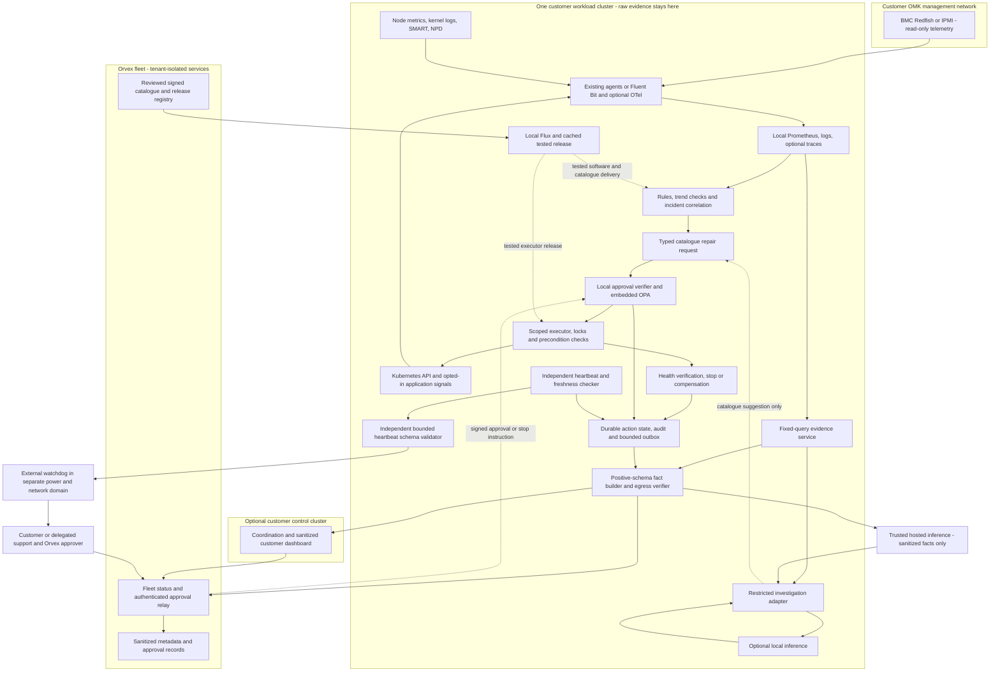

# Nightshift: open-source architecture research

## Executive recommendation

Build Nightshift around **local deterministic detection and a small, typed repair controller**. Reuse existing telemetry, storage, policy evaluation and delivery systems. Keep AI investigation outside the execution trust boundary. Put fleet coordination above this local loop, so loss of Orvex connectivity removes central convenience rather than local safety.

The proposed MVP stack is Prometheus and Alertmanager; node_exporter, kube-state-metrics and node-problem-detector where the platform permits; Fluent Bit and a local log store; SMART plus read-only Redfish/IPMI on OMK; an independent heartbeat checker and an off-cluster watchdog; controller-runtime with embedded OPA; authenticated approval adapters; existing Quornex identity; Flux for tested release distribution. Evaluate K8sGPT analyzers and a restricted HolmesGPT integration for explanations. Support hosted models through a service that constructs outbound requests using only explicitly allowed fields and local models through a separate in-cluster endpoint. The comparison below distinguishes reusable products from the Nightshift controls that still require development.

**Enterprise scale should preserve these boundaries, not replace them with one central brain.** Benchmark VictoriaMetrics for metrics economics, OCM for fleet inventory/placement, NATS JetStream for asynchronous sanitized events, and Temporal for long-running management workflows. Add these when the existing Quornex platform does not already solve the same need. Do not install a full workflow engine, search cluster, secrets server and GPU in every small cluster by default.

Three findings drive the recommendation:

1. Strong OSS building blocks exist, but their combination does not implement Nightshift's approval, privacy, repair-conflict or data-protection requirements automatically.
2. Hardware diagnosis needs host, out-of-band management and external perspectives. Total power/network loss cannot be diagnosed or repaired reliably by software running only inside the failed cluster.
3. Always-on telemetry and per-node agents can dominate fleet resource costs. AI should be invoked after deduplication and deterministic checks, with explicit request budgets.

**Status:** a production-oriented architecture proposal for review, not a production certification. No benchmark, security audit or 10,000-cluster deployment of this assembled design was performed. Product facts below are supported by primary sources; sizing, comparative fit and rollout thresholds are explicitly proposed estimates. Exact stable versions must be pinned at implementation freeze.

**Navigate:** [Executive recommendation](#executive-recommendation) · [Requirements and evaluation method](#1-requirements-and-evaluation-method) · [Comparison matrix: observation, hardware and diagnosis](#2-comparison-matrix-observation-hardware-and-diagnosis) · [Comparison matrix: execution, privacy and fleet](#3-comparison-matrix-execution-privacy-and-fleet) · [What Nightshift should reuse, extend and build](#4-what-nightshift-should-reuse-extend-and-build) · [Proposed architecture and trust boundaries](#5-proposed-architecture-and-trust-boundaries) · [Safety, disconnected operation and external observers](#6-safety-disconnected-operation-and-external-observers) · [OMK hardware and EKS capability matrix](#7-omk-hardware-and-eks-capability-matrix) · [AI, privacy and customer isolation](#8-ai-privacy-and-customer-isolation) · [Resource overhead and 10,000-cluster economics](#9-resource-overhead-and-10000-cluster-economics) · [Maintenance, security and maturity assessment](#10-maintenance-security-and-maturity-assessment) · [Trade-offs, contrary evidence and reversal conditions](#11-trade-offs-contrary-evidence-and-reversal-conditions) · [Prioritized proof-of-concept plan](#12-prioritized-proof-of-concept-plan) · [Open decisions for architecture review and Party Mode](#13-open-decisions-for-architecture-review-and-party-mode) · [Evidence appendix and refresh policy](#14-evidence-appendix-and-refresh-policy)

## 1. Requirements and evaluation method

Read as project context: current PRD and PRD addendum, final brief and brief addendum, Danny's Q&A, requirements checklist and earlier research/extraction notes. Current PRD decisions take precedence over older interpretations. Its unfinished sections are requirements still to settle, not permission to invent behavior.

Hard gates: local operation during management disconnection; raw logs/secrets remain in the originating cluster; fixed tested repairs; read access independent from write authority; explicit customer/Orvex approval rules; no direct customer-data/database/backup mutation; provider-aware EKS operation; report uncertainty when evidence cannot distinguish causes.

Selection priorities after these gates: safety/isolation 30%, operational maturity and maintenance 25%, fleet cost/resource burden 20%, integration and disconnected behavior 15%, portability and exit cost 10%. These are proposed review weights, not user-approved business priorities. The report uses qualitative comparisons rather than invented benchmark scores. A candidate with unverified hardware support or untested safety controls does not pass a production gate merely by scoring well elsewhere.

Evidence labels:

- **Documented:** maintainer documentation/repository supports the specific fact. Confidence medium unless independently reproduced. Repository license is not a review of every dependency, model weight or commercial edition.
- **Recommendation:** engineering inference under Nightshift's constraints.
- **Estimate:** planning arithmetic or initial benchmark envelope, not observed usage.
- **Unverified:** no adequate source, test or current compatibility evidence obtained. No candidate receives a blanket “secure” or “10k proven” label.

The search covered major viable categories and alternatives, not every OSS repository. Source and maintenance details are retained in [evidence digests](digests/). Project/vendor scale claims remain vendor claims. Official documentation and GitHub are not independent third-party validation; that limitation follows the requested source policy.

## 2. Comparison matrix: observation, hardware and diagnosis

Licenses are upstream core licenses observed on 2026-10-29. **MVP** means a production pilot after the stated tests; a one-VM demonstration may use a smaller configuration.

| Component | Strong options and licenses | Production/security/scaling limitations | MVP recommendation | Enterprise consideration |
|---|---|---|---|---|
| Metrics storage/rules | [Prometheus](https://github.com/prometheus/prometheus), Apache-2.0; [VictoriaMetrics OSS](https://docs.victoriametrics.com/victoriametrics/), Apache-2.0 | Prometheus local TSDB is not replicated; bound series churn, retention and query use. VictoriaMetrics has separate Enterprise features; MetricsQL compatibility and resource savings need workload tests. | Existing Prometheus; otherwise local Prometheus with bounded retention and local rules. | Benchmark VictoriaMetrics single-node locally and its cluster edition for approved central aggregates; retain local evaluation. No automatic migration solely because fleet reaches 10k. |
| Collection pipeline | [Fluent Bit](https://github.com/fluent/fluent-bit), Apache-2.0; [OTel Collector](https://github.com/open-telemetry/opentelemetry-collector), Apache-2.0; [Vector](https://github.com/vectordotdev/vector), MPL-2.0 core | Filesystem queues consume disk and can overflow. OTel component stability varies; Vector has buffer minimums and experimental configurations. Host logs require sensitive mounts. | Fluent Bit for node logs; OTel only when OTLP/tracing or existing deployment justifies it. | Standardize one primary agent per signal; use minimal OTel distributions or Vector when transformations warrant it. Avoid duplicate collection. |
| Local log backend | [Loki](https://github.com/grafana/loki), AGPL-3.0; [OpenSearch](https://github.com/opensearch-project/OpenSearch), Apache-2.0 | Loki needs explicit auth and label discipline; filesystem examples are not a production storage plan. OpenSearch adds JVM/index/replication operations. Both can store sensitive evidence. | Reuse local backend; otherwise evaluate Loki for stream/time queries with supported local-boundary storage. A VM prototype can query bounded local files. | OpenSearch only if indexed full-text needs justify cost; Loki with appropriate object storage/HA for larger customer clusters. No central raw-log lake under current privacy rule. |
| Kubernetes/node state | [node_exporter](https://github.com/prometheus/node_exporter), [kube-state-metrics](https://github.com/kubernetes/kube-state-metrics), [NPD](https://github.com/kubernetes/node-problem-detector), all Apache-2.0 | Complementary host metrics, object state and node conditions; not interchangeable RCA engines. NPD writes conditions/events; exporter host access is privileged visibility. | Reuse existing exporters; add missing signals and vetted NPD checks. | Scope API watches/labels, test version support and reduce duplication with cloud-native node detection. |
| Disk health | [smartctl_exporter](https://github.com/prometheus-community/smartctl_exporter), Apache-2.0; [Scrutiny](https://github.com/AnalogJ/scrutiny), MIT | Device/RAID passthrough differs; SMART does not predict every failure. Scrutiny describes itself as work in progress and adds a database/UI. Both require device access. | smartctl_exporter where actual disks are visible. | Scrutiny for specialist local history if validated; keep one source of disk metrics. No SMART promise for virtual EKS disks. |
| BMC telemetry | [ipmi_exporter](https://github.com/prometheus-community/ipmi_exporter), MIT; [fishymetrics](https://github.com/comcast/fishymetrics), Apache-2.0 | IPMI's FreeIPMI dependencies and Redfish vendor/firmware differences need testing. Protect target parameters, management networks and credentials; some exporters perform pre-actions. | Prefer tested Redfish/fishymetrics for supported hardware; IPMI exporter fallback. Collect from a management segment using read-only accounts. | Maintain a certified vendor/firmware capability matrix; a small typed Redfish adapter may be safer than extending an exporter with write operations. |
| Independent watchdog | [Healthchecks](https://github.com/healthchecks/healthchecks), BSD-3-Clause; [blackbox_exporter](https://github.com/prometheus/blackbox_exporter), Apache-2.0; Uptime Kuma evaluated in supplemental digest | Missed push heartbeat and failed active probe are different evidence. A probe depending on the same failed Prometheus cannot detect its evaluator's death. | Healthchecks outside the cluster plus local independent API/freshness checker. Use blackbox probes for service reachability. | Separate regional failure domains, independent alert transports and an external observer of the fleet watchdog itself. |
| Prediction | [Prometheus rules/functions](https://prometheus.io/docs/prometheus/latest/querying/functions/#predict_linear), Apache-2.0; [River](https://github.com/online-ml/river), BSD-3-Clause; [PyOD](https://github.com/yzhao062/pyod), BSD-2-Clause | Linear gauge forecasts are not general failure prediction. Libraries lack Nightshift's labels, feature pipeline, calibration and action policy. | Thresholds, sustained trends, freshness and time-to-exhaustion estimates with uncertainty. | River online models or PyOD offline comparisons in shadow mode, promoted only after time-ordered evaluation improves incident outcomes. |
| AI investigation/RCA | [HolmesGPT](https://github.com/HolmesGPT/holmesgpt), [K8sGPT](https://github.com/k8sgpt-ai/k8sgpt), [kagent](https://github.com/kagent-dev/kagent), Apache-2.0 | Broad tools and default configurations can exceed Nightshift's permissions. No retrieved result establishes true causal accuracy or safe execution for this fleet. kagent is a larger agent platform. | K8sGPT analyzer baseline; restricted HolmesGPT as a parallel PoC. Fixed evidence tools, no shell/remediation credentials. | Adopt whichever beats deterministic baseline on representative cases; extend adapters upstream rather than maintain a broad fork. Defer kagent unless its lifecycle platform is independently needed. |
| Traces/application visibility | [Jaeger](https://github.com/jaegertracing/jaeger), Apache-2.0; [Tempo](https://github.com/grafana/tempo), AGPL-3.0 | Opt-in instrumentation, sampling, local storage and sensitive attributes must be designed. Request bodies and trace names can reveal customer data. | Existing OTel instrumentation/backend only; do not mandate tracing for every cluster. | Compare local Jaeger/Tempo on actual traces; eBPF application capture such as Pixie is a separate consent/privilege evaluation. |

Metrics persistence and queue semantics are documented in [Prometheus storage](https://prometheus.io/docs/prometheus/latest/storage/), [OTel resilience](https://opentelemetry.io/docs/collector/resiliency/), [Fluent Bit buffering](https://docs.fluentbit.io/manual/data-pipeline/buffering.md) and [Vector buffering](https://vector.dev/docs/architecture/buffering-model/). Loki needs an [authentication layer](https://grafana.com/docs/loki/latest/operations/authentication/); OpenSearch production setup must replace demo credentials/certificates and plan replicas/snapshots, as its [installation guide](https://docs.opensearch.org/latest/install-and-configure/install-opensearch/index/) explains.

### Broader monitoring alternatives screened

**Zabbix** is a credible integrated infrastructure/network monitoring alternative, AGPLv3 from version 7.0, with an explicit [LTS lifecycle](https://www.zabbix.com/life_cycle_and_release_policy) and [license policy](https://www.zabbix.com/license). Its [proxy documentation](https://www.zabbix.com/documentation/current/en/manual/distributed_monitoring/proxies) documents buffered collection during unreliable communications, including SNMP/IPMI, but proxies do not evaluate triggers or send alerts. A central-server/proxy topology therefore fails Nightshift's local-decision requirement by itself. Reuse Zabbix as an evidence source if already deployed; a local server is an alternative only after budgeting its database and operations. Keep remote commands outside AI authority.

**Netdata Agent** is GPLv3+ and bundles collection, storage, ML and alerts. Its [repository](https://github.com/netdata/netdata) distinguishes the OSS agent from closed-source UI/Cloud components. The [v2.12.0 release notes](https://github.com/netdata/netdata/releases) describe a new Redfish collector and early-access traces; these features are not long-established production evidence. It is a useful consolidation challenger for a lab benchmark against the exporter stack. Do not assume its dashboards/cloud are fully OSS or disconnected, or treat its anomaly scores as calibrated failures. Its actual comparative footprint and new hardware coverage remain unverified.

## 3. Comparison matrix: execution, privacy and fleet

| Component | Alternatives and licenses | Limitations / integration work | MVP recommendation | Enterprise consideration |
|---|---|---|---|---|
| Repair workflow | [controller-runtime](https://github.com/kubernetes-sigs/controller-runtime), Apache-2.0; [Argo Workflows](https://github.com/argoproj/argo-workflows), Apache-2.0; [Temporal](https://github.com/temporalio/temporal), MIT; [StackStorm](https://github.com/StackStorm/st2), Apache-2.0 | Controller is a library, not a complete safe-repair product. Argo needs template and parameter lockdown. Temporal needs durable services/datastore; StackStorm has a substantial dependency footprint. | Small controller owning typed repair resources and fixed compiled handlers. Argo is viable if already operated locally and locked down. | Temporal for long management workflows, or Argo for substantial local DAGs; local authorization still gates every mutation. StackStorm mainly if already the operations standard. |
| Node recovery/fencing | [Medik8s NHC](https://github.com/medik8s/node-healthcheck-operator) + [SNR](https://github.com/medik8s/self-node-remediation), Apache-2.0; provider-native repair; typed Redfish recovery | Partition handling, safe-state timeouts, minimum topology and privileged access are release-specific. Reboot is not application/data recovery. | Detection and escalation first; only catalogue-approved mitigation. Do not enable generic automatic fencing by default. | NHC/SNR or fence-agent integration after storage/fencing tests; provider-owned pools delegate node repair. |
| Policy evaluation | [OPA](https://github.com/open-policy-agent/opa), Apache-2.0; [Cedar](https://github.com/cedar-policy/cedar), Apache-2.0 | Neither supplies durable approvals, truthful evidence or execution locking. Standalone OPA authentication is off by default. | Embed OPA in Go executor, default deny; test every catalogue action. | Cedar wins if entity-oriented authorization and existing team expertise dominate. Preserve a policy interface and conformance tests. |
| Human approvals | Typed Nightshift approval service using existing IdP; Argo suspend/resume; Temporal signal-based workflow | Suspend/resume and signals provide mechanisms, not customer delegation, exact-action binding or protection from replay. A timed resume is not consent. | Develop exact approval semantics; portal first, signed Slack requests through an adapter. | Workflow engine may host the wait; same local verifier, expiry and revalidation contract. |
| Privacy minimization | [OTel redaction](https://github.com/open-telemetry/opentelemetry-collector-contrib/tree/main/processor/redactionprocessor), Apache-2.0; [Presidio](https://github.com/data-privacy-stack/presidio), MIT | Attribute filtering/PII detection does not guarantee confidential business context is removed. Redaction stability differs by signal. | Develop positive-schema fact builder and deny-by-default egress; optional redaction as another layer. | Domain-specific recognizers and privacy regression corpus; retain identical boundaries for fleet dashboards and inference. |
| Hosted provider access | Direct provider adapters; [LiteLLM OSS](https://github.com/BerriAI/litellm), MIT outside separate enterprise code | Direct adapters require retries/quotas/compatibility work. LiteLLM adds keys, routing, logging and upgrades; some identity/audit controls are Enterprise. | Small adapter interface, fixed supported providers, request/token budget. | LiteLLM OSS if provider routing/quotas justify it; do not depend on commercial features accidentally. |
| Local inference | [llama.cpp](https://github.com/ggml-org/llama.cpp), MIT; [vLLM](https://github.com/vllm-project/vllm), Apache-2.0; [Ollama](https://github.com/ollama/ollama), MIT | Runtime licence differs from model-weight licence. Context/concurrency consume KV memory. Local API and distributed runtime need security controls. | Benchmark llama.cpp or Ollama with approved quantized model; hosted sanitized mode remains a separate option. | vLLM for sufficiently utilized in-cluster accelerators and concurrency; no cross-cluster private inference until privacy policy permits it. |
| Release delivery | [Flux](https://github.com/fluxcd/flux2), Apache-2.0; [Argo CD](https://github.com/argoproj/argo-cd), Apache-2.0 | GitOps can undo emergency changes if ownership overlaps. Repo/registry access and cold restarts fail during outages unless artifacts are cached. | Reuse existing GitOps; otherwise per-cluster Flux with digest-pinned signed OCI releases. | Shard release channels/cohorts; Argo CD where already standardized, with explicit HA/sharding. |
| Fleet inventory/placement | [OCM](https://github.com/open-cluster-management-io/ocm), Apache-2.0; Flux plus Nightshift metadata API; Argo CD cluster inventory | OCM adds klusterlet/controllers and powerful work APIs; inventory alone does not provide safety or privacy. No reproduced 10k result here. | Existing Quornex inventory and a minimal status API; Flux for delivery. | OCM if placement/governance gaps justify it; cluster-local agents continue independently. Avoid duplicate fleet control planes. |
| Event transport | HTTPS plus durable outbox; [NATS JetStream](https://github.com/nats-io/nats-server), Apache-2.0 | HTTPS requires custom retry/outbox. JetStream needs capacity/retention/account operations; message redelivery never means actions execute exactly once. | Batched outbound HTTPS and bounded local outbox. | NATS accounts, subject ACLs and isolated leaf domains for approved events; never bridge raw telemetry subjects. |
| Incident/action state | Kubernetes CRDs/status; [SQLite](https://www.sqlite.org/copyright.html), public domain; [PostgreSQL](https://www.postgresql.org/about/licence/), PostgreSQL licence | CRDs share API/etcd failure domain; don't store raw logs there. SQLite is a single-node persistence option, not replica-safe shared storage. Postgres needs backup/HA work. | CRD state for Kubernetes controller; SQLite only for a single-instance VM PoC or independent local outbox. Existing Postgres centrally. | Tenant-sharded Postgres, tested RLS and archive lifecycle; dedicated DB/instance for customers needing stronger isolation. |
| Human identity | [Keycloak](https://github.com/keycloak/keycloak) and [Dex](https://github.com/dexidp/dex), Apache-2.0 | Authentication does not establish repair approval/delegation. Central identity refresh can break offline approval workflows. | Reuse Quornex IdP; develop approval authorization separately. | Keycloak for full IAM; Dex for federation. |
| Workload identity/PKI | [SPIRE](https://github.com/spiffe/spire) and [cert-manager](https://github.com/cert-manager/cert-manager), Apache-2.0 | Attested workload identity versus certificate management: distinct approaches, not interchangeable products. Test trust/expiry during disconnection. | Existing PKI and scoped service accounts; cert-manager if already present. | SPIRE when workload attestation and federation justify its control plane/agents. |
| Secret storage/delivery | [OpenBao](https://github.com/openbao/openbao) and [SOPS](https://github.com/getsops/sops), MPL-2.0 | Online secrets service versus encrypted configuration files; different rotation/availability trade-offs. Neither guarantees offline credential continuity. | Encrypted Kubernetes Secrets; SOPS if Git carries secrets. | OpenBao when dynamic secrets/rotation warrant the service; retain local outage plan. |
| Notification/escalation | [Alertmanager](https://github.com/prometheus/alertmanager), Apache-2.0; [ntfy](https://github.com/binwiederhier/ntfy), dual Apache-2.0/GPLv2; [Gotify](https://github.com/gotify/server), MIT | Alertmanager groups/routes alerts; ntfy/Gotify supply push transports. Push is not guaranteed voice escalation; receipt is not approval. | Alertmanager + portal/Slack adapters; existing transports first. | Delivery receipts, escalation scheduling and independent phone transport; measure carrier/delivery costs. |
| Dashboard/customer views | [Grafana](https://github.com/grafana/grafana), AGPL-3.0 core; native Quornex portal using backend APIs | Grafana plugins/editions have separate terms. Native portal work costs development time. Neither is the local rule evaluator. | Existing Grafana for engineers; develop plain-language portal views. | Tenant-scoped queries, dashboard performance tests and customer evidence permissions. |

For Argo, use [restricted template execution](https://argo-workflows.readthedocs.io/en/latest/workflow-restrictions/) and treat [suspension](https://argo-workflows.readthedocs.io/en/latest/walk-through/suspending/) as a wait primitive only. OPA's [security documentation](https://www.openpolicyagent.org/docs/security) requires deliberate endpoint protection if it is deployed as a server. [Cedar authorization](https://docs.cedarpolicy.com/auth/authorization.html) provides default-deny and forbid precedence. These primitives help implement policy; Nightshift must still enforce it at the executor.

Also screen [Rancher Fleet](https://github.com/rancher/fleet), Apache-2.0, if Orvex already uses Rancher. Its [documentation](https://fleet.rancher.io/) describes GitOps/Helm-based distributed deployment and its upstream [release stream](https://github.com/rancher/fleet/releases) shows maintained artifacts. It is a viable delivery alternative to Flux/Argo CD, not Nightshift's repair policy or an automatic 10k-capacity proof. Reuse an existing Fleet installation; adding Rancher solely for Nightshift is not justified by this research.

## 4. What Nightshift should reuse, extend and build

| Reuse | Extend through narrow integrations | Develop as Nightshift product logic |
|---|---|---|
| Telemetry agents, metrics/rules, supported log/trace storage, SMART/BMC protocols, IdP/PKI, policy engine, GitOps and notification transports | Platform capability discovery; OMK/EKS signal adapters; fixed-query evidence adapters; curated analyzers; catalogue-specific exporter mappings; approved fleet status schema | Incident/repair catalogue and evidence contracts; incident correlation; risk/approval/delegation semantics; exact-action authorization; execution conflict control; verification/stop rules; outbound fact builder; customer explanations and audit timeline; sanitized learning/release pipeline |

The catalogue is a safety product, not merely a prompt collection. Each entry needs signal/version applicability, sufficient evidence, uncertainties, target type, allowed parameters, prohibited targets, risk, permissions, preconditions, timeout, concurrency scope, idempotency strategy, verification and compensation or escalation. Some supported problems have no executable repair, such as a physical disk replacement.

Use topology and deterministic relationships first for correlation: owner references, affected nodes, service dependencies, change timestamps and symptom timelines. Maintain hypotheses separately from observed facts. “Correlated with a rollout” is weaker than a demonstrated cause. The AI can explain evidence and suggest a catalogue identifier; it cannot invent an executor operation.

## 5. Proposed architecture and trust boundaries

Arrows describe logical interfaces, not permission to send arbitrary data. Hosted requests contain only validated facts; responses are untrusted suggestions. The independent heartbeat path has its own tiny schema validator so it can survive failure of the main evidence/egress service: opaque ID, timestamp and fixed health codes only, with no arbitrary strings. The direct cluster-to-fleet status path supports customers without a control cluster. Management coordination does not widen the diagnostic-data boundary. Release distribution changes catalogue/software state through controlled rollout, not an individual live repair request. Details such as exact CRD names and transport endpoints remain design proposals.

### Data flows

1. **Observe locally:** collectors ingest approved sources. Record signal timestamp, collector health, permissions and visibility gaps. Raw logs, event text, object details, trace attributes and pseudonym mappings stay local, including backups and debug logs.
2. **Detect and correlate:** local rules group related symptoms into a case. Forecasts report uncertainty and data freshness. Loss of telemetry opens a monitoring failure case instead of reporting the cluster healthy.
3. **Investigate:** fixed query IDs retrieve bounded evidence. Local models may inspect richer approved evidence. Hosted adapters receive typed failure codes, numeric summaries, windows, opaque references and evidence IDs. No raw strings are assumed safe merely because a secret detector finds nothing.
4. **Authorize:** select a tested catalogue action. Locally verify customer permission, current delegation, required Orvex approval, exact target, catalogue revision, evidence digest, expiry and policy version. Approval absence or validation failure blocks execution.
5. **Execute and verify:** acquire conflict lock; re-read live state; enforce budgets and preconditions; use idempotent handlers so retries do not repeat the action’s effects; check service outcomes, not just API success. On uncertainty, record partial state and stop. Compensation is a separately tested action, not an assumption that every action can be undone.
6. **Publish sanitized state:** bounded outbox sends allowlisted case summaries, action results and costs to authorized customer/fleet services. Retries preserve tenant identity; sequence numbers and deduplication handle reconnects.
7. **Learn and release:** local cases yield reviewed sanitized patterns. Engineers update rules/catalogues, replay regression cases, sign a new release and roll out by cohort. No automatic online promotion of model-written repairs.

## 6. Safety, disconnected operation and external observers

### Safe execution contract

Use typed operations such as `RestartReplica` with target UID and bounded parameters; never an arbitrary command, patch, URL or SQL field. Separate read-only evidence identities from mutation identities. Action-specific Kubernetes permissions and small privileged helpers narrow blast radius; removing a shell button does not make broad `patch` or `exec` credentials safe.

Bind approval to customer, cluster, target UID/provider instance ID, action/catalogue digest, canonical parameters, evidence digest and expiration. Store approval provenance and verify identity server-side. Slack signing validates message origin, not a user's authority by itself. Recheck health, target identity and permission immediately before execution; prior approval does not make stale evidence true.

Serialize overlapping repairs by target/service/node and enforce customer-wide budgets where coordination is available. A Kubernetes Lease alone is not fencing: a paused old executor may resume after losing its lease. Use optimistic concurrency on an execution record, fencing tokens where the target supports them, pre-mutation checks and explicit ambiguous-result reconciliation. If exclusivity cannot be demonstrated, do not execute a disruptive operation.

Define repair ownership with GitOps, autoscalers, operators and EKS before enabling actions. Prefer owner-aware APIs or temporary, bounded overrides instead of controllers fighting over replicas or configuration. Cordon/drain, reboot and node replacement can affect stateful services even without direct database writes; stateful/local-storage targets need tested application constraints and fencing, or escalation.

### Failure behavior

| Failure | Local behavior | External behavior / limitation |
|---|---|---|
| Orvex/control-cluster link unavailable | Continue local observation and still-valid pre-authorized actions; queue sanitized status. Block new approvals requiring unreachable people/services. | Watchdog reports loss of contact with uncertainty. No new permission inferred from disconnection. |
| Hosted model unavailable | Deterministic detection and authorized catalogue loop continue; known explanations use templates. | Report AI investigation unavailable; optional local model only if preconfigured. |
| Prometheus stopped or stale | Independent checker tests agent timestamps and API/node reachability without querying Prometheus as its sole dependency. | Separate heartbeat path alerts on monitor failure. |
| Kubernetes API/quorum unavailable | Existing host collectors can record local signals. Cluster controller cannot assume it can lock, authorize or repair via API. | External observer/BMC gathers evidence. Default to observe/escalate; separate host recovery is a narrowly tested additional subsystem. |
| Whole cluster/site power or network loss | In-cluster components cannot operate. | Off-site observer detects silence; separately powered OOB channel may distinguish causes. No software guarantee of recovery without powered/reachable hardware. |
| Audit store full/corrupt or action result ambiguous | Fail closed for mutation; keep minimal bounded health reporting on a reserved path. Reconcile partial action before retry. | Escalate monitoring degradation; never delete customer data to make audit space. |
| Authorization expiry during outage | Stop starting affected repairs; retain immutable record of valid completed work. | Offline revocation cannot be instantaneous. Explicit bounded permission lifetime trades autonomy against stale authorization. |

**Proposed test durations, not settled NFRs:** 24-hour management disconnection first, then seven days; independent heartbeat every 60 seconds with a three-miss threshold plus jitter tolerance. Maintain preprovisioned images, model weights, policies, trust roots, local DNS/time behavior and credentials for the chosen duration. Cold restart and expiry must be tested, not just an already-running cluster. These values require PRD agreement later.

The same-cluster independent checker meets independence from the metrics pipeline, but cannot survive cluster destruction. Healthchecks outside that failure domain detects missed pings; blackbox probes offer a second viewpoint. No single absent heartbeat establishes “power supply failed.” Redundant management power, UPS and independent network routes are hardware/site prerequisites, not capabilities created by an exporter.

## 7. OMK hardware and EKS capability matrix

Redfish is a [DMTF management standard](https://www.dmtf.org/standards/redfish), not a guarantee of identical fields or permissions across BMC firmware. Inventory actual server models, SMART access, ECC/RAS reporting, NIC counters, firmware, management-network routes and customer-granted credentials during installation. Poll BMCs gently with timeouts/jitter; expose missing or unsupported data explicitly. Never share power-control credentials with telemetry collectors. Audit exporter code for state-changing pre-scrape actions.

| Layer | OMK bare metal | EKS on EC2-backed nodes | EKS Fargate / managed control plane |
|---|---|---|---|
| Physical disks, PSU, fans, ECC | Conditional SMART/BMC/OS visibility; hardware-specific | Provider-side physical sensors generally unavailable; use exposed instance/storage evidence | No host/BMC visibility |
| OS/kernel/runtime | Host agents/NPD with scoped privileged access | Depends on node OS, permissions and compute mode | Fargate lacks DaemonSets/privileged host access |
| Kubernetes objects/app | Cluster APIs and explicit app opt-in | Cluster APIs and app opt-in | Cluster APIs/app instrumentation where supported |
| Control-plane internals | What OMK exposes and permits | Managed control-plane internals remain provider-owned | Same provider boundary |
| Automatic node repair | Nightshift/approved existing remediator with fencing tests | Choose one owner; EKS mode and pool settings matter | Auto Mode behavior provider-managed; Fargate not covered by node monitoring agent |
| Control-plane logs | Local collection if configured | AWS CloudWatch export, disabled by default and charged | Provider service path; not a local host log feed |

AWS documents [Fargate restrictions](https://docs.aws.amazon.com/eks/latest/userguide/fargate.html), [node health behavior](https://docs.aws.amazon.com/eks/latest/userguide/node-health.html), [repair settings](https://docs.aws.amazon.com/eks/latest/userguide/node-repair.html) and [control-plane logging](https://docs.aws.amazon.com/eks/latest/userguide/control-plane-logs.html). Its repair does not handle standard disk/memory pressure by default. Auto Mode repair is always enabled and nonconfigurable according to the repair guide. Nightshift must consume this behavior rather than run competing reboot/replacement policies.

CloudWatch creates a requirement question: if “raw logs stay inside the cluster” is literal, exported provider control-plane logs cannot be treated as compliant merely because they stay in the customer's AWS account. Until clarified, mark this path unavailable or subject to an explicitly approved boundary exception. Do not silently weaken privacy to obtain broader EKS visibility.

## 8. AI, privacy and customer isolation

HolmesGPT's current [Bash toolset documentation](https://holmesgpt.dev/latest/data-sources/builtin-toolsets/bash/) says it is enabled by default. Disable Bash, arbitrary command/MCP discovery and remediation toolsets, and supply only fixed bounded evidence operations. K8sGPT analyzers offer a useful baseline, but analyzer findings still need privacy filtering and validation. Neither tool's name or “read-only” description proves its entire tool surface meets this design.

The **egress fact builder is a security boundary**. Allow fixed enumerations and bounded numeric fields; reject unexpected keys and free text. Even identifiers, topology, precise timestamps and aggregates may be sensitive, so approve the schema with customers. A hash/pseudonym is not automatic anonymization. Separate facts for inference, dashboards, support and fleet learning may need different policies.

Presidio's [FAQ](https://presidio.dataprivacystack.org/faq/) disclaims complete sensitive-data detection. The OTel redaction processor has per-signal stability limits. Use both only as additional controls; positive schema construction plus network-enforced egress is the primary design. Inspect outbound retries, queues, error reporting, prompt traces and debug callbacks. Fail closed on schema/policy failures. Sanitizing exported text also does not solve prompt injection in local evidence: treat all logs/tool results and model outputs as untrusted, and keep authority outside the model.

Hosted and local modes use the same evaluation cases and action constraints. Local inference requires approved model weights, local endpoint selection, authenticated APIs, protected caches and no cloud fallback. [Ollama's FAQ](https://docs.ollama.com/faq) documents `OLLAMA_NO_CLOUD=1`; enforce network policy as well. [vLLM security guidance](https://docs.vllm.ai/en/latest/usage/security/) describes distributed-runtime and tenant-boundary concerns. Its API-key mechanism alone does not protect all exposed endpoints: use an authenticated gateway with an explicit route allowlist and restrict network access. A shared inference process is not a strong customer isolation boundary. Sharing private inference across even one customer's clusters remains an unresolved project privacy decision.

Central isolation proposal: derive customer/cluster identity from authenticated certificates or tokens, not a request field. Authorize every resource and query. Separate NATS accounts/ACLs if used; per-tenant quotas and queues; Postgres RLS under non-owner/non-superuser application roles; separate encryption keys and dedicated deployments for stronger customer requirements. [Postgres RLS](https://www.postgresql.org/docs/current/ddl-rowsecurity.html) has owner/privileged-role bypass caveats. [NATS accounts](https://docs.nats.io/learn/security/accounts-and-multitenancy) provide a messaging boundary, but neither replaces application authorization. Test cross-tenant reads, writes, subscriptions, approval replay and inference-cache access.

Experimental code fixes belong in an isolated build/test workflow: opt-in repository access, proposed patch/PR, sandboxed tests and explicit engineer review. Do not give the local repair executor repository-wide deployment or customer database credentials. Generated code tests are evidence for review, not authority to deploy.

## 9. Resource overhead and 10,000-cluster economics

All ranges below are **initial benchmark envelopes**. They are not official minimums, product comparisons measured here or guaranteed Kubernetes requests/limits. Assume a small three-node cluster, around 100,000 active metric series, 30-second scrape interval, moderate query load and 1 GB/day raw logs. Larger node counts, cardinality, query concurrency and incident storms can exceed these ranges substantially.

| Component / placement | Initial CPU envelope | Initial RAM envelope | Disk / scaling driver |
|---|---:|---:|---|
| node_exporter + NPD + log agent + optional SMART, per node combined | 0.05–0.30 core | 0.15–0.50 GiB | Bounded log spool, initially 0.5–2 GiB; bursts can exceed this |
| Prometheus, one local replica | 0.2–1.0 core | 0.5–2 GiB | Samples, head/index/WAL, churn, retention and query range |
| Alertmanager + kube-state-metrics + probes/checker, per cluster combined | 0.05–0.25 core | 0.15–0.50 GiB | Object cardinality, probe frequency and alert count |
| Custom controller + embedded policy + outbox | 0.05–0.20 core | 0.125–0.50 GiB | Scoped caches, audit history and outage backlog |
| Minimal Flux controllers, if newly needed | 0.05–0.25 core | 0.15–0.60 GiB | Source sizes, reconciliation frequency and concurrent builds |
| BMC exporter per cluster or management site | 0.01–0.10 core | 0.03–0.15 GiB | Vendor latency and concurrent target sessions |
| Local Loki/service storage, if newly needed | 0.1–0.5 core | 0.25–1 GiB | Ingest/query/retention; object-store overhead additional |
| Optional investigation worker | 0.1–1 core during work | 0.25–1 GiB | Concurrent cases; scale to zero where feasible |
| Optional local inference | Unspecified; benchmark CPU/GPU split | Model-dependent host RAM | Weights + KV cache + runtime; VRAM and power measured separately |
| Shared external watchdog + database | 0.2–1 core initially | 0.5–2 GiB initially | Fleet heartbeat/query load; unverified 10k capacity |

Three-node **base without AI, log backend or BMC exporter:** roughly **0.5–2.6 cores and 1.4–5.1 GiB** summed across the cluster. This includes newly installed minimal Flux and one metrics replica. It excludes Kubernetes overhead, raw evidence storage, HA duplicates and existing platform services. At 10,000 identical clusters that is about **5,000–26,000 cores and 14–51 thousand GiB** of aggregate capacity. These are summed planning envelopes, not expected steady-state usage. Reusing existing telemetry/GitOps can cut incremental Nightshift cost substantially; measure incremental and total footprints separately.

HA is an explicit extra cost: duplicate independent metric collectors/rule evaluators where required, spread controller replicas across nodes, and provide durable state/quorum. Three nodes alone do not guarantee independent power, disk or control-plane availability. A single Prometheus process and SQLite file is an acceptable prototype configuration, not the production-HA claim.

### Reproducible capacity arithmetic

Using Prometheus's [rough storage formula](https://prometheus.io/docs/prometheus/latest/storage/), 100,000 series / 30 seconds is about 3,333 samples/second. At 1–2 bytes/sample, seven days is approximately **2–4 GB per cluster for samples alone**. Across 10,000 clusters this is about 33.3 million samples/second and **20–40 TB** before index/head/WAL/compaction, replication and backups. Provisioning solely from compressed sample bytes would under-size the deployment.

At the assumed 1 GB/day raw logs and seven-day retention, fleet-wide uncompressed retention is **70 TB**, before indexes or replication. At 10 GB/day it is **700 TB**. These bytes remain distributed locally under the privacy model; a cheap central store does not solve that requirement.

An additional 256 MiB per cluster becomes about **2.44 TiB fleet RAM**; 0.1 core becomes **1,000 cores**. One 1 KiB sanitized heartbeat/minute/cluster is about **14.7 GB/day fleet payload** and 167 messages/second, excluding protocol overhead; byte-small does not mean the receiver/database scales without testing. Polling releases every minute yields 14.4 million fleet polls/day; cache, jitter and use bounded intervals.

### Cost model inputs and sensitivities

Use `cost_per_cluster = local_compute + storage + backups + allocated_shared_services + model_usage + notifications + operations`. Avoid double-counting shared platform costs, but show total capacity consumption as well as incremental bills.

**Illustrative prices only, not vendor quotes:** if allocated capacity costs $10/core-month and $2/GiB-month, the base envelope above represents roughly **$8–36/cluster-month**, before storage, redundancy, support and AI. That becomes $800–3,600/month at 100 clusters and $80,000–360,000/month at 10,000. Actual spare bare-metal capacity and incremental EKS node billing can give very different results. Replace these assumptions with the selected provider's rates and measured utilization before economic conclusions.

Hosted AI formula: `(input_tokens × input_rate + output_tokens × output_rate) / 1,000,000 × calls`, plus retries/evaluation. Assuming a 30-day month, 250 fleet incidents/night and ten calls/incident yield 75,000 calls/month; 10,000 input and 2,000 output tokens per call means 750 million input and 150 million output tokens/month. This is scenario arithmetic, not validated incident demand or model pricing. One such call per cluster daily adds 300,000 calls per 30-day month; periodic AI polling can exceed incident-triggered usage.

GPU purchase amortization: a hypothetical $1,000 card over 36 months is $27.78/month before server, power, cooling, maintenance and spare capacity. Ten thousand dedicated cards imply $10 million purchase and about $277,778/month purchase amortization alone. Danny's $1,000/24 GB and $10,000/96 GB examples are hypotheses, not verified purchase offers. Queue latency and diagnosis quality must be compared with sanitized hosted inference before claiming savings. No hosted prices or current GPU procurement quote were verified in this report.

At 100 clusters, shared-service and engineering costs have a larger allocation per cluster. At 10k, local collectors, cardinality, retention, upgrade operations and support workload dominate sensitivities. Track human minutes/case and damaging versus harmless unsuccessful repairs separately; reducing model cost while increasing operator burden can make the product more expensive.

## 10. Maintenance, security and maturity assessment

The evidence digests linked in §14 include release-page snapshots. Examples observed: Prometheus stable 3.15.1 on October 21, 2026; OPA 1.21.4 artifacts on October 23; HolmesGPT 0.45.0 on October 15; kagent 1.0.0-alpha17 on October 21; Presidio 2.2.366 security release on October 27. These demonstrate maintenance artifacts, not equivalent support or production suitability. Version-specific facts must be rechecked before pinning. Some projects' stable/prerelease branches and publication dates differ.

Maturity judgment: Prometheus/exporters, Alertmanager, established log pipelines, PostgreSQL, Flux/Argo CD and OPA are the lowest-risk reuse candidates for their documented roles. Hardware exporters need device-specific qualification. AI investigation frameworks and learned detectors need task-specific evidence. A mature dependency cannot make a newly written executor production-mature by inheritance. The current research did not exhaustively audit maintainer concentration, support response time, transitive dependencies or all current security advisories.

Before any production pilot, capture each selected image's exact release/commit/digest, license/NOTICE and SBOM, supported Kubernetes/OS/kernel versions, security advisories, signature provenance, privileges and resource profile. Review releases over time, not stars. Apply patches through replay and cohort tests. AGPL/MPL and runtime/model licensing need distribution-specific checks; this report identifies licenses without declaring the final combined distribution compliant.

Security architecture should be testable: non-root/read-only filesystems where possible; separate privileged collectors; narrow Kubernetes roles; no arbitrary `exec`; signed releases; management network segregation; authenticated local endpoints; encrypted evidence volumes/backups; controlled query budgets; tenant-bound audit access. Reuse existing Falco or evaluate Tetragon for runtime detection if needed, rather than introducing another privileged agent by default. Their purpose is security telemetry/enforcement, not proof that Nightshift actions are safe.

## 11. Trade-offs, contrary evidence and reversal conditions

| Proposed choice | Strongest argument against it | Keep the decision reversible / switch when |
|---|---|---|
| Small custom controller | Bespoke state machine and safety code are difficult to build and maintain. | Typed action API and conformance suite; use restricted Argo if local DAG complexity exceeds what a small controller can safely own. |
| Prometheus local baseline | Per-cluster TSDB/rule memory, upgrade work and HA duplication may dominate cost. | PromQL/query adapter and replay corpus; switch to VictoriaMetrics only after semantic, recovery and resource comparison. |
| Loki candidate for local logs | Auth/storage/retention operations and AGPL obligations can outweigh expected simplicity. | Reuse existing backend first; bounded query interface; OpenSearch if its search benefits justify measured cost. |
| Rules before learned prediction | Fixed rules miss unknown and non-linear precursors. | Keep labeled replay cases and shadow River/PyOD; promote only if measurable precision/lead-time improves. |
| Restricted HolmesGPT | Removing broad shell tools may remove much of the tool's diagnostic value. | Compare against K8sGPT + deterministic templates; reject framework if adapter work exceeds demonstrated gains. |
| Strict allowlisted hosted facts | Privacy protection may remove context required for useful diagnosis. | Measure accuracy on identical incidents; escalate to local investigation/humans when facts are insufficient, rather than leak richer data. |
| Flux without new OCM initially | Custom inventory/status code could recreate OCM badly. | First inspect Quornex Fleet capabilities; adopt OCM when its actual gaps exceed the added controllers/agents and migration cost. |
| Offline authorization lifetimes | Short expiry loses autonomy; long expiry delays revocation during a partition. | Make the trade explicit by action class and customer policy; never claim immediate revocation and unlimited offline autonomy simultaneously. |

These counterarguments arise from integration constraints and documented limitations; no independent adversarial production audit was performed. The later BMAD Party Mode should challenge them with product, operations, security and cost perspectives.

## 12. Prioritized proof-of-concept plan

The following is an ordered proposal, not authorization to run disruptive experiments on production. Use isolated disposable fixtures and non-customer data. Resource and latency thresholds remain to be agreed before testing.

| Priority | Experiment and deliverable | Exit evidence / failure decision |
|---|---|---|
| P0.1 | Inventory existing Quornex/OMK telemetry, GitOps, identity, operators and hardware access. Produce platform capability/repair-ownership manifest. | Show what is reused, missing and prohibited for OMK, EKS EC2, Auto Mode and Fargate; no duplicate repair owners. |
| P0.2 | One full deterministic loop: bounded temporary-directory exhaustion detection → explanation → typed catalogue cleanup of Nightshift-owned disposable files → permission check → execution → verification. | Verify deletion limits, excluded paths, stale/replayed approval rejection, revocation and denial paths. No free-form command input; no customer files involved. |
| P0.3 | Executor failure/concurrency campaign: crash before/after mutation, duplicate delivery, controller pause/lease loss, target replacement and partial results. | At most one authorized logical action; ambiguous outcomes reconcile safely; competing repairs stop; audit reconstructs the sequence. Failure blocks autonomous rollout. |
| P0.4 | Privacy and injection harness against real outbound sockets, queues and error paths; fake secrets, confidential strings and hostile instructions. | No seeded disallowed fields/strings escape in the stated corpus; schema errors fail closed; model cannot acquire execution authority. Report scope, not “100% privacy.” |
| P0.5 | Stop Prometheus and the checker, and interrupt the API connection and fleet link, in separate tests; test cold restart during 24-hour then seven-day management outage. | Independent monitor notices stale/missing data; local permitted behavior survives within its authorization window; no approval inferred from silence. Alert-delay measurements recorded. |
| P1.1 | Real OMK SMART/BMC matrix: NVMe/SATA/RAID, NIC error counters, PSU/fan sensors, unreachable BMC and missing fields. Use lab hardware plus Redfish fixtures. | Correct model/firmware capability reporting; read-only scrapes; unsupported fields visibly unknown. Fixtures do not validate real power-loss behavior. |
| P1.2 | EKS ownership and limits trial in a disposable environment, including provider repair and unavailable permissions. | No race with EKS repair; control-plane/Fargate exclusions explicit; AWS bills and privacy-boundary exceptions recorded. |
| P1.3 | Prometheus vs VictoriaMetrics and pipeline/backends at fixed cardinality, log rates, bursts, churn and queries. | Measure idle/p95 CPU/RSS, disk/WAL/queue growth, dropped records and recovery. Fit a per-node/per-cluster cost model; reject defaults exceeding agreed envelope. |
| P1.4 | AI benchmark: deterministic templates, K8sGPT analyzers, restricted HolmesGPT; hosted facts vs local model on same incident cases. | Incident-level explanation usefulness, unsupported claims, schema compliance, latency, token use and human handling time. No promotion based solely on framework benchmark marketing. |
| P2.1 | Scale sanitized control plane: 100 real/simulated agents, then 1k/10k connections, reconnect storms, certificate expiry and fleet-wide bad release. | Demonstrate tenant isolation, bounded queues, rollout stop, backpressure and restore. Simulators establish control-plane behavior only, not 10k real-cluster telemetry performance. |
| P2.2 | Fencing and disruptive recovery tests with stateful fixtures, provider race and partitioned nodes; compare NHC/SNR or typed BMC action. | Independent fencing evidence before workload relocation; application-consistency checks; no mass reboot. Keep disruptive repairs disabled if tests fail. |
| P2.3 | Canary pilot, suggested 5 → 25 → 100 clusters after review; staged release/rollback exercise. | Measure damaging repairs, harmless failures, false alerts, local overhead, human minutes and actual dollars/cluster; pause expansion on safety or isolation failure. |

Use Chaos Mesh versus Chaos Toolkit where their privileges and experiment model fit; a manual failure harness is sufficient for the smallest VM demonstration. Production chaos infrastructure is optional, not part of every customer install. The top-20 failure catalogue should determine test coverage: include silent NIC/node, disk exhaustion/health, memory pressure, runtime failure, API partition, certificate/credential expiry, monitoring failure and service dependency failures.

## 13. Open decisions for architecture review and Party Mode

1. What telemetry, operators, identity, storage and fleet APIs does Quornex already ship? This could change much of the incremental stack.
2. Which actions require per-attempt Orvex approval, how does last-resort permission expire, and what can run while approval services are unreachable? Preserve current PRD open questions.
3. Does the privacy boundary permit CloudWatch, a customer's control cluster or shared inference within that customer's infrastructure? Until resolved, preserve the stricter originating-cluster boundary.
4. Minimum OMK topology, OOB management, independent power/network and hardware permissions? Without these, promise uncertainty/escalation rather than fault-specific diagnosis.
5. Cluster-size distribution, retention, cardinality, log volume, SLOs, outage duration and latency targets? These drive sizing more than fleet count alone.
6. Which stateful workload protections and fencing evidence are required? Some proposed mitigations may be disallowed permanently.
7. What availability is required of Nightshift during Kubernetes quorum loss versus management disconnection? They require different designs.
8. What patch/support ownership and license obligations can the team sustain? Exact advisory clearance and hardware-specific qualification remain unfinished adoption gates.

**Suggested Party Mode challenge:** defend the local repair boundary; test custom controller versus Argo; quantify always-on overhead; question whether hosted fact-only diagnosis is useful enough; challenge BMC assumptions and provider races; resolve offline revocation and the existing PRD approval ambiguities. No decision in this report is adopted automatically.

## 14. Evidence appendix and refresh policy

Detailed evidence, source URLs, license observations, release snapshots and limitations are in:

- [Observability](digests/observability.md)
- [Hardware and execution](digests/hardware-execution.md)
- [AI, prediction and privacy](digests/ai-privacy.md)
- [Fleet, policy, identity and storage](digests/fleet-policy.md)
- [Supplemental tracing, runtime security and test tools](digests/supplemental.md)

Sources were accessed on **2026-10-29**. Most documentation pages are undated living documents; release dates are recorded only when exposed. The [source index](sources.md), [comparison CSV](comparison-matrix.csv), [Mermaid source](architecture.mmd) and [citation spot-check](verification.md) accompany the report. This report uses direct links so each product fact can be checked without following a secondary summary. Additional screening notes cover [Zabbix, Netdata and Rancher Fleet](digests/additional-screen.md).

Recheck release/security/compatibility claims before implementation and within one month (**2026-11-29** at latest); AI framework/edition behavior within three months (**2027-01-29**); maintenance signals within six months (**2027-04-29**). Resource/cost estimates expire as soon as actual measurements or pricing exist. Re-run the selection before adoption if the report is older than two quarters. No publisher claim establishes absence of vulnerabilities, safe arbitrary remediation or assembled-stack fleet capacity.
